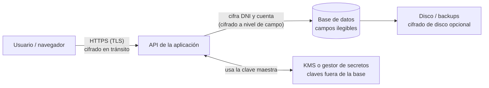
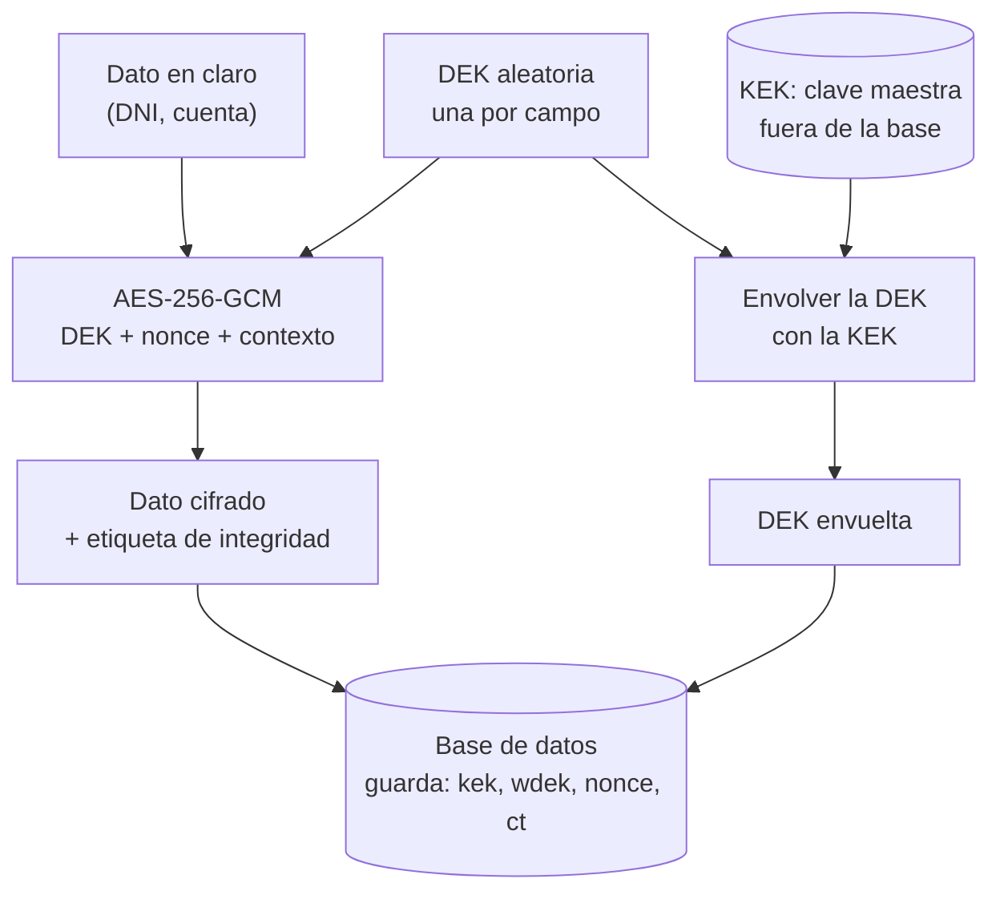
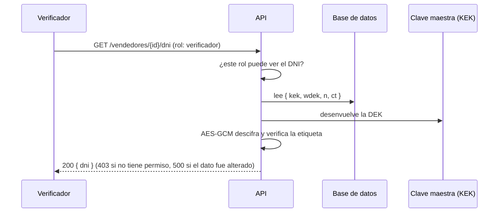

> [0. Acerca del Grupo](../../0.md) › [0.2. Temas Individuales (Informe + Video) / Video aporte al proyecto](../0.2.md) › [0.2.2. Integrante 2 (GONZALES)](0.2.2.md)

# 0.2.2. Integrante 2 (GONZALES)

# Desarrollo Conceptual: Cifrado de datos

## Definición

El **cifrado de datos** es el proceso de transformar información legible (*texto en claro*) en información ilegible (*texto cifrado*) mediante un algoritmo y una clave, de modo que solo quien posea la clave correcta pueda recuperar el dato original. Los algoritmos modernos de cifrado autenticado, como AES-GCM, además detectan si el dato cifrado fue modificado.

**Problema que resuelve:** la confidencialidad (y, con cifrado autenticado, la integridad) de la información cuando esta sale del control directo de la aplicación: un volcado robado de la base de datos, una copia de seguridad expuesta, una inyección SQL o un usuario interno que consulta datos que no le corresponden.

---

## Motivación

Un marketplace como Qhatu guarda el DNI y la cuenta bancaria de cada vendedor en una tabla `vendedores`. Basta una falla (una inyección SQL, un backup en un bucket mal configurado, una credencial filtrada, un empleado con acceso de más) para que alguien obtenga la tabla completa. Si los datos están en claro, el incidente expone a todos los vendedores a la vez: suplantación de identidad, fraude y sanciones por incumplir la Ley N.º 29733 de Protección de Datos Personales.

**Por qué las soluciones habituales no alcanzan:**

| Solución habitual | Qué protege | Por qué no basta |
|---|---|---|
| Control de acceso, autenticación y firewall | La puerta de entrada | Si la puerta falla (o el atacante es interno), todo queda legible |
| HTTPS / TLS | Los datos en tránsito entre cliente y servidor | Una vez que llegan a la base de datos, quedan en claro |
| Cifrado de disco o *Transparent Data Encryption* (TDE) | El disco o los archivos si los roban físicamente | La base entrega los datos descifrados a cualquiera que pueda consultarla: un atacante con inyección SQL, un administrador de base de datos o una copia lógica del contenido |
| *Hash* (SHA-256, bcrypt, Argon2) | Contraseñas | El *hash* es irreversible; el DNI o la cuenta bancaria sí deben poder recuperarse (por ejemplo, para liquidar un pago) |

La necesidad real es que los datos más sensibles **sigan siendo ilegibles aunque alguien consiga la base de datos**, y que solo se puedan descifrar desde la aplicación, bajo reglas de acceso y con claves guardadas fuera de la base. Eso es el **cifrado a nivel de campo en la aplicación**.

---

## Conceptos y componentes principales

| Concepto | Qué es |
|---|---|
| **Texto en claro / texto cifrado** | El dato legible y su versión ilegible tras cifrarlo |
| **Cifrado simétrico** | Una misma clave cifra y descifra. Es rápido; se usa para los datos (AES) |
| **Cifrado asimétrico** | Un par de claves (pública y privada), usado para intercambiar claves o firmar (RSA, curvas elípticas). No se usa para cifrar campos en la demo |
| **AES-256-GCM** | Algoritmo simétrico con clave de 256 bits en modo *AEAD*: cifra y, a la vez, genera una **etiqueta de autenticación** que permite detectar cualquier alteración |
| **Nonce (vector de inicialización)** | Valor aleatorio de 96 bits que acompaña a cada cifrado. **Nunca debe repetirse con la misma clave** |
| **Contexto (AAD)** | Texto adicional que queda autenticado junto al dato, por ejemplo `vendedor:<id>:dni`. Si el cifrado se copia a otro registro, el descifrado falla |
| **DEK (clave de datos)** | Clave que cifra un dato concreto. Se genera aleatoriamente, una por campo |
| **KEK (clave maestra)** | Clave que protege (envuelve) a las DEK. Vive fuera de la base de datos |
| **Envelope encryption** | Esquema de dos niveles: el dato se cifra con una DEK y la DEK se cifra con la KEK. Se guarda el dato cifrado y la DEK envuelta |
| **KMS / HSM / gestor de secretos** | Servicio o dispositivo especializado en custodiar la KEK, controlar quién la usa y auditar su uso |
| **Rotación de claves** | Reemplazar una clave maestra por otra. Con *envelope encryption* solo hay que volver a envolver las DEK, no re-cifrar los datos |
| **Índice ciego** | HMAC del dato con una clave propia. Permite buscar o detectar duplicados por **igualdad** sin descifrar |
| **Cifrado en tránsito / en reposo / a nivel de campo** | Protege la comunicación (TLS), el almacenamiento completo (disco, TDE) o valores individuales (aplicación) |

### Diagrama 1: dónde se cifra

Las capas se complementan. El cifrado a nivel de campo es la única que mantiene el dato ilegible dentro de la base de datos.



### Diagrama 2: envelope encryption (escritura)



### Diagrama 3: lectura autorizada



---

## Relación con la arquitectura

### Atributos de calidad

| Atributo | Efecto | Detalle |
|---|---|---|
| **Seguridad** | Favorece | Confidencialidad: los datos son ilegibles sin la clave. Integridad: GCM detecta alteraciones. Es la táctica de seguridad *cifrar datos* (categoría *resistir ataques*), y se combina con *autorizar actores* al exigir un rol antes de descifrar |
| **Cumplimiento legal** | Favorece | Aporta una medida técnica de seguridad exigible por la Ley N.º 29733 (restricción RES-01 del proyecto) |
| **Rendimiento** | Compromete (poco) | Cifrar con AES es muy rápido; el costo real aparece si cada lectura exige una llamada de red al KMS. Se mitiga reutilizando claves en memoria durante un tiempo corto |
| **Disponibilidad** | Compromete | El servicio de claves pasa a ser una dependencia crítica: si no responde, no se puede descifrar. Se mitiga con redundancia del KMS y con claves en caché |
| **Mantenibilidad** | Compromete (moderado) | Hay más código y más procesos: gestión y rotación de claves, y migración si se cambia de algoritmo (por eso el sobre guarda un campo de versión `v`) |
| **Funcionalidad de consulta** | Compromete | No se puede buscar con `LIKE`, ordenar ni agrupar sobre un campo cifrado. Solo la igualdad se resuelve con un índice ciego |

### Decisiones de arquitectura en las que influye

| Decisión | Cómo influye el cifrado |
|---|---|
| Asignación de responsabilidades | Quién puede descifrar cada dato (por ejemplo, solo el rol verificador ve el DNI y solo Pagos ve la cuenta) y qué módulo guarda las claves |
| Modelo de datos | Las columnas cifradas se guardan como texto, y si hay que buscar por ese campo se agrega una columna de índice ciego con restricción de unicidad |
| Gestión de claves | Dónde viven las claves (variables de entorno, gestor de secretos o KMS), cuántas claves hay y cada cuánto se rotan |
| Elección de tecnología | Usar una librería criptográfica auditada y no algoritmos propios; elegir la nube y el KMS |
| Modelo de coordinación | Si varios módulos descifran, se decide entre una librería compartida o un servicio de cifrado único |
| Despliegue y operación | Cómo se inyectan los secretos y cómo se hacen las copias de seguridad sin exponer las claves |

### Aplicación en Qhatu

| Dato | ¿Se cifra? | Motivo |
|---|---|---|
| DNI / RUC del vendedor | **Sí**, con índice ciego | Dato personal sensible (Ley 29733). El índice ciego permite detectar un documento ya registrado sin descifrar (escenario ESC-VEN-05) |
| Cuenta bancaria del vendedor | **Sí** | Dato financiero usado en las liquidaciones del módulo Pagos |
| Contraseña de acceso | No se cifra: lleva *hash* (Argon2 o bcrypt) | Nunca debe poder recuperarse |
| Datos de tarjeta del comprador | No se almacenan | Los procesa la pasarela de pago y Qhatu solo guarda un token (reduce el alcance de PCI DSS) |
| Nombre del comercio, reseñas, reputación | No | Información pública; cifrarla solo añadiría costo |

---

## Conclusión

El cifrado de datos a nivel de campo complementa, y no reemplaza, a TLS, al control de acceso y al cifrado de disco: es la capa que sigue protegiendo al dato cuando las demás fallan. Su valor en la arquitectura está en **decidir con cuidado qué se cifra, dónde y con qué claves**: cifrar lo sensible, separar las claves de los datos, rotarlas sin re-cifrar (*envelope encryption*) y aceptar el costo de no poder consultar libremente esos campos.

---

# Consideraciones técnicas: Cifrado de datos

## 1. Herramientas y tecnologías utilizadas

| **Herramienta** | **Rol** | **Versión recomendada** |
|---|---|---|
| **Python** | Lenguaje de la demo | 3.10 o superior (probado con 3.12 y 3.13) |
| **cryptography** | Librería criptográfica (AES-GCM) | 42 o superior |
| **FastAPI** | API de ejemplo del módulo Vendedores | 0.159 o superior |
| **Uvicorn** | Servidor de la API | 0.29 o superior |
| **SQLite** | Base de datos de la demo (incluida con Python) | — |
| **python-dotenv** | Carga de las claves desde el archivo `.env` | 1.0 o superior |
| **pytest** y **httpx2** | Pruebas automáticas y cliente de prueba de la API | pytest 8 o superior, httpx2 2.0 o superior |
| **HTML / CSS / JS** | Demo visual en el navegador (sin librerías externas) | Navegador moderno (Chrome, Edge, Firefox) |

---

## 2. Puesta en marcha

### 2.1 Demo local (paso a paso)

**Paso 1. Obtener el código.** El código está un repositorio público aparte, en la carpeta `modulo2-demo-cifrado-de-datos`.

```cmd
git clone https://github.com/trox-vevo/modulo2-demo-cifrado-de-datos
```

**Paso 2. Crear y activar el entorno virtual.**

```cmd
python -m venv .venv
.venv\Scripts\activate.bat
```

En macOS o Linux: `source .venv/bin/activate`.

**Paso 3. Instalar las dependencias.**

```cmd
pip install -r requirements.txt
```

**Paso 4. Generar las claves de la demo.** Crea el archivo `.env` con dos claves maestras (`v1` y `v2`) y la clave del índice ciego, todas aleatorias de 256 bits. Ese archivo **no se sube al repositorio** (está en `.gitignore`).

```cmd
python -m src.generar_claves
```

**Paso 5. Comprobar que todo funciona con las pruebas automáticas.**

```cmd
python -m pytest
```


**Paso 6. Abrir la demo visual.**

```cmd
python ui_demo.py
```

Se abre `http://127.0.0.1:8000/` en el navegador. Para cerrarla, `Ctrl+C` en la terminal. El detalle completo de uso está en el `README.md` de la carpeta.

### 2.2 En producción: configuración con un KMS en la nube

En la demo la clave maestra vive en un archivo `.env`, lo cual es suficiente para aprender pero no para producción. En un despliegue real, la configuración sería:

1. **Crear la clave maestra en el KMS del proveedor** (AWS KMS, Azure Key Vault o Google Cloud KMS) como clave simétrica AES-256. La clave nunca sale del servicio.
2. **Restringir su uso con una política de permisos:** solo la identidad de la aplicación puede usarla para envolver y desenvolver claves de datos. Quien administra la infraestructura no necesita poder descifrar los datos de negocio.
3. **Envolver y desenvolver las DEK con el KMS:** en AWS se usa `GenerateDataKey` y `Decrypt`; en Azure Key Vault, `wrapKey` y `unwrapKey`; en Google Cloud KMS, `encrypt` y `decrypt` sobre la DEK. El dato en sí se sigue cifrando **localmente** con la DEK (el KMS no recibe los datos de negocio).
4. **Activar la rotación automática de la clave maestra** que ofrecen los proveedores, y la auditoría de cada uso de la clave.
5. **Adaptar el código:** cambian `Keyring.desde_entorno()` y las funciones que envuelven la DEK (`_envolver` y `_desenvolver`, que pasarían a llamar al KMS). El resto del módulo no cambia.

> Alternativa más simple: guardar las claves como secretos en un gestor de secretos (AWS Secrets Manager, Azure Key Vault, etc.) y leerlas al iniciar. Así solo cambia `Keyring.desde_entorno()`, pero las claves sí llegan a la memoria de la aplicación, algo que con un KMS no ocurre para la clave maestra.

---

## 3. Aplicabilidad

**Conviene cuando:**
- Se guardan datos personales sensibles, financieros o credenciales de terceros (DNI, cuentas bancarias, tokens de acceso).
- Existe un requisito legal o de cumplimiento (Ley 29733, PCI DSS).
- El impacto de que se filtre la base de datos es alto y hay varias personas o sistemas con acceso a ella.
- Se necesita que distintos roles vean distintos datos.

**Introduce complejidad innecesaria cuando:**
- El dato es público o de bajo riesgo (nombre de un comercio, reseñas, categorías).
- Se necesita filtrar, ordenar o hacer búsquedas parciales de forma intensiva sobre ese campo.
- Es un prototipo que no maneja datos reales.
- Se quiere "cifrar todo por si acaso": se paga el costo en consultas y en gestión de claves sin proteger nada adicional.
- La amenaza real es un atacante que ya controla la aplicación con sus claves: el cifrado en la aplicación no la detiene.

---

## 4. Trade-offs

| **Beneficio** | **Costo** |
|---|---|
| Un volcado de la base de datos no expone los datos sensibles | No se puede buscar con `LIKE`, ordenar ni agrupar por campos cifrados |
| Una DEK por campo limita el daño si una clave se filtra | Más columnas y más código (sobre cifrado, índice ciego) |
| La rotación de la clave maestra no obliga a re-cifrar los datos | Hay que operar y proteger las claves: rotación, respaldo y auditoría |
| GCM detecta cualquier alteración del dato | Si se pierde la clave maestra, los datos se pierden para siempre |
| El acceso al dato puede restringirse por rol | El servicio de claves se vuelve una dependencia crítica (disponibilidad) |
| Ayuda a cumplir la Ley 29733 | Pequeño costo de rendimiento; mayor si cada lectura llama a un KMS remoto |

---

## 5. Alternativas y cómo elegir

| **Enfoque** | **Qué protege** | **Limitación** | **Cuándo elegirlo** |
|---|---|---|---|
| **Cifrado de disco o volumen** (del proveedor de nube) | Robo del disco o de snapshots | La base entrega los datos en claro a quien la consulta | Siempre como base: es casi gratuito |
| **TDE del motor de base de datos** (según el motor) | Archivos de datos y backups | Igual que el anterior: transparente para quien consulta | Cuando se quiere proteger los archivos sin tocar el código |
| **Cifrado de columnas en el motor** (por ejemplo, `pgcrypto` en PostgreSQL) | Datos de columnas concretas | La clave pasa por la base de datos y puede quedar en sus registros | Casos simples donde no se puede cifrar en la aplicación |
| **Cifrado a nivel de aplicación** (el de esta demo) | Volcados, backups, inyección SQL y administradores de base de datos | No protege si la aplicación está comprometida; limita las consultas | Datos sensibles con roles distintos y requisito de separar las claves de los datos |
| **Tokenización** | Datos como números de tarjeta | Requiere una bóveda aparte; el dato real vive en otro sistema | Datos regulados donde conviene no almacenarlos (como las tarjetas con una pasarela de pago) |
| **Cifrado de extremo a extremo** (en el cliente) | Incluso frente al propio servidor | El servidor no puede procesar el dato | Mensajería o información que ni el sistema debe ver |
| **Hash** (bcrypt, Argon2) | Datos que no deben recuperarse | Es irreversible | Contraseñas |

**Cómo elegir:** se parte de la amenaza (¿disco robado, base de datos expuesta, administrador interno, aplicación comprometida?), de si el dato debe recuperarse y de si se necesita consultarlo por ese campo. Los enfoques **se combinan**: en Qhatu se usarían TLS, cifrado de disco del proveedor, cifrado a nivel de campo con índice ciego para DNI y cuenta bancaria, *hash* para las contraseñas y tokenización de la pasarela para las tarjetas.

---

## 6. Conclusión

La puesta en marcha de la demo requiere solo Python y cinco dependencias: clonar el repositorio, crear el entorno, instalar, generar las claves y ejecutar. Para producción, el esquema se mantiene y la clave maestra pasa a custodiarse en un KMS. La decisión clave no es técnica sino de diseño: cifrar únicamente los datos que lo necesitan y aceptar sus costos de consulta y operación.

---

# Demo (código)

## Escenario

La demo se integra con el módulo **Vendedores, Reputación y Disputas** de Qhatu (Módulo 2). Cuando un emprendedor se registra como vendedor entrega su **DNI** (para verificar su identidad) y su **cuenta bancaria** (para recibir las liquidaciones del módulo Pagos). Ambos datos deben quedar protegidos aunque alguien consiga la base de datos.

La demo conecta con los requisitos del proyecto:

| Requisito | Cómo lo aborda la demo |
|---|---|
| **RES-01** (Ley 29733) | El DNI y la cuenta bancaria se guardan cifrados y solo se descifran con el rol autorizado |
| **ESC-VEN-05** (alguien se registra con el documento de un tercero) | El índice ciego detecta un DNI ya registrado, sin descifrar, y deriva la solicitud a revisión manual (respuesta `409`) |

### Flujo de uso

1. Un emprendedor se registra con su razón social, DNI y cuenta bancaria. La API responde con los datos **enmascarados** (`****5678`).
2. Antes de guardar, el servidor cifra cada campo con AES-256-GCM, con su propia clave de datos, protegida a su vez por la clave maestra.
3. Si alguien roba la base de datos, solo ve texto ilegible. El nombre del comercio sí se ve porque es público.
4. Solo el rol `verificador` puede pedir el DNI y solo el rol `pagos` puede pedir la cuenta bancaria. Cualquier otro rol recibe `403`.
5. Si otra persona intenta registrarse con el mismo DNI, el sistema lo detecta comparando índices ciegos, sin descifrar nada.
6. Si alguien altera un dato en la base, la API se niega a devolverlo (`500`).
7. Si la clave maestra se compromete, se rota de `v1` a `v2` sin re-cifrar los datos, y la clave anterior deja de servir.

## Estructura del código

El código se encuentra en un repositorio personal público externo titulado `modulo2-demo-cifrado-de-datos`.

**Repositorio del código:** https://github.com/trox-vevo/modulo2-demo-cifrado-de-datos

```
modulo2-demo-cifrado-de-datos/
├── ui_demo.py             <- lanzador de la demo visual
├── demo.py                <- recorrido de 6 pasos en consola
├── requirements.txt
├── static/index.html      <- página de la demo visual
├── src/
│   ├── cifrado.py         <- módulo de cifrado (lo reutilizable)
│   ├── vendedores.py      <- registro de vendedores
│   ├── main.py            <- API (FastAPI)
│   ├── db.py              <- acceso a SQLite
│   ├── rotar_claves.py    <- rotación de la clave maestra
│   ├── generar_claves.py  <- crea el .env
│   └── ui.py              <- endpoints de apoyo de la demo visual
└── tests/                 <- 22 pruebas automáticas
```

## Código clave

**Esquema de la tabla.** Las columnas sensibles guardan texto cifrado, y `dni_bidx` es el índice ciego con restricción de unicidad:

```sql
CREATE TABLE IF NOT EXISTS vendedores (
    id             TEXT PRIMARY KEY,
    nombre         TEXT NOT NULL,
    dni_cifrado    TEXT NOT NULL,
    dni_bidx       TEXT NOT NULL UNIQUE,   -- indice ciego: detecta DNI duplicado sin descifrar
    cuenta_cifrada TEXT NOT NULL,
    estado         TEXT NOT NULL DEFAULT 'pendiente_verificacion',
    creado_en      TEXT NOT NULL
);
```

**Cifrar un campo** (`src/cifrado.py`, extracto simplificado):

```python
def cifrar_campo(keyring, texto, contexto):
    dek = AESGCM.generate_key(bit_length=256)    # clave de datos nueva para este campo
    nonce = os.urandom(12)                        # 96 bits, nunca se reutiliza
    ct = AESGCM(dek).encrypt(nonce, texto.encode("utf-8"), contexto.encode("utf-8"))
    sobre = {
        "v": 1,
        "kek": keyring.activa,                                                  # qué clave maestra se usó
        "wdek": _envolver(keyring.keks[keyring.activa], dek, keyring.activa),   # DEK envuelta
        "n": _b64e(nonce),
        "ct": _b64e(ct),                                                        # dato cifrado + etiqueta
    }
    return json.dumps(sobre, separators=(",", ":"))
```

**Descifrar un campo.** Si la clave es incorrecta, el contexto es distinto o el dato fue alterado, la etiqueta de GCM no valida y se lanza un error:

```python
def descifrar_campo(keyring, sobre_json, contexto):
    try:
        sobre = json.loads(sobre_json)
        kek_id = sobre["kek"]
        dek = _desenvolver(keyring.keks[kek_id], sobre["wdek"], kek_id)
        texto = AESGCM(dek).decrypt(_b64d(sobre["n"]), _b64d(sobre["ct"]), contexto.encode("utf-8"))
        return texto.decode("utf-8")
    except (KeyError, ValueError, InvalidTag) as e:
        raise CifradoError("No se pudo descifrar: clave incorrecta o dato alterado") from e
```

**Índice ciego** (detecta el mismo DNI sin descifrar, con una clave distinta a las de cifrado):

```python
def indice_ciego(keyring, valor):
    normalizado = valor.strip().upper()
    return hmac.new(keyring.blind_key, normalizado.encode("utf-8"), hashlib.sha256).hexdigest()
```

**Rotación de la clave maestra** (extracto simplificado, sin el manejo de errores). Solo cambia la DEK envuelta, el dato cifrado (`ct`) queda intacto:

```python
def reenvolver_dek(keyring, sobre_json, nueva_kek_id):
    sobre = json.loads(sobre_json)
    viejo_id = sobre["kek"]
    dek = _desenvolver(keyring.keks[viejo_id], sobre["wdek"], viejo_id)
    sobre["kek"] = nueva_kek_id
    sobre["wdek"] = _envolver(keyring.keks[nueva_kek_id], dek, nueva_kek_id)
    return json.dumps(sobre, separators=(",", ":"))
```

**Lectura con control de rol** (`src/main.py`). El rol se verifica **antes** de descifrar:

```python
ROLES_DNI = {"verificador", "admin"}
ROLES_CUENTA = {"pagos", "admin"}

@app.get("/vendedores/{vid}/dni")
def ver_dni(vid: str, x_rol: str | None = Header(default=None)):
    _exigir_rol(x_rol, ROLES_DNI)
    f = _fila(vid)
    return {"dni": descifrar_campo(obtener_keyring(), f["dni_cifrado"], f"vendedor:{vid}:dni")}
```

## Cómo ejecutarla

Las instrucciones paso a paso están en la sección [2.1 Demo local](#21-demo-local-paso-a-paso) y en el `README.md` de la carpeta `qhatu-cifrado-demo`. En resumen:

```cmd
cd qhatu-cifrado-demo
python -m venv .venv
.venv\Scripts\activate.bat
pip install -r requirements.txt
python -m src.generar_claves
python ui_demo.py
```

## Evidencia de funcionamiento

La demo visual recorre seis pasos. Cada paso se ejecuta con su botón y usa llamadas reales a la API.

### Paso 1. Registro y cifrado

Se registra un vendedor de ejemplo (*Textiles Andinos SAC*, DNI `12345678`). La API responde `201` con los datos enmascarados y el servidor muestra las 6 etapas del cifrado: dato en claro, clave de datos, nonce, AES-256-GCM, clave envuelta y guardado.


### Paso 2. Lo que ve quien roba la base de datos

La tarjeta "Lo que ve quien robe la base" muestra las filas tal como están guardadas. Al buscar `12345678` en toda la base, el resultado es **0 coincidencias**.


### Paso 3. Acceso por rol

Se prueban los tres casos: el `verificador` ve el DNI, `soporte` es rechazado y `pagos` ve la cuenta bancaria.


### Paso 4. DNI duplicado (ESC-VEN-05)

Se intenta registrar a otra persona con el mismo DNI. La API responde `409` y se comparan los índices ciegos.


### Paso 5. Alteración de un dato en la base

Se cambia un solo bit del DNI cifrado. Al leerlo, la API se niega a devolverlo. Luego se restaura.


### Paso 6. Rotación de la clave maestra

Se rota la clave maestra de `v1` a `v2` y se compara el DNI cifrado antes y después.


### Recorrido equivalente en consola (opcional)

```cmd
python demo.py --auto
```

## Pruebas automáticas

`python -m pytest` ejecuta 22 pruebas que verifican el comportamiento de la demo (ver Captura 2):

| Grupo | Pruebas | Qué verifican |
|---|---|---|
| Módulo de cifrado (`test_cifrado.py`) | 10 | Ida y vuelta, cifrados distintos para el mismo texto, fallo con contexto o clave incorrectos, detección de alteración, rotación sin tocar el dato, estabilidad del índice ciego y rechazo de claves de tamaño incorrecto |
| API (`test_api.py`) | 7 | Datos enmascarados, que la base no guarde texto plano, detección de DNI duplicado, permisos por rol, error ante datos alterados y validación de entrada |
| Demo visual (`test_ui.py`) | 5 | Traza real del cifrado, `409` con índice ciego, alterar y restaurar, rotación y clave inexistente |

## Beneficio

El módulo `src/cifrado.py` no depende de FastAPI ni de la base de datos, así que se puede copiar tal cual al módulo de Vendedores y al de Pagos del proyecto final. Con él, Qhatu protege el DNI y la cuenta bancaria de sus vendedores frente al robo de la base de datos, detecta documentos duplicados sin exponerlos y permite cambiar las claves sin migrar los datos.

**Video:**
(WIP)

---

[⬅️ Anterior](../0.2.1/0.2.1.md) | [🏠 Home](../../../README.md) | [Siguiente ➡️](../0.2.3/0.2.3.md)
