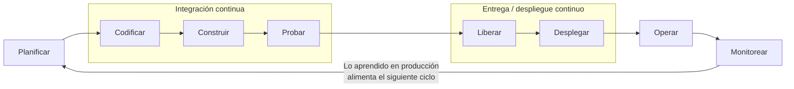
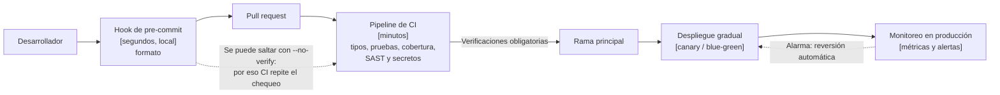
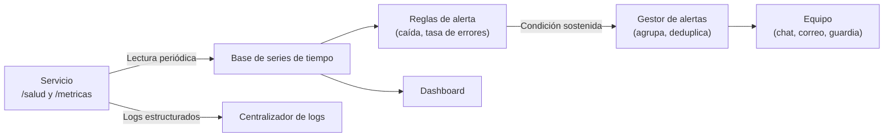
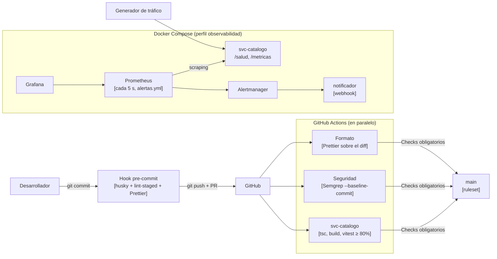

> [0. Acerca del Grupo](../../0.md) › [0.2. Temas Individuales (Informe + Video) / Video aporte al proyecto](../0.2.md) › [0.2.3. Integrante 3 (LUNA)](0.2.3.md)

# 0.2.3. Integrante 3 (LUNA)

**Tema individual:** DevOps · **Módulo:** 3. Catálogo y Búsqueda

# Desarrollo Conceptual: DevOps

## Definición

**DevOps** es un conjunto de prácticas culturales, procesos y herramientas que integra a quienes desarrollan el software (*Dev*) con quienes lo operan en producción (*Ops*), para entregar cambios **con frecuencia, de forma confiable y repetible**. No es una herramienta ni un rol: es una forma de trabajar en la que el equipo es responsable del software desde que se escribe hasta que funciona en producción, y en la que todo paso repetitivo (compilar, probar, revisar, desplegar, vigilar) se automatiza.

**Problema que resuelve:** en el modelo tradicional, desarrollo entrega un paquete a operaciones cada pocas semanas o meses. Cada entrega acumula muchos cambios, se prueba a mano, se despliega con pasos manuales y, cuando algo falla, nadie sabe qué cambio lo causó. DevOps reduce el tamaño de cada entrega y la distancia entre "escribí el código" y "sé si funciona en producción".

## Motivación

| Sin DevOps | Con DevOps |
|---|---|
| Integración al final: los conflictos y errores aparecen todos juntos | Integración continua: cada cambio se valida al momento de proponerlo |
| Pruebas manuales que se saltan cuando hay apuro | Pruebas automáticas que se ejecutan siempre y bloquean el cambio si fallan |
| Despliegue manual con pasos que solo conoce una persona | Despliegue automatizado y repetible, definido como código |
| Servidores configurados a mano, distintos entre entornos | Infraestructura como código: staging y producción se crean igual |
| Las fallas se descubren cuando un usuario reclama | Observabilidad: métricas, logs y alertas avisan al equipo antes |
| La seguridad se revisa al final, si se revisa | Seguridad integrada en el pipeline (DevSecOps), sobre cada cambio |

La industria mide el efecto con las cuatro métricas DORA: **frecuencia de despliegue**, **tiempo de entrega de un cambio**, **tasa de fallas por cambio** y **tiempo de recuperación**. Los equipos que adoptan estas prácticas despliegan más seguido y, a la vez, fallan menos y se recuperan antes, porque cada cambio es pequeño y fácil de revertir.

## Conceptos y componentes principales

| Concepto | Descripción |
|---|---|
| **Ciclo DevOps** | Planificar → codificar → construir → probar → liberar → desplegar → operar → monitorear, y vuelta a planificar con lo aprendido en producción |
| **Integración continua (CI)** | Cada cambio se integra a la rama principal con frecuencia, y un proceso automático verifica que el código compile y pase las pruebas |
| **Entrega continua** | El software queda siempre listo para desplegar; el paso a producción requiere una aprobación |
| **Despliegue continuo** | Si todas las verificaciones pasan, el cambio llega a producción sin intervención manual |
| **Pipeline** | Secuencia automatizada de etapas (verificar, probar, construir, publicar, desplegar) que recorre cada cambio. Se define en un archivo versionado junto al código |
| **Artefacto** | Resultado inmutable del build (una imagen de contenedor, un paquete) que se promueve sin cambios entre entornos |
| **Protección de la rama principal** | Regla del repositorio que exige un pull request y que las verificaciones obligatorias pasen antes de fusionar |
| **Shift-left** | Mover las verificaciones lo más temprano posible: en la máquina del desarrollador (hooks de pre-commit) y en el pull request, no después del despliegue |
| **DevSecOps** | Integrar la seguridad en el pipeline: análisis estático (SAST), detección de secretos, revisión de dependencias e imágenes |
| **Infraestructura como código (IaC)** | Redes, bases y servicios se describen en archivos versionados y se crean con una herramienta, no a mano en una consola |
| **Estrategias de despliegue** | *Rolling* (reemplazo gradual), *blue/green* (dos versiones en paralelo y cambio de tráfico) y *canary* (un porcentaje pequeño del tráfico a la versión nueva antes del resto) |
| **Observabilidad** | Capacidad de entender el estado interno del sistema desde afuera, con tres señales: **métricas** (números en el tiempo), **logs** (eventos) y **trazas** (el recorrido de una solicitud entre servicios) |
| **Health check vs monitoreo** | El health check responde "¿el proceso está vivo?". El monitoreo responde "¿está funcionando bien, desde cuándo no, y quién se enteró?": guarda métricas, evalúa reglas y **notifica** |

Las prácticas DevOps también se han especializado: **MLOps** (ciclo de vida de modelos de machine learning), **LLMOps / GenAIOps** (aplicaciones con modelos de lenguaje: prompts, RAG y evaluación), **GitOps** (Git como única fuente de verdad del estado desplegado) y **Platform Engineering** (equipos que ofrecen el pipeline y la infraestructura como un producto interno).

### Diagrama 1: el ciclo DevOps



### Diagrama 2: capas de retroalimentación

Cuanto antes se detecta un defecto, más barato es corregirlo. Cada capa es más lenta que la anterior, pero más difícil de saltar.



### Diagrama 3: del health check a la alerta



## Relación con la arquitectura

### Atributos de calidad

| Atributo | Efecto | Detalle |
|---|---|---|
| **Mantenibilidad** | Favorece | Cada cambio se valida automáticamente; un error se detecta en minutos y se sabe exactamente qué commit lo introdujo. El despliegue es repetible, sin pasos manuales, y la infraestructura se recrea desde código (*parametrización*) |
| **Capacidad para ser probado** | Favorece | Las pruebas corren en cada pull request con un umbral de cobertura, y el servicio expone su estado (`/salud`, `/metricas`) para observarlo. Tácticas: *controlar y observar el estado* |
| **Disponibilidad** | Favorece | Despliegues graduales con reversión automática y monitoreo que detecta fallas antes que el usuario. Tácticas: *monitor*, *ping/echo*, *actualizaciones de software* y *rollback* |
| **Seguridad** | Favorece | SAST, detección de secretos y permisos mínimos en el pipeline; credenciales temporales (OIDC) en vez de llaves fijas. Tácticas: *detectar ataques* y *limitar el acceso* |

Fuera de los atributos de calidad, DevOps tiene un costo: más herramientas que mantener (runners, reglas, dashboards, alertas) y minutos de espera en cada cambio. Es una restricción del proyecto que se compensa en los trade-offs (sección 5 de las consideraciones técnicas).

### Escenarios de calidad del tema

| Cod Escenario | Atributo de Calidad | Estímulo | Fuente del Estímulo | Artefacto | Entorno | Respuesta | Medida de Respuesta |
|---|---|---|---|---|---|---|---|
| ESC-DEVOPS-01 | Mantenibilidad | Se propone un cambio defectuoso (rompe una regla de negocio, introduce código inseguro o una credencial) | Desarrollador del equipo | Código de `svc-catalogo` | Desarrollo, durante la integración de cambios | El defecto se detecta antes de llegar a la rama principal y a producción, y el desarrollador recibe el motivo exacto | Detección en 5 min o menos desde que se abre el pull request (la duración del pipeline); 0 defectos de este tipo en producción; chequeos locales en 5 s o menos |
| ESC-DEVOPS-02 | Disponibilidad | El servicio deja de responder o más del 5% de sus respuestas son errores 5xx | Falla interna (proceso caído o dependencia que falla) | `svc-catalogo` | Operación normal | El sistema detecta la falla y notifica al equipo automáticamente, sin que nadie revise los logs a mano | Notificación en 1 min o menos desde el inicio de la falla |

**Tácticas:** para ESC-DEVOPS-01, *capacidad para ser probado* (pipeline con verificaciones obligatorias para fusionar). Para ESC-DEVOPS-02, *monitor* y *ping/echo* (lectura periódica de métricas), con *notificación* al equipo. En el diseño de Qhatu se refinan en [ESC-CAT-12](../../../5/5.3/5.3.md) y [ESC-CAT-02](../../../5/5.3/5.3.md).

### Decisiones de arquitectura en las que influye

| Decisión | Cómo influye DevOps |
|---|---|
| Elección de tecnología | Plataforma de CI/CD, herramienta de IaC, herramientas de SAST y de observabilidad |
| Mapeo entre elementos | Unidad de despliegue (contenedor), estrategia de despliegue (blue/green, canary) y entornos (staging, producción) |
| Asignación de responsabilidades | Cada servicio expone `/salud` y `/metricas` y escribe logs estructurados; el pipeline es responsable de validar y desplegar |
| Modelo de datos | Las migraciones de esquema deben ser compatibles hacia atrás para permitir despliegues graduales |

### Aplicación en Qhatu

| Decisión del proyecto | Qué concepto aplica |
|---|---|
| [ADR-CAT-07](../../../4/4.3/4.3.md): GitHub Actions como plataforma de CI/CD | Integración continua, pipeline como código |
| [ADR-CAT-08](../../../4/4.3/4.3.md): Terraform para la infraestructura | Infraestructura como código |
| [ADR-CAT-09](../../../4/4.3/4.3.md): blue/green con AWS CodeDeploy y canary de 10% | Estrategias de despliegue |
| [ADR-TAC-CAT-02](../../../5/5.3/5.3.md): alarmas de CloudWatch que revierten el despliegue | Monitoreo y reversión automática |
| [ADR-TAC-CAT-12](../../../5/5.3/5.3.md): pruebas de integración y umbral de cobertura en el pipeline | Capacidad para ser probado |
| [Vista 6.4](../../../6/6.4/6.4.md): recorrido de un cambio desde el pull request hasta producción | Pipeline completo de CI/CD |

## Conclusión

DevOps no se instala: se practica. Su valor está en **acortar el tiempo entre un error y su detección**, en el commit (segundos), en el pull request (minutos) o en producción (antes de que el usuario lo note). Para que funcione, cada verificación tiene que ser automática, rápida y confiable: un pipeline lento o lleno de falsos positivos termina siendo ignorado. En Qhatu se traduce en un pipeline con verificaciones obligatorias, seguridad sobre lo que cada cambio introduce y observabilidad con alertas, en lugar de un health check que nadie mira.

---

# Consideraciones técnicas: DevOps

## 1. Herramientas y tecnologías utilizadas

| **Herramienta** | **Rol** | **Versión** | **Equivalente en producción (AWS)** |
|---|---|---|---|
| **GitHub Actions** | Ejecuta el pipeline en cada pull request | Runners `ubuntu-latest` | El mismo ([ADR-CAT-07](../../../4/4.3/4.3.md)) |
| **Rulesets de GitHub** | Protegen `main`: exigen PR y verificaciones obligatorias | — | El mismo |
| **Vitest + @vitest/coverage-v8** | Pruebas unitarias y de integración con umbral de cobertura | 3.x | El mismo |
| **Supertest** | Pruebas HTTP contra la app de Express sin levantar un puerto | 7.x | El mismo |
| **Prettier** | Formato de código, en el hook local y en CI | 3.9.10 (versión fija) | El mismo |
| **husky + lint-staged** | Hook de pre-commit que formatea solo los archivos en stage | 9.x / 15.x | — (local) |
| **Semgrep** | Análisis estático de seguridad (SAST) y detección de secretos, solo sobre el diff | Imagen `semgrep/semgrep` | El mismo |
| **prom-client** | Expone métricas en formato Prometheus desde Node.js | 15.x | Métricas en Amazon CloudWatch |
| **Prometheus** | Lee las métricas cada 5 s y evalúa las reglas de alerta | 2.55 | Amazon CloudWatch Metrics y Alarms |
| **Alertmanager** | Agrupa las alertas y las envía al equipo | 0.27 | Amazon SNS |
| **Grafana** | Dashboard de métricas | 11.3 | CloudWatch Dashboards |
| **Docker Compose** | Levanta el servicio y el stack de observabilidad en local | v2 | Amazon ECS sobre Fargate |
| **Render y Vercel** | Despliegue continuo real del caso Luistudio | — | AWS CodeDeploy + ECS ([ADR-CAT-09](../../../4/4.3/4.3.md)) |

---

## 2. Puesta en marcha

### 2.1 Pipeline de CI (`.github/workflows/ci.yml`)

El workflow se ejecuta en cada pull request y tiene **tres jobs en paralelo**, para que la detección tarde lo que dura el job más lento y no la suma de todos:

| Job | Qué hace | Por qué así |
|---|---|---|
| `Formato (archivos del PR)` | `prettier --check` solo sobre los archivos que cambió el PR (`git diff origin/main...HEAD`) | No bloquear a nadie por el formato de código que no tocó |
| `Seguridad (Semgrep sobre el diff)` | `semgrep scan` con reglas propias y `p/secrets`, con `--baseline-commit` del PR | Reportar solo los hallazgos que **introduce** el PR, no los que ya existían |
| `@qhatu/<servicio>` (matriz) | Por cada servicio: `tsc --noEmit` → `build` → pruebas con cobertura | Un fallo en un servicio no oculta el resultado de los demás (`fail-fast: false`) |

Otras configuraciones del workflow:

- `concurrency` con `cancel-in-progress`: si llega un commit nuevo al mismo PR, se cancela la ejecución anterior.
- `permissions: contents: read`: el pipeline solo puede leer el repositorio (mínimo privilegio).
- `fetch-depth: 0` en los jobs de formato y seguridad, porque necesitan el historial para calcular el diff.

### 2.2 Protección de la rama principal

En GitHub: **Settings → Rules → Rulesets → New branch ruleset**.

1. Target: *Include default branch*.
2. Activa *Require a pull request before merging*.
3. Activa *Require status checks to pass* y agrega `Formato (archivos del PR)`, `Seguridad (Semgrep sobre el diff)` y `@qhatu/svc-catalogo`.
4. Activa *Block force pushes*.

Requiere permisos de administrador del repositorio. Los checks solo aparecen en el buscador después de haberse ejecutado al menos una vez.

### 2.3 Hook de pre-commit

```bash
npm install          # el script "prepare" ejecuta husky y activa .husky/pre-commit
```

`.husky/pre-commit` ejecuta `npx lint-staged`, y `package.json` define qué hacer con los archivos en stage:

```json
"lint-staged": {
  "*.{ts,tsx,js,json,yml,yaml}": "prettier --write"
}
```

El hook **corrige** el formato en lugar de rechazar el commit, y solo procesa los archivos en stage, por lo que tarda alrededor de 1 s. Un hook lento (pruebas completas, builds) termina siendo evitado con `git commit --no-verify`; por eso las verificaciones pesadas viven en el CI, que no se puede saltar.

### 2.4 Análisis de seguridad con Semgrep

Las reglas propias están en `.semgrep/reglas.yml`, todas con severidad `ERROR`:

| Regla | Detecta |
|---|---|
| `credencial-en-codigo` | Una constante o propiedad cuyo nombre contiene `clave`, `secret`, `password`, `token` o `api_key` con un texto literal de 8 o más caracteres |
| `sql-concatenado` | `db.query(...)` con un template literal interpolado o una concatenación (riesgo de inyección SQL) |
| `uso-de-eval` | Cualquier uso de `eval` |

Comando del pipeline:

```bash
semgrep scan --config .semgrep/ --config p/secrets --error --metrics=off --baseline-commit <sha-base-del-PR>
```

Para probarlo localmente con Docker:

```bash
docker run --rm -v "$PWD:/src" -w /src semgrep/semgrep semgrep scan --config .semgrep/ --config p/secrets --error
```

`.semgrepignore` excluye `node_modules`, `dist`, `coverage` y `test/`.

### 2.5 Observabilidad local

```bash
docker compose --profile observabilidad up -d --build
npm run trafico -w @qhatu/svc-catalogo          # genera carga constante
```

| Componente | URL |
|---|---|
| Métricas del servicio | http://localhost:3000/metricas |
| Prometheus (alertas) | http://localhost:9090/alerts |
| Alertmanager | http://localhost:9093 |
| Grafana (admin / admin) | http://localhost:3001 → Qhatu → svc-catalogo |
| Notificaciones | `docker compose logs -f notificador` |

Las reglas están en `infra/observabilidad/prometheus/alertas.yml`: `ServicioCaido` (`up == 0` durante 15 s) y `TasaErroresAlta` (más de 5% de respuestas 5xx en 30 s, sostenido durante 30 s). El perfil `observabilidad` hace que un `docker compose up` normal del equipo no levante estos contenedores.

### 2.6 Despliegue continuo real: caso Luistudio (Render + Vercel)

Como Qhatu aún no se despliega en AWS, el despliegue continuo se muestra con un proyecto anterior (monorepo con frontend React en Vercel y backend Spring Boot en Render):

1. **GitHub Actions**: un workflow con dos jobs, frontend (lint, pruebas y build) y backend (`mvn clean verify`), en cada pull request y push a `main`.
2. **Ruleset de `main`**: exige pull request y que pasen los status checks, y bloquea el force push.
3. **Render** → Settings → *Auto-Deploy*: **After CI Checks Pass**. Render solo despliega un commit de `main` si el CI de GitHub pasó. *Health Check Path* apunta a un endpoint de salud: si la versión nueva no responde, Render no le pasa el tráfico.
4. **Vercel**: despliega `main` a producción y cada pull request a una URL de vista previa.

### 2.7 En producción: diseño en AWS

El diseño completo está en la [vista 6.4](../../../6/6.4/6.4.md). Al fusionar en `main`, el pipeline asume un rol de IAM por OIDC (sin llaves estáticas), publica la imagen en Amazon ECR etiquetada con el hash del commit y lanza un despliegue blue/green con AWS CodeDeploy (`ECSCanary10Percent5Minutes`). Las alarmas de CloudWatch sobre la tasa de 5xx y la latencia p95 revierten el despliegue automáticamente. La infraestructura sigue el mismo flujo con Terraform (`plan` en el PR, `apply` al fusionar).

---

## 3. Problemas frecuentes y soluciones

| Problema | Causa | Solución |
|---|---|---|
| El pipeline tarda demasiado y el equipo deja de esperarlo | Jobs en serie, instalación de dependencias sin caché | Paralelizar jobs, usar `concurrency` para cancelar ejecuciones viejas, cachear dependencias |
| El hook de pre-commit se salta con `--no-verify` | El hook es lento o molesto | Que el hook solo formatee archivos en stage (segundos) y repetir el chequeo en el CI |
| La herramienta de seguridad bloquea por código que el PR no tocó | Escaneo de todo el repositorio | Escanear solo el diff (`--baseline-commit`) |
| Muchos falsos positivos de seguridad | Reglas genéricas sin calibrar | Elegir rulesets acotados, bloquear solo severidad alta y excluir carpetas como `test/` |
| Un secreto se subió y luego se borró | El historial de Git lo conserva | Considerarlo comprometido y **rotarlo**; borrarlo del código no basta |
| El merge no queda bloqueado aunque el check falle | Falta la regla de protección o el check no está marcado como obligatorio | Configurar el ruleset con los checks requeridos (requiere admin) |
| El check no aparece al configurar el ruleset | Nunca se ejecutó | Abrir un PR o ejecutar el workflow manualmente (`workflow_dispatch`) una vez |
| La alerta no salta aunque haya errores | La regla usa una tasa y no hay tráfico | Mantener tráfico (en producción, canarios sintéticos) o alertar también por `up == 0` |
| Alertas que se disparan por un solo error | Umbral sin ventana ni mínimo de solicitudes | Usar `for:` (condición sostenida) y un mínimo de solicitudes, como en ADR-TAC-CAT-02 |
| El despliegue en Render arranca aunque el CI falle | *Auto-Deploy* en "On Commit" | Cambiarlo a "After CI Checks Pass" |
| El servicio gratuito de Render tarda en responder | Se suspende por inactividad | Abrirlo antes de la demostración o usar un plan pago en producción |

## 4. Aplicabilidad

**Conviene** en todo proyecto con más de un desarrollador y despliegues frecuentes, y es casi obligatorio con microservicios: con 7 servicios, desplegar a mano no escala. **Es menos crítico** en prototipos de una sola persona o en scripts que no llegan a producción, donde basta un CI mínimo. El nivel de automatización debe crecer con el riesgo: en Qhatu, Pagos y Catálogo (dinero y precio) justifican reversión automática, mientras que un panel interno podría desplegarse con aprobación manual.

## 5. Trade-offs

| Se gana | Se paga |
|---|---|
| Detección temprana y trazable de defectos | Minutos de espera en cada PR y mantenimiento del pipeline |
| Despliegues frecuentes, pequeños y reversibles | Diseño cuidadoso de migraciones compatibles hacia atrás |
| Seguridad revisada en cada cambio | Calibración continua para evitar falsos positivos |
| Fallas detectadas antes que el usuario | Más infraestructura que operar (métricas, alertas, dashboards) y riesgo de fatiga por alertas |

## 6. Alternativas y cómo elegir

| Necesidad | Opciones | Criterio |
|---|---|---|
| Plataforma de CI/CD | GitHub Actions, GitLab CI, Jenkins, AWS CodePipeline | Si el código está en GitHub, Actions no requiere servidores propios. Jenkins da más control, pero hay que administrarlo. CodePipeline se integra con AWS, pero tiene menos ecosistema |
| SAST y secretos | Semgrep, CodeQL, SonarQube, Aikido, gitleaks | Semgrep permite reglas propias simples y escanear solo el diff. CodeQL tiene análisis más profundo. gitleaks revisa todo el historial de commits (útil, pero un secreto borrado sigue bloqueando) |
| Observabilidad | Prometheus + Grafana, Amazon CloudWatch, Datadog, Sentry, ELK / OpenSearch | Prometheus y Grafana son abiertos y sirven en local. CloudWatch es nativo de AWS (el diseño de Qhatu). Datadog unifica todo con costo por host. Sentry se enfoca en errores de la aplicación |
| Despliegue gradual | Rolling, blue/green, canary | Rolling es simple pero lento de revertir. Blue/green revierte en segundos. Canary limita el impacto a un porcentaje del tráfico |

## 7. Conclusión

La configuración se apoya en tres capas: un hook local que corrige en segundos, un pipeline que no se puede saltar y un monitoreo que avisa sin que nadie mire los logs. Cada una está calibrada para no estorbar: el hook solo toca los archivos en stage, el formato y la seguridad solo revisan lo que el PR cambió, y las alertas exigen una condición sostenida.

---

# Demo (código)

Código en el repositorio del grupo: [ulima-arqsoft/arqui262-grupo5-codigo](https://github.com/ulima-arqsoft/arqui262-grupo5-codigo).

## Escenario

`svc-catalogo` expone la API de precio y stock que Pedidos consulta en el checkout ([contrato](https://github.com/ulima-arqsoft/arqui262-grupo5-codigo/blob/main/contratos/apis/precios-stock.v1.yaml)). Una regla crítica es que **un producto sin stock nunca debe aparecer como disponible**, porque Pedidos lo vendería sin poder entregarlo. La demo muestra cómo DevOps protege esa regla y la disponibilidad del servicio:

1. Un desarrollador hace un commit con mal formato y el hook lo corrige en el acto.
2. Abre un PR que rompe la regla de disponibilidad: las pruebas fallan y el merge queda bloqueado (ESC-DEVOPS-01).
3. Agrega una credencial al código: Semgrep la detecta y solo marca la línea nueva.
4. Corrige ambos problemas y todas las verificaciones pasan.
5. En operación, la base falla en el 30% de las consultas o el servicio se cae: las alertas notifican al equipo en menos de 1 min (ESC-DEVOPS-02).

### Arquitectura de la demo



## Estructura del código

```text
arqui262-grupo5-codigo/
├── .github/workflows/ci.yml           # Pipeline: formato, seguridad y verificación por servicio
├── .husky/pre-commit                  # Ejecuta lint-staged
├── .prettierrc.json / .prettierignore
├── .semgrep/reglas.yml                # Reglas propias de SAST
├── .semgrepignore
├── docker-compose.yml                 # Perfil "observabilidad"
├── infra/observabilidad/
│   ├── prometheus/prometheus.yml      # Scraping cada 5 s
│   ├── prometheus/alertas.yml         # ServicioCaido y TasaErroresAlta
│   ├── alertmanager/alertmanager.yml  # Receptor webhook (en producción: SNS / Slack)
│   └── grafana/                       # Datasource y dashboard aprovisionados
└── servicios/svc-catalogo/
    ├── src/
    │   ├── app.ts                     # Express: /salud, /metricas, rutas y manejo de errores
    │   ├── dominio/precio-stock.ts    # Reglas de estado, precio y validación
    │   ├── api/precios-stock.ts       # POST /v1/precios-stock/consultas
    │   ├── adaptadores/salida/repositorio-productos-memoria.ts  # Con PORCENTAJE_FALLAS
    │   └── observabilidad/metricas.ts # Contador y histograma de prom-client
    ├── test/unit/precio-stock.test.ts
    ├── test/integracion/api.test.ts
    ├── scripts/generar-trafico.ts
    └── vitest.config.ts               # Umbral de cobertura de 80%
```

## Código clave

**La regla protegida** (`src/dominio/precio-stock.ts`):

```ts
// Un producto sin stock nunca debe mostrarse como disponible: Pedidos lo vendería sin poder entregarlo.
export function determinarEstado(producto: Pick<Producto, 'stock' | 'activo'>): EstadoProducto {
  if (!producto.activo) return 'no_disponible';
  return producto.stock > 0 ? 'disponible' : 'agotado';
}
```

**Métricas por ruta y código** (`src/observabilidad/metricas.ts`). Se usa la ruta declarada, no la URL, para no crear una serie por cada id:

```ts
export const medirSolicitudes: RequestHandler = (req, res, next) => {
  const fin = duracion.startTimer();
  res.on('finish', () => {
    const ruta = req.route ? req.baseUrl + req.route.path : 'no_encontrada';
    if (ruta === '/metricas') return;
    solicitudes.inc({ metodo: req.method, ruta, codigo: res.statusCode });
    fin({ metodo: req.method, ruta });
  });
  next();
};
```

**Seguridad solo sobre el diff** (`.github/workflows/ci.yml`):

```yaml
seguridad:
  name: Seguridad (Semgrep sobre el diff)
  runs-on: ubuntu-latest
  container: semgrep/semgrep
  steps:
    - uses: actions/checkout@v4
      with:
        fetch-depth: 0
    - name: Análisis estático (SAST) y secretos
      env:
        BASE: ${{ github.event.pull_request.base.sha }}
      run: |
        git config --global --add safe.directory "$GITHUB_WORKSPACE"
        ARGS=""
        if [ -n "$BASE" ]; then ARGS="--baseline-commit $BASE"; fi
        semgrep scan --config .semgrep/ --config p/secrets --error --metrics=off $ARGS
```

**Regla de alerta** (`infra/observabilidad/prometheus/alertas.yml`):

```yaml
- alert: TasaErroresAlta
  expr: |
    sum(rate(http_solicitudes_total{job="svc-catalogo", codigo=~"5.."}[30s]))
      / sum(rate(http_solicitudes_total{job="svc-catalogo"}[30s])) > 0.05
  for: 30s
  labels:
    severidad: alta
```

## Cómo ejecutarla

```bash
git clone https://github.com/ulima-arqsoft/arqui262-grupo5-codigo.git
cd arqui262-grupo5-codigo
npm install                                   # instala dependencias y activa el hook
npm test -w @qhatu/svc-catalogo               # pruebas con cobertura
docker compose --profile observabilidad up -d --build
npm run trafico -w @qhatu/svc-catalogo        # en otra terminal
docker compose logs -f notificador            # en otra terminal
```

Para simular fallas: `PORCENTAJE_FALLAS=30 docker compose --profile observabilidad up -d svc-catalogo` (en PowerShell: `$env:PORCENTAJE_FALLAS=30; docker compose ...`) o `docker compose stop svc-catalogo`. Más detalle en [`infra/observabilidad/README.md`](https://github.com/ulima-arqsoft/arqui262-grupo5-codigo/blob/main/infra/observabilidad/README.md).

## Evidencia de funcionamiento

### Paso 1. El hook corrige el formato

Un commit con `export const MONEDA_POR_DEFECTO="PEN"   as const` queda guardado como `export const MONEDA_POR_DEFECTO = 'PEN' as const;`. Prettier corre solo sobre el archivo en stage, en alrededor de 1 s.

### Paso 2. Un bug de negocio se detecta en el pipeline (ESC-DEVOPS-01)

Al cambiar `producto.stock > 0` por `producto.stock >= 0`, el job `@qhatu/svc-catalogo` falla y el merge queda bloqueado:

```text
FAIL  test/unit/precio-stock.test.ts > determinarEstado > marca como agotado un producto activo sin stock
AssertionError: expected 'disponible' to be 'agotado' // Object.is equality
FAIL  test/integracion/api.test.ts > API de svc-catalogo > POST /v1/precios-stock/consultas devuelve precio y estado
AssertionError: expected { …(7) } to match object { estado: 'agotado', …(1) }
Tests  2 failed | 13 passed (15)
```

### Paso 3. Una credencial en el código se detecta solo en la línea nueva

Al agregar `const API_KEY_PASARELA = 'pasarela-clave-9f8a7b6c5d4e';`, el job de seguridad falla con la regla `credencial-en-codigo`. El código que ya existía produce 0 hallazgos (`Ran 48 rules on 174 files: 0 findings`), por lo que el PR solo se bloquea por lo que introdujo.

### Paso 4. Falla parcial: tasa de errores alta (ESC-DEVOPS-02)

Con `PORCENTAJE_FALLAS=30` y tráfico constante, Prometheus pasa `TasaErroresAlta` a *firing* y Alertmanager entrega al notificador:

```json
"commonLabels": { "alertname": "TasaErroresAlta", "severidad": "alta" },
"commonAnnotations": {
  "descripcion": "Tasa de errores actual: 26.92%",
  "resumen": "Más del 5% de las solicitudes a svc-catalogo terminan en 5xx"
}
```

Tiempo medido desde el inicio de la falla hasta la notificación: unos **40 s**. Al volver a `PORCENTAJE_FALLAS=0`, llega la notificación `resolved`.

### Paso 5. Caída total del servicio

Con `docker compose stop svc-catalogo`, el dashboard muestra **CAÍDO** y `ServicioCaido` se notifica en **34 s**. Ambas alertas cumplen la medida de 1 min o menos.

## Pruebas automáticas

```text
✓ test/unit/precio-stock.test.ts (10 tests)
✓ test/integracion/api.test.ts (5 tests)
Tests  15 passed (15)

File               | % Stmts | % Branch | % Funcs | % Lines
All files          |     100 |     92.1 |     100 |     100
```

## Beneficio

La demo no es un ejemplo aislado: es el pipeline real del repositorio de código de Qhatu. Las verificaciones de formato, seguridad y pruebas corren ya en cada pull request de los 7 microservicios, y `svc-catalogo` queda como plantilla de cómo exponer `/metricas` y escribir pruebas con umbral de cobertura. El stack de observabilidad local permite a cada integrante probar sus alertas antes de llevarlas a CloudWatch, como indica el diseño de la [vista 6.4](../../../6/6.4/6.4.md).

---

Video del tema individual: https://youtu.be/Rl1CosR1MAU

Video de aporte al proyecto: https://youtu.be/fC8gccHkHDE

---

[⬅️ Anterior](../0.2.2/0.2.2.md) | [🏠 Home](../../../README.md) | [Siguiente ➡️](../0.2.4/0.2.4.md)
