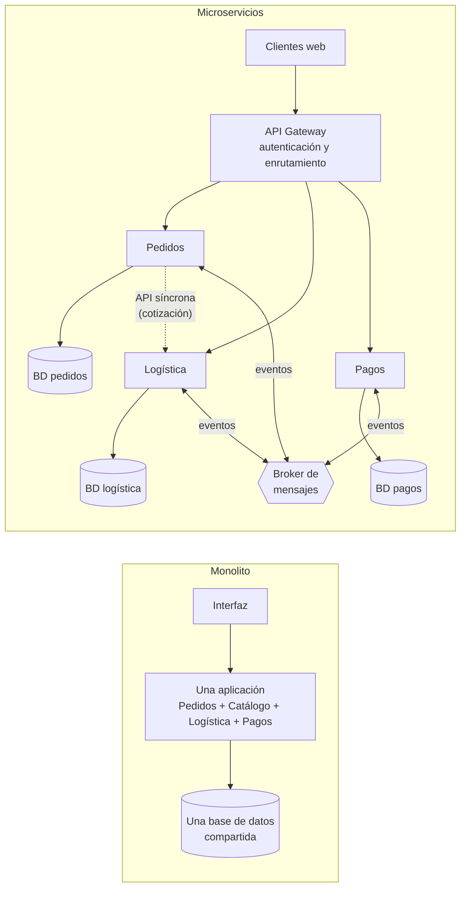
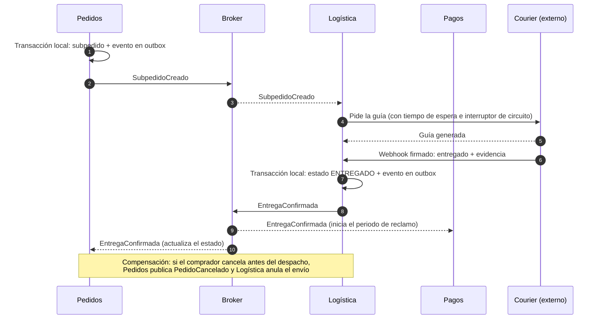
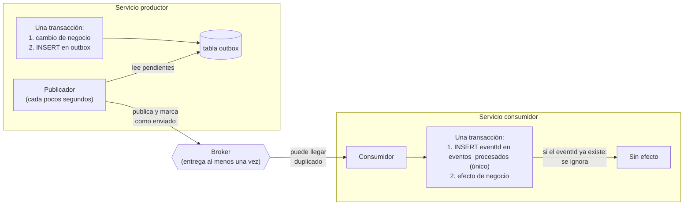
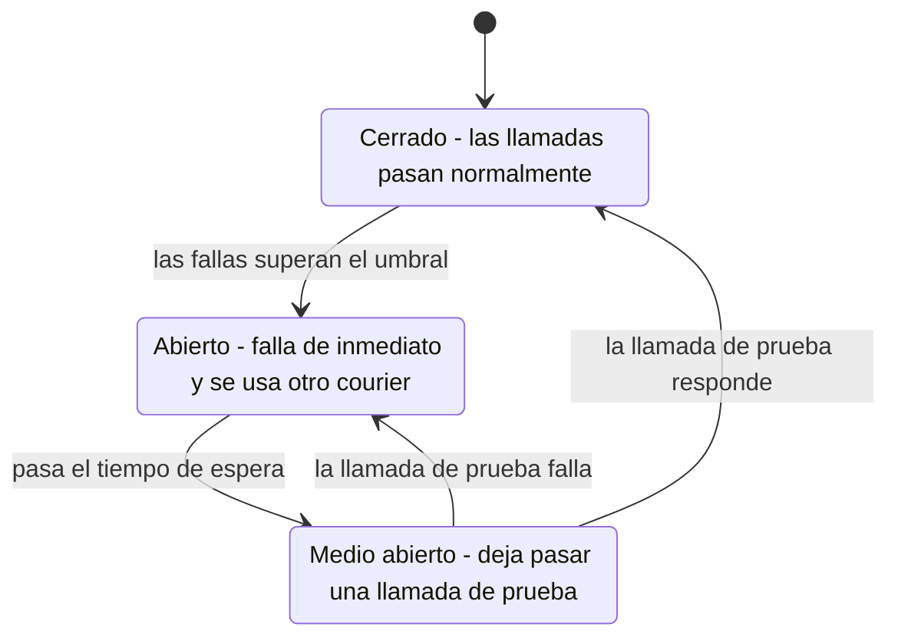
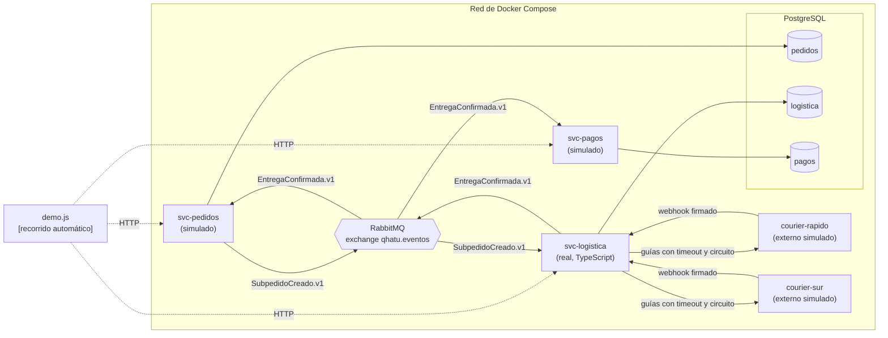

> [0. Acerca del Grupo](../../0.md) › [0.2. Temas Individuales (Informe + Video) / Video aporte al proyecto](../0.2.md) › [0.2.4. Integrante 4 (SANTIN)](0.2.4.md)

# 0.2.4. Integrante 4 (SANTIN)

**Tema individual:** Arquitectura de Microservicios · **Módulo:** 4. Logística

# Desarrollo Conceptual: Arquitectura de Microservicios

## Definición

La **arquitectura de microservicios** es un estilo de arquitectura en el que una aplicación se construye como un conjunto de **servicios pequeños, autónomos y desplegables por separado**. Cada servicio implementa una capacidad de negocio completa (por ejemplo, «entregar un pedido»), es dueño exclusivo de sus datos y se comunica con los demás solo a través de interfaces bien definidas: APIs síncronas o eventos asíncronos.

Sus tres rasgos esenciales son:

1. **Despliegue independiente:** un servicio se puede cambiar, probar y poner en producción sin desplegar los demás.
2. **Datos propios:** cada servicio tiene su propia base de datos y ningún otro servicio la lee ni la escribe directamente.
3. **Límites por capacidad de negocio:** el sistema se divide según lo que hace el negocio (pedidos, pagos, logística), no según capas técnicas (presentación, negocio, datos).

**Problema que resuelve:** en una aplicación grande con un solo desplegable (*monolito*), todo crece, falla y se despliega junto. Una parte con mucha carga obliga a escalar toda la aplicación, una falla en un componente puede tumbar a todos los demás y cada cambio requiere coordinar a todo el equipo. Los microservicios separan esas partes para que **escalen, fallen y evolucionen de forma independiente**.

---

## Motivación

La necesidad aparece cuando una sola aplicación tiene partes con exigencias muy distintas. Qhatu es un caso típico:

- En una campaña como Cyber Wow, la búsqueda pasa de 40 a 400 consultas por segundo y el checkout y los pagos también se multiplican, mientras Vendedores o Logística casi no cambian.
- Varias partes dependen de sistemas externos que fallan por su cuenta: la pasarela de pagos, RENIEC/SUNAT y cada uno de los couriers. Si la API de un courier se cuelga, no debería impedir que un comprador pague.
- Cinco integrantes trabajan en paralelo, cada uno dueño de un módulo, y no pueden coordinar cada despliegue con los otros cuatro.

**Por qué las soluciones habituales no alcanzan:**

| Solución habitual | Qué resuelve | Por qué no basta |
|---|---|---|
| Monolito en capas (presentación, negocio, datos) | Es simple de construir, probar y desplegar al inicio | Todo escala junto: para atender 10 veces más búsquedas se replica también Pagos y Logística. Una fuga de memoria en un módulo tumba a todos. Los cinco integrantes modifican el mismo desplegable |
| Monolito modular (un desplegable dividido en módulos con interfaces) | Ordena el código y define límites claros entre módulos | Sigue siendo un solo proceso: el escalamiento y las fallas siguen siendo conjuntos, y el despliegue de un módulo exige desplegar todos |
| Escalar verticalmente (una máquina más grande) | Da más capacidad sin cambiar el diseño | Se paga la capacidad del pico todo el año y no aísla las fallas: sigue habiendo un punto único de falla |
| Llamadas síncronas entre módulos con reintentos | Integra módulos que ya están separados | Si el módulo llamado está caído, el que llama también falla: la disponibilidad de cada uno queda atada a la de los demás (fallas en cascada) |

La necesidad real es poder **escalar, desplegar y dejar fallar cada capacidad de negocio por separado**, aceptando el costo de un sistema distribuido. Eso es lo que propone la arquitectura de microservicios.

---

## Conceptos y componentes principales

| Concepto | Qué es |
|---|---|
| **Microservicio** | Proceso independiente que implementa una capacidad de negocio, con su propio código, ciclo de despliegue y datos |
| **Contexto delimitado** (*bounded context*) | Frontera dentro de la cual un término tiene un único significado. Ayuda a decidir dónde cortar los servicios: «envío» significa algo distinto en Logística que en Pagos |
| **Base de datos por servicio** | Cada servicio es dueño de sus datos. Los demás los obtienen por su API o por eventos, nunca leyendo sus tablas |
| **API Gateway** | Punto único de entrada para los clientes: autentica y enruta cada solicitud al servicio que corresponde |
| **Comunicación síncrona** | Solicitud y respuesta (REST, gRPC). Se usa cuando el usuario espera el resultado en la misma interacción |
| **Comunicación asíncrona y eventos de dominio** | Un servicio publica un hecho de negocio («entrega confirmada») en un *broker* de mensajes y los interesados lo consumen cuando pueden. Emisor y receptor no necesitan estar disponibles a la vez |
| **Broker de mensajes** | Intermediario que guarda los mensajes en colas durables hasta que el consumidor los procesa |
| **Contrato versionado** | Formato acordado de una API o evento (`EntregaConfirmada.v1`). Mientras se respete, cada servicio cambia por dentro sin afectar a los demás |
| **Saga** | Secuencia de transacciones locales, una por servicio, que juntas forman un proceso de negocio. Si un paso falla, se ejecutan **acciones de compensación** en lugar de un *rollback* global |
| **Coreografía / orquestación** | Dos formas de coordinar una saga: en la coreografía cada servicio reacciona a los eventos de los demás; en la orquestación un coordinador central indica a cada uno qué hacer |
| **Patrón outbox** | El evento se guarda en una tabla `outbox` en la **misma transacción** que el cambio de negocio, y un publicador lo envía luego al broker. Así un cambio guardado nunca queda sin su evento |
| **Consumidor idempotente** | Un broker entrega cada mensaje **al menos una vez**, por lo que puede llegar duplicado. El consumidor registra los identificadores ya procesados y aplica cada evento una sola vez |
| **Interruptor de circuito** (*circuit breaker*) | Protege a un servicio de una dependencia que falla: tras varias fallas deja de llamarla durante un tiempo y responde de inmediato con una alternativa, en lugar de acumular solicitudes en espera |
| **Consistencia eventual** | Como no hay transacciones entre servicios, los datos de distintos servicios quedan coherentes unos segundos después, no en el mismo instante |
| **Observabilidad** | Registros, métricas y trazas con un identificador de correlación que permite seguir una operación a través de varios servicios |

### Diagrama 1: del monolito a los microservicios

En el monolito, todos los módulos comparten un proceso y una base de datos. En microservicios, cada capacidad es un proceso con sus datos, y se integran por APIs y eventos.



### Diagrama 2: saga coreografiada de compra en Qhatu

No hay un coordinador central: cada servicio hace su transacción local y publica un evento al que reaccionan los siguientes. La cancelación es el paso de compensación.



### Diagrama 3: outbox y consumidor idempotente

Los dos patrones que hacen confiable la comunicación por eventos: el productor no pierde eventos y el consumidor no los aplica dos veces.



### Diagrama 4: estados del interruptor de circuito



---

## Relación con la arquitectura

### Atributos de calidad

| Atributo | Efecto | Detalle |
|---|---|---|
| **Escalabilidad y rendimiento** | Favorece | Cada servicio escala por separado: en campaña se agregan réplicas solo de Búsqueda, Pedidos y Pagos. La táctica es *mantener múltiples copias de cómputo* donde hace falta |
| **Disponibilidad** | Favorece | Las fallas quedan aisladas en un proceso. Con eventos, un servicio caído no detiene a los que publican: el broker guarda los mensajes. Con interruptores de circuito, una dependencia lenta no consume los recursos del que la llama |
| **Mantenibilidad y despliegue** | Favorece | Cada servicio es pequeño y se despliega solo, con su propio pipeline. Un cambio en Logística no exige desplegar Pagos |
| **Interoperabilidad** | Favorece (con disciplina) | Los contratos versionados y los adaptadores aíslan a cada servicio de los demás y de los sistemas externos |
| **Consistencia de datos** | Compromete | No hay transacciones entre servicios: se trabaja con consistencia eventual, sagas, outbox e idempotencia |
| **Rendimiento de las llamadas entre servicios** | Compromete | Cada interacción cruza la red: hay latencia, tiempos de espera y fallas parciales que en un monolito no existen |
| **Capacidad para ser probado** | Compromete | Probar un flujo completo requiere levantar varios servicios, un broker y varias bases; hacen falta pruebas de contrato y entornos efímeros |
| **Operación y costo** | Compromete | Más procesos, bases, colas y pipelines que operar y monitorear; se necesita observabilidad distribuida |
| **Seguridad** | Mixto | Aísla los datos sensibles en su servicio (p. ej. Pagos), pero aumenta la superficie: hay que autenticar también la comunicación entre servicios y con terceros |

### Decisiones de arquitectura en las que influye

| Decisión | Cómo influye el estilo de microservicios |
|---|---|
| Asignación de responsabilidades | Dónde cortar los servicios: por capacidad de negocio, no por tecnología ni por proveedor externo. Cuándo un módulo se divide en más de un servicio (Catálogo y Búsqueda) y cuándo basta un servicio con componentes internos (Logística) |
| Modelo de coordinación | Qué interacciones son síncronas (lo que el usuario espera en el momento) y cuáles son eventos; saga coreografiada u orquestada; outbox e idempotencia |
| Modelo de datos | Base de datos por servicio; cómo obtener datos de otro servicio (API o copia por eventos); consistencia eventual |
| Mapeo entre elementos | Unidad de ejecución por servicio (contenedores), réplicas, tareas programadas, balanceadores y despliegue independiente |
| Elección de tecnología | Broker de mensajes, orquestador de contenedores, API Gateway, bibliotecas de resiliencia y herramientas de observabilidad; un mismo stack facilita mover gente entre servicios |

### Aplicación en Qhatu

| Decisión del proyecto | Qué concepto aplica |
|---|---|
| [ADR-GLO-01](../../../4/4.6/4.6.1/4.6.1.md): un microservicio por módulo, con su base de datos | Microservicio, base de datos por servicio |
| [ADR-GLO-02](../../../4/4.6/4.6.1/4.6.1.md): API Gateway + proveedor de identidad | API Gateway |
| [ADR-GLO-03](../../../4/4.6/4.6.2/4.6.2.md): eventos para los hechos de negocio y REST solo para consultas inmediatas, con outbox y consumidores idempotentes | Comunicación síncrona y asíncrona, outbox, idempotencia, saga coreografiada |
| [ADR-GLO-04](../../../4/4.6/4.6.3/4.6.3.md): una base lógica y un usuario por servicio | Base de datos por servicio |
| [ADR-GLO-06](../../../4/4.6/4.6.4/4.6.4.md): contenedores con réplicas y despliegue sin cortes | Despliegue independiente |
| [ADR-LOG-01](../../../4/4.4/4.4.md): Logística es un servicio con un adaptador por courier, no un servicio por courier | Límites por capacidad de negocio |
| [ADR-LOG-02](../../../4/4.4/4.4.md): webhooks encolados y `EntregaConfirmada` con outbox | Saga coreografiada, outbox |
| [ADR-LOG-04](../../../4/4.4/4.4.md): el importador de archivos como tarea programada aparte | Despliegue y escalado por tipo de carga |
| [ADR-LOG-05](../../../4/4.4/4.4.md): un interruptor de circuito por courier | Interruptor de circuito, aislamiento de fallas |

---

## Conclusión

La arquitectura de microservicios no es un objetivo en sí misma: es una forma de **comprar independencia** (para escalar, desplegar y fallar por partes) **pagando con complejidad distribuida** (red, consistencia eventual, más piezas que operar). Vale la pena cuando las partes del sistema tienen exigencias realmente distintas, como ocurre en Qhatu con las campañas y los terceros que fallan, y siempre que se adopten desde el inicio los patrones que la hacen confiable: base de datos por servicio, eventos con outbox, consumidores idempotentes, contratos versionados e interruptores de circuito.

---

# Consideraciones técnicas: Arquitectura de Microservicios

## 1. Herramientas y tecnologías utilizadas

| **Herramienta** | **Rol** | **Versión recomendada** | **Equivalente en producción (AWS)** |
|---|---|---|---|
| **Docker** | Empaqueta cada microservicio en una imagen independiente | Docker Desktop 4.x o Docker Engine 24 o superior | Imágenes en Amazon ECR |
| **Docker Compose** | Levanta todos los servicios, el broker y la base en local con un solo comando | Compose v2 (incluido en Docker Desktop) | Amazon ECS sobre Fargate ([ADR-GLO-06](../../../4/4.6/4.6.4/4.6.4.md)) |
| **Node.js + TypeScript + Express** | Stack de cada microservicio | Node 22 LTS, TypeScript 5, Express 4 | El mismo ([ADR-GLO-07](../../../4/4.6/4.6.5/4.6.5.md)) |
| **RabbitMQ** | Broker de eventos: exchange `qhatu.eventos` y una cola durable por consumidor | 3.13 con consola de administración | Amazon MQ for RabbitMQ ([ADR-GLO-03](../../../4/4.6/4.6.2/4.6.2.md)) |
| **PostgreSQL** | Una base lógica y un usuario por servicio | 16 | Amazon RDS for PostgreSQL ([ADR-GLO-04](../../../4/4.6/4.6.3/4.6.3.md)) |
| **amqplib** | Cliente AMQP para publicar con confirmación y consumir | 0.10 | El mismo |
| **pg** | Cliente de PostgreSQL | 8.13 | El mismo |
| **opossum** | Interruptor de circuito por dependencia | 8.x | El mismo ([ADR-LOG-05](../../../4/4.4/4.4.md)) |
| **node:test** | Pruebas unitarias del dominio | Incluido en Node 22 | Pipeline de GitHub Actions ([ADR-CAT-07](../../../4/4.3/4.3.md)) |

---

## 2. Puesta en marcha

### 2.1 Entorno local con Docker Compose (paso a paso)

**Paso 1. Instalar Docker.** En Windows o macOS, instalar [Docker Desktop](https://www.docker.com/products/docker-desktop/) y reiniciar si lo pide. En Windows se usa el motor WSL 2, que el instalador activa. Verificar en una terminal:

```bash
docker --version
docker compose version
```

**Paso 2. Obtener el código.** El código está en un repositorio público aparte, `modulo4-demo-microservicios`.

```bash
git clone https://github.com/renaxo01/modulo4-demo-microservicios
cd modulo4-demo-microservicios
```

**Paso 3. Construir y levantar los servicios.** Compose construye una imagen por servicio, crea la red interna, levanta RabbitMQ y PostgreSQL (con una base y un usuario por servicio, creados por `postgres/01-bases-por-servicio.sql`) y espera a que estén sanos antes de arrancar los microservicios.

```bash
docker compose up -d --build
```

**Paso 4. Verificar el estado.** Los siete contenedores deben quedar en *running* (RabbitMQ y PostgreSQL además en *healthy*).

```bash
docker compose ps
```

**Paso 5. Ejecutar el recorrido automático** (descrito en la sección *Demo*):

```bash
docker compose run --rm demo
```

**Paso 6. Observar.** Registros de cada servicio con `docker compose logs -f svc-logistica svc-pagos svc-pedidos`, y la consola de RabbitMQ en http://localhost:15672 (usuario `qhatu`, clave `qhatu`).

**Paso 7. Apagar** y borrar los datos:

```bash
docker compose down -v
```

### 2.2 En producción: configuración en AWS

La misma estructura se lleva a AWS con los servicios gestionados ya decididos en el proyecto ([4.6](../../../4/4.6/4.6.md), [6.4](../../../6/6.4/6.4.md)). Para cada microservicio:

1. **Imagen:** el pipeline construye la imagen y la publica en un repositorio de **Amazon ECR** propio del servicio (`svc-logistica`), con la etiqueta igual al hash del commit.
2. **Definición de tarea de ECS:** CPU y memoria (p. ej. 0.5 vCPU y 1 GB), puerto, variables de entorno y referencias a **AWS Secrets Manager** (cadena de conexión a la base, secretos HMAC de couriers, clave maestra de cifrado). Ningún secreto va en la imagen.
3. **Servicio de ECS sobre Fargate:** mínimo 2 tareas en 2 zonas de disponibilidad, registradas en un grupo de destino del **Application Load Balancer interno** con health check `GET /salud`, y autoescalado por CPU o por profundidad de cola.
4. **Entrada:** una ruta en **Amazon API Gateway** (con autorizador JWT de Cognito para clientes y sin él para los webhooks firmados de terceros), conectada al ALB por VPC Link.
5. **Datos:** una base lógica y un usuario propios en **Amazon RDS for PostgreSQL** Multi-AZ; el usuario no tiene permiso de conexión a las bases de los demás servicios.
6. **Eventos:** en **Amazon MQ for RabbitMQ**, el exchange `qhatu.eventos` (topic) y una cola durable por consumidor con su cola de mensajes fallidos, declaradas por el propio servicio al arrancar.
7. **Tareas programadas:** procesos por lotes (como `logistica-importador`) como tareas de ECS disparadas por **Amazon EventBridge Scheduler**, con la misma imagen y otro comando.
8. **Observabilidad:** registros JSON en **CloudWatch Logs** con el `correlationId` del evento, métricas y alarmas (circuito abierto, mensajes en colas de fallidos, webhooks rechazados) que avisan por Amazon SNS.
9. **Despliegue:** blue/green con **AWS CodeDeploy** y reversión automática por alarma ([ADR-CAT-09](../../../4/4.3/4.3.md)), con la infraestructura definida en Terraform ([ADR-CAT-08](../../../4/4.3/4.3.md)).

> **Agregar un microservicio nuevo** consiste en repetir esos nueve puntos con el mismo módulo de Terraform y la misma plantilla de pipeline. Por eso conviene estandarizarlos desde el primer servicio.

---

## 3. Aplicabilidad

**Conviene cuando:**
- Las partes del sistema tienen cargas muy distintas y conviene escalarlas por separado (campañas como Cyber Wow).
- Hay dependencias externas que fallan con frecuencia y su falla no debe propagarse (pasarelas, couriers, servicios del Estado).
- Varios equipos o personas deben desarrollar y desplegar en paralelo, cada uno dueño de una parte.
- Los límites de negocio son claros y estables (pedidos, pagos y logística no cambian de frontera cada mes).
- El equipo puede asumir la operación: contenedores, broker, observabilidad y pipelines automatizados.

**Introduce complejidad innecesaria cuando:**
- Es un MVP o un producto cuyo dominio aún no se entiende: los límites mal puestos son muy caros de mover entre servicios.
- El equipo es de 1 o 2 personas o no tiene automatización de despliegue: operar 5 servicios a mano es más lento que mantener un monolito.
- La carga es baja y homogénea: no hay nada que escalar por separado.
- El negocio necesita transacciones fuertes entre muchas entidades (p. ej. un sistema contable): la consistencia eventual se vuelve un problema en lugar de una solución.
- Se divide por capas técnicas o por tabla («servicio de usuarios», «servicio de direcciones»): se obtiene un *monolito distribuido* con todos los costos y ninguna independencia.

---

## 4. Trade-offs

| **Beneficio** | **Costo** |
|---|---|
| Cada servicio escala por separado: se paga capacidad extra solo donde hay pico | Más procesos, bases y colas que operar y pagar fuera de campaña |
| Una falla queda contenida en su servicio | Aparecen fallas parciales de red, tiempos de espera y reintentos que hay que diseñar |
| Despliegue independiente y frecuente | Hace falta un pipeline por servicio y pruebas de contrato para no romper a los consumidores |
| Cada servicio elige su modelo de datos | No hay *joins* ni transacciones entre servicios: consistencia eventual, sagas y compensaciones |
| Equipos autónomos con dueños claros | Coordinar contratos versionados entre equipos |
| Los eventos desacoplan en el tiempo: un servicio caído no detiene a los demás | Depurar un flujo exige observabilidad distribuida (identificador de correlación, registros centralizados) |
| Tecnologías y bibliotecas adecuadas por servicio | Si cada servicio usa un stack distinto, nadie puede mantener el de otro (por eso Qhatu usa un solo stack, ADR-GLO-07) |

---

## 5. Alternativas y cómo elegir

| **Enfoque** | **Idea** | **Limitación** | **Cuándo elegirlo** |
|---|---|---|---|
| **Monolito en capas** | Una aplicación y una base de datos | Todo escala, falla y se despliega junto | Productos pequeños, MVP, equipos de 1 a 3 personas |
| **Monolito modular** | Un desplegable dividido en módulos con interfaces explícitas | El escalamiento y las fallas siguen siendo conjuntos | Paso previo a microservicios: se ordenan los límites sin pagar la red. Es la mejor opción si el dominio aún cambia |
| **SOA con bus de servicios (ESB)** | Servicios grandes integrados por un bus central con lógica de transformación y enrutamiento | El bus concentra lógica y se vuelve un cuello de botella y un punto único de falla | Integrar sistemas corporativos heredados que no se pueden modificar |
| **Funciones sin servidor (FaaS)** | Funciones de vida corta que se ejecutan por evento | Arranques en frío, límites de tiempo y mal encaje con conexiones permanentes a la base y al broker | Tareas esporádicas o muy variables; puede **combinarse** con microservicios para procesos puntuales |
| **Microservicios** | Servicios autónomos por capacidad de negocio, con datos propios | Complejidad distribuida | Cargas distintas por módulo, terceros que fallan y equipos en paralelo |

**Dentro de microservicios también hay que elegir:**

| Elección | Opciones | Criterio |
|---|---|---|
| Coordinación de sagas | Coreografía (eventos) u orquestación (un coordinador) | Coreografía para flujos cortos con pocos participantes (como el de Qhatu); orquestación cuando el flujo tiene muchos pasos y compensaciones, porque deja el proceso visible en un solo lugar |
| Plataforma de ejecución | Contenedores gestionados (ECS), Kubernetes (EKS) o máquinas virtuales | Contenedores gestionados para equipos sin operador dedicado; Kubernetes si se necesita portabilidad y hay quien lo opere |
| Comunicación | REST, gRPC o mensajería | REST o gRPC solo cuando el usuario espera la respuesta; mensajería para todo lo demás |

**Cómo elegir:** se parte de las exigencias de calidad. Si ningún escenario necesita escalar o fallar por separado, conviene un monolito modular. Si varios lo necesitan, como en Qhatu (ESC-CAT-03, ESC-PAG-03, ESC-LOG-01, ESC-VEN-01), se separan **solo** esas capacidades en servicios. Si después hace falta, se divide más un servicio, como ocurrió con Catálogo y Búsqueda.

---

## 6. Conclusión

Para involucrarse con microservicios basta con Docker y Docker Compose: un solo comando levanta los servicios, el broker y las bases. Para producción, cada servicio repite la misma receta en AWS (imagen, tarea de ECS, balanceador, base propia, colas y alarmas), lo que conviene estandarizar desde el primero. La decisión importante no es tecnológica sino de diseño: **dónde trazar los límites** y qué patrones (outbox, idempotencia, interruptor de circuito, contratos versionados) se adoptan para que el sistema distribuido sea confiable.

---

# Demo (código)

## Escenario

La demo implementa el módulo **Logística** de Qhatu (módulo 4) como un microservicio real, `svc-logistica`, y lo hace colaborar con versiones mínimas de **Pedidos**, **Pagos** y dos **couriers externos**. Cada uno corre en su propio contenedor y con su propia base de datos, y se comunican por eventos en RabbitMQ: es la saga coreografiada de compra del proyecto ([6.4](../../../6/6.4/6.4.md)), desde que se crea el subpedido hasta que Pagos inicia el periodo de reclamo.

La demo conecta con los requisitos del proyecto:

| Requisito | Cómo lo aborda la demo |
|---|---|
| **ADR-GLO-01** y **ADR-GLO-04** (microservicio por módulo, base por servicio) | 5 procesos independientes; PostgreSQL con una base y un usuario por servicio, sin permiso para conectarse a las bases de los demás |
| **ADR-GLO-03** y **ADR-LOG-02** (eventos, outbox, idempotencia) | `SubpedidoCreado.v1` y `EntregaConfirmada.v1` publicados con outbox en `qhatu.eventos`; consumidores que ignoran duplicados |
| **ESC-LOG-01** (un courier no responde) | Tiempo de espera, interruptor de circuito `opossum` por courier y reasignación a otro courier con cobertura; guía pendiente con reintentos si ninguno responde |
| **ESC-LOG-05** (notificación falsa de entrega) | Webhooks verificados con HMAC-SHA256 y marca de tiempo; sin firma válida, `401` y registro |
| **ESC-LOG-07** (cada courier con su formato) | Interfaz `Courier` con un adaptador por courier: `DELIVERED` (Rápido Express) y `ENT` (Courier Sur) se traducen a `ENTREGADO` |
| **ESC-LOG-08** y **ESC-PAG-10** (`EntregaConfirmada` sin pérdidas ni duplicados) | Outbox en la misma transacción que el estado; Pagos aplica el evento una sola vez aunque llegue repetido |

### Arquitectura de la demo



### Flujo de uso

1. Pedidos crea un subpedido y, en la misma transacción, guarda `SubpedidoCreado` en su outbox; el publicador lo envía a RabbitMQ.
2. Logística lo consume (una sola vez), crea el envío y pide la guía al courier más barato con cobertura.
3. Si ese courier no responde en el tiempo de espera, el interruptor de circuito se abre y el envío se reasigna al siguiente courier; los demás couriers no se ven afectados.
4. El courier informa la entrega con un webhook **firmado**. Logística lo valida, responde `202`, lo encola, lo traduce al modelo común y guarda `EntregaConfirmada` en su outbox.
5. Pagos y Pedidos consumen el mismo evento: Pagos inicia el periodo de reclamo y Pedidos marca el subpedido como entregado.
6. Un webhook sin firma, o con una firma inventada, se rechaza con `401` y no cambia nada.
7. Si el mismo evento llega dos veces, Pagos lo ignora.
8. Si Pagos está caído, Logística confirma la entrega igual y el evento espera en la cola hasta que Pagos vuelve.

## Estructura del código

El código se encuentra en un repositorio personal público titulado `modulo4-demo-microservicios`.

**Repositorio del código:** https://github.com/renaxo01/modulo4-demo-microservicios

```text
modulo4-demo-microservicios/
├── docker-compose.yml             <- 7 contenedores + el recorrido automático
├── postgres/
│   └── 01-bases-por-servicio.sql  <- una base y un usuario por servicio
├── svc-logistica/                 <- microservicio real del módulo 4 (TypeScript)
│   ├── Dockerfile                 <- compila, ejecuta las pruebas y arma la imagen
│   ├── src/
│   │   ├── index.ts               <- arranque: base, broker, consumidores, outbox, HTTP
│   │   ├── api/rutas.ts           <- cotizaciones, seguimiento y webhooks de couriers
│   │   ├── dominio/               <- estados, asignación, firma HMAC y casos de uso
│   │   ├── adaptadores/           <- RabbitMQ, PostgreSQL, couriers (opossum), outbox
│   │   └── salud/                 <- GET /salud
│   └── test/unit/dominio.test.ts  <- 10 pruebas unitarias
├── simulados/src/
│   ├── pedidos.js                 <- svc-pedidos simulado
│   ├── pagos.js                   <- svc-pagos simulado
│   ├── courier.js                 <- courier externo simulado (dos formatos)
│   └── demo.js                    <- recorrido automático con 19 verificaciones
└── contratos/eventos/             <- JSON Schema de SubpedidoCreado.v1 y EntregaConfirmada.v1
```

La carpeta `svc-logistica` sigue la estructura común de los microservicios definida en [7.1](../../../7/7.1/7.1.md).

## Código clave

**Outbox: el cambio de estado y el evento se guardan en la misma transacción** ([`svc-logistica/src/dominio/casos-uso.ts`](https://github.com/renaxo01/modulo4-demo-microservicios/blob/main/svc-logistica/src/dominio/casos-uso.ts), extracto simplificado). Si la transacción falla, no se guarda ninguno de los dos; si se confirma, el publicador enviará el evento aunque RabbitMQ esté caído en ese momento:

```typescript
await enTransaccion(async (c) => {
  // Idempotencia: la misma notificación del courier no se procesa dos veces.
  const dup = await c.query('INSERT INTO evento_procesado (id) VALUES ($1) ON CONFLICT DO NOTHING', [`${courierId}:${n.idNotificacion}`]);
  if (dup.rowCount === 0) return;
  // ... traducción al modelo común y validación de la transición ...
  await c.query('UPDATE envio SET estado=$2, ... WHERE subpedido_id=$1', [envio.subpedido_id, nuevo]);
  if (nuevo === 'ENTREGADO') {
    await c.query('INSERT INTO outbox (id, routing_key, subpedido_id, payload) VALUES ($1,$2,$3,$4)',
      [evento.eventId, 'EntregaConfirmada.v1', envio.subpedido_id, evento]);
  }
});
```

**Publicador del outbox** ([`svc-logistica/src/adaptadores/salida/outbox.ts`](https://github.com/renaxo01/modulo4-demo-microservicios/blob/main/svc-logistica/src/adaptadores/salida/outbox.ts)). `FOR UPDATE SKIP LOCKED` permite que varias réplicas del servicio publiquen a la vez sin duplicar:

```typescript
const { rows } = await c.query(
  `SELECT id, routing_key, payload FROM outbox WHERE publicado_en IS NULL
    ORDER BY creado_en LIMIT 100 FOR UPDATE SKIP LOCKED`);
for (const r of rows) {
  await publicarEvento(r.routing_key, r.payload);          // espera la confirmación del broker
  await c.query('UPDATE outbox SET publicado_en = now() WHERE id = $1', [r.id]);
}
```

**Un interruptor de circuito por courier** ([`svc-logistica/src/adaptadores/salida/couriers.ts`](https://github.com/renaxo01/modulo4-demo-microservicios/blob/main/svc-logistica/src/adaptadores/salida/couriers.ts)):

```typescript
const cb = new CircuitBreaker(
  async (datos: DatosGuia) => courier.generarGuia(datos, AbortSignal.timeout(config.circuito.timeoutMs)),
  {
    timeout: config.circuito.timeoutMs,                 // 5 s en producción
    errorThresholdPercentage: config.circuito.umbralErrores,
    rollingCountTimeout: config.circuito.ventanaMs,
    volumeThreshold: config.circuito.minimoLlamadas,
    resetTimeout: config.circuito.reintentoMs,          // luego deja pasar una llamada de prueba
  },
);
cb.on('open', () => log('warn', 'circuito_abierto', { courierId }));
```

**Reasignación, sin conocer HTTP ni opossum** ([`svc-logistica/src/dominio/asignacion.ts`](https://github.com/renaxo01/modulo4-demo-microservicios/blob/main/svc-logistica/src/dominio/asignacion.ts)):

```typescript
for (const c of [...candidatos].sort((a, b) => a.tarifa - b.tarifa)) {
  if (circuitoAbierto(c.courierId)) { intentos.push({ courierId: c.courierId, resultado: 'circuito_abierto' }); continue; }
  try {
    const guia = await pedirGuia(c.courierId);
    return { asignado: true, courierId: c.courierId, guia, intentos };
  } catch (e) {
    intentos.push({ courierId: c.courierId, resultado: 'error', detalle: (e as Error).message });
  }
}
return { asignado: false, intentos };   // guía pendiente: se reintenta periódicamente
```

**Consumidor idempotente en Pagos** ([`simulados/src/pagos.js`](https://github.com/renaxo01/modulo4-demo-microservicios/blob/main/simulados/src/pagos.js)):

```javascript
const r = await c.query('INSERT INTO eventos_procesados (event_id) VALUES ($1) ON CONFLICT DO NOTHING', [ev.eventId]);
if (r.rowCount === 0) log('evento_duplicado_ignorado', { eventId: ev.eventId });
else await c.query(`INSERT INTO retencion ... 'EN_RECLAMO' ...`, [ev.datos.subpedidoId, ev.datos.entregadoEn]);
```

**Base de datos por servicio** ([`postgres/01-bases-por-servicio.sql`](https://github.com/renaxo01/modulo4-demo-microservicios/blob/main/postgres/01-bases-por-servicio.sql)):

```sql
CREATE USER logistica WITH PASSWORD 'logistica';
CREATE DATABASE logistica OWNER logistica;
REVOKE CONNECT ON DATABASE logistica FROM PUBLIC;   -- Pedidos y Pagos no pueden conectarse
```

## Cómo ejecutarla

Requisito: Docker Desktop. Los pasos detallados están en la sección *2.1* y en el `README.md` del [repositorio](https://github.com/renaxo01/modulo4-demo-microservicios). En resumen:

```bash
git clone https://github.com/renaxo01/modulo4-demo-microservicios
cd modulo4-demo-microservicios
docker compose up -d --build
docker compose run --rm demo
```

Escenario adicional, con Pagos caído:

```bash
docker compose stop svc-pagos
docker compose run --rm demo node src/demo.js crear-y-entregar
docker compose start svc-pagos
docker compose run --rm demo node src/demo.js ver-pago SUB-XXXXXX
```

## Evidencia de funcionamiento

El recorrido automático (`docker compose run --rm demo`) recorre seis pasos con llamadas reales entre los servicios en ejecución y verifica cada resultado. A continuación se muestra la salida de cada paso y lo que registran los servicios en ese momento (`docker compose logs svc-logistica svc-pagos`).

### Paso 0. Cinco procesos independientes, cada uno con su base

Cada microservicio responde en su propio puerto e informa la base de datos que le pertenece.

```text

━━ 0. Cinco procesos independientes, cada uno con su propia base de datos 
  ✔ pedidos   responde en http://localhost:3001  (base propia: pedidos)
  ✔ logistica responde en http://localhost:3004  (base propia: logistica)
  ✔ pagos     responde en http://localhost:3005  (base propia: pagos)
  ✔ rapido    responde en http://localhost:4001  
  ✔ sur       responde en http://localhost:4002
```

### Paso 1. Saga coreografiada: SubpedidoCreado → asignación de courier

Pedidos crea un subpedido y publica `SubpedidoCreado`. Logística lo recibe por RabbitMQ, crea el envío y genera la guía con el courier más barato con cobertura.

```text
━━ 1. Saga coreografiada: Pedidos publica SubpedidoCreado y Logística asigna courier 
  Pedidos creó: {"subpedidoId":"SUB-144060","pedidoId":"PED-144060"}
  Seguimiento en Logística: {"estado":"GUIA_GENERADA","courier":"rapido","guia":"RX-939644"}
  ✔ Logística recibió el evento por RabbitMQ y generó la guía
  ✔ Eligió al courier más barato con cobertura (Rápido Express)
```

Registro de `svc-logistica`:

```json
{"evento":"courier_asignado","subpedidoId":"SUB-144060","courierId":"rapido","guia":"RX-939644","intentos":"rapido:ok"}
```

### Paso 2. Falla de un courier: interruptor de circuito y reasignación (ESC-LOG-01)

Rápido Express deja de responder. Logística corta la llamada a los 2 s, abre el circuito de ese courier y reasigna el envío a Courier Sur. El circuito de Courier Sur sigue cerrado: la falla no se propaga.

```text
━━ 2. Falla de un courier: interruptor de circuito y reasignación (ESC-LOG-01) 
  Acción: Rápido Express deja de responder
  Intentos de asignación: rapido: error (Timed out after 2000ms)  →  sur: ok
  ✔ La llamada a Rápido Express se cortó por tiempo de espera
  ✔ El envío se reasignó a Courier Sur (guía CS-121809)
  Circuitos: rapido=abierto, sur=cerrado
  ✔ El circuito de Rápido Express quedó abierto: no se le envían más llamadas
  ✔ El circuito de Courier Sur sigue cerrado: la falla no se propaga
```

Registro de `svc-logistica`:

```json
{"nivel":"warn","evento":"circuito_abierto","courierId":"rapido"}
{"nivel":"info","evento":"envio_reasignado","subpedidoId":"SUB-144580","courierId":"sur","guia":"CS-121809","intentos":"rapido:error → sur:ok"}
```

### Paso 3. Entrega confirmada con webhook firmado → EntregaConfirmada

Courier Sur informa la entrega en su propio formato (`ENT`) con un webhook firmado. Logística lo acepta (`202`), lo traduce a `ENTREGADO` y escribe `EntregaConfirmada` en el outbox en la misma transacción. Pagos y Pedidos consumen el mismo evento.

```text
━━ 3. Entrega confirmada con webhook firmado → EntregaConfirmada → Pagos y Pedidos 
  Courier Sur envió (su propio formato): {"idNotificacion":"070897b6-8d73-4f6c-9c57-d0c5e649a877","numeroGuia":"CS-121809","codigoEstado":"ENT","fecha":"2026-10-22T07:45:47.614Z","evidencia":{"tipo":"firma","ref":"s3://evidencias/CS-121809.png"}}
  ✔ Logística aceptó el webhook firmado (202) y lo encoló
  ✔ Traducido al modelo común: "ENT" de Courier Sur → ENTREGADO
  Pagos: {"subpedido_id":"SUB-144580","estado":"EN_RECLAMO","reclamo_hasta":"2026-10-29T07:45:47.614Z","veces_aplicado":1,"actualizado_en":"2026-10-22T07:45:48.291Z"}
  ✔ Pagos consumió EntregaConfirmada e inició el periodo de reclamo
  ✔ Pedidos consumió el mismo evento y marcó el subpedido como entregado
```

Registros de `svc-logistica` y `svc-pagos`:

```json
{"evento":"estado_actualizado","subpedidoId":"SUB-144580","courierId":"sur","estadoCourier":"ENT","estadoComun":"ENTREGADO"}
{"evento":"entrega_confirmada_en_outbox","subpedidoId":"SUB-144580","eventId":"df4f014c-b1bd-44f8-b951-a416e445f648"}
{"evento":"evento_publicado","routingKey":"EntregaConfirmada.v1","eventId":"df4f014c-b1bd-44f8-b951-a416e445f648"}
{"servicio":"svc-pagos","evento":"periodo_de_reclamo_iniciado","subpedidoId":"SUB-144580","eventId":"df4f014c-b1bd-44f8-b951-a416e445f648"}
```

### Paso 4. Notificación falsa de entrega (ESC-LOG-05)

Se envía a Logística un aviso de entrega sin firma y otro con una firma inventada. Ambos se rechazan con `401` y quedan registrados; el envío no cambia y Pagos no libera nada.

```text
━━ 4. Notificación falsa de entrega sin firma (ESC-LOG-05) ━━━━━━━━━━━━━━━
  Respuesta de Logística: {"status":401,"datos":{"error":"no_autenticado","motivo":"firma_ausente"}}
  ✔ Logística rechazó el webhook sin firma (401) y lo registró
  ✔ También rechaza una firma inventada (401)
  ✔ El envío no cambió y Pagos no liberó nada: 0 entregas falsas confirmadas
```

Registro de `svc-logistica`:

```json
{"nivel":"warn","evento":"webhook_rechazado","courierId":"rapido","motivo":"firma_ausente"}
{"nivel":"warn","evento":"webhook_rechazado","courierId":"rapido","motivo":"firma_invalida"}
```

### Paso 5. Evento duplicado (ESC-PAG-10)

Se vuelve a publicar exactamente el mismo `EntregaConfirmada` (mismo `eventId`), como puede ocurrir con la entrega al-menos-una-vez de RabbitMQ. Pagos lo ignora.

```text
━━ 5. Evento duplicado: entrega al-menos-una-vez de RabbitMQ (ESC-PAG-10) 
  Se volvió a publicar el mismo eventId: df4f014c-b1bd-44f8-b951-a416e445f648
  ✔ Pagos lo ignoró: el periodo de reclamo se aplicó 1 vez
```

Registro de `svc-pagos`:

```json
{"servicio":"svc-pagos","evento":"evento_duplicado_ignorado","eventId":"df4f014c-b1bd-44f8-b951-a416e445f648","subpedidoId":"SUB-144580"}
```

Resultado final del recorrido:

```text
━━ Resultado: 19 de 19 verificaciones correctas ━━━━━━━━━━━━━━━━━━━━━━━━━━
```

### Paso 6. Pagos caído: el evento no se pierde

Con `svc-pagos` detenido (`docker compose stop svc-pagos`), Logística confirma una entrega igual y el evento queda esperando en la cola `pagos.entrega-confirmada`:

```text
$ docker compose run --rm demo node src/demo.js crear-y-entregar
━━ Pagos está detenido: Logística confirma una entrega igual
  ✔ Logística registró la entrega de SUB-053024 sin depender de Pagos
  ✔ Pagos no responde: EntregaConfirmada espera en la cola pagos.entrega-confirmada
```

Al volver a iniciar `svc-pagos` (`docker compose start svc-pagos`), procesa el evento pendiente y comienza el periodo de reclamo. La caída de un servicio no detuvo a los demás y ningún evento se perdió:

```text
$ docker compose run --rm demo node src/demo.js ver-pago SUB-053024
━━ Pagos volvió: procesa el evento que quedó en la cola
  Pagos: {"subpedido_id":"SUB-053024","estado":"EN_RECLAMO","reclamo_hasta":"2026-10-29T07:44:14.046Z","veces_aplicado":1}
  ✔ El evento no se perdió: Pagos inició el periodo de reclamo al recuperarse
```

## Pruebas automáticas

| Grupo | Pruebas | Qué verifican |
|---|---|---|
| Unitarias de `svc-logistica` (`npm test`, se ejecutan al construir la imagen) | 10 | Firma HMAC válida, ausente, alterada, vencida y de courier desconocido; transiciones de estado que no retroceden; asignación al más barato, reasignación ante falla, salto de circuitos abiertos y guía pendiente |
| Recorrido de punta a punta (`demo.js`) | 19 verificaciones | Los 5 escenarios de la demo contra los servicios reales en ejecución |

Salida de las pruebas unitarias de `svc-logistica` (`npm test`):

```text
ok 1 - firma: acepta un webhook firmado correctamente
ok 2 - firma: rechaza un webhook sin firma
ok 3 - firma: rechaza un cuerpo alterado (ENTREGADO en vez de EN_REPARTO)
ok 4 - firma: rechaza un reenvío con más de 5 min de antigüedad
ok 5 - firma: rechaza a un courier sin secreto registrado
ok 6 - estados: no retrocede ni sale de un estado final
ok 7 - asignación: elige el courier más barato si responde
ok 8 - asignación: reasigna al siguiente courier si el primero falla (ESC-LOG-01)
ok 9 - asignación: salta los couriers con el circuito abierto
ok 10 - asignación: deja la guía pendiente si ningún courier responde
# tests 10
# pass 10
# fail 0
```

## Beneficio

`svc-logistica` no es un ejemplo aislado: es el punto de partida del microservicio del módulo 4 de Qhatu. Ya implementa las decisiones de [4.4](../../../4/4.4/4.4.md) y [5.4](../../../5/5.4/5.4.md): adaptador por courier, interruptor de circuito, webhooks firmados, modelo común de estados y outbox. Además, el `docker-compose.yml`, el script de bases por servicio, el publicador de outbox y el consumidor idempotente sirven de plantilla para que los demás integrantes levanten y prueben sus servicios junto con los otros.

---

Video del tema individual: https://youtu.be/32HwPSrts_g

Video de aporte al proyecto: https://youtu.be/cUaII3PPcdM

---

[⬅️ Anterior](../0.2.3/0.2.3.md) | [🏠 Home](../../../README.md) | [Siguiente ➡️](../0.2.5/0.2.5.md)
