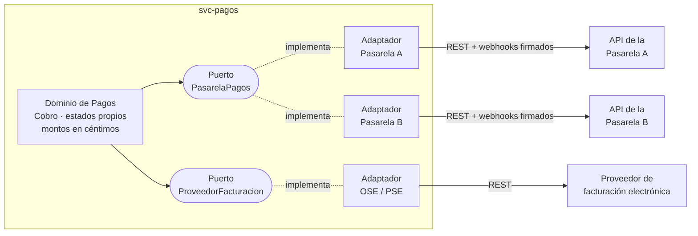
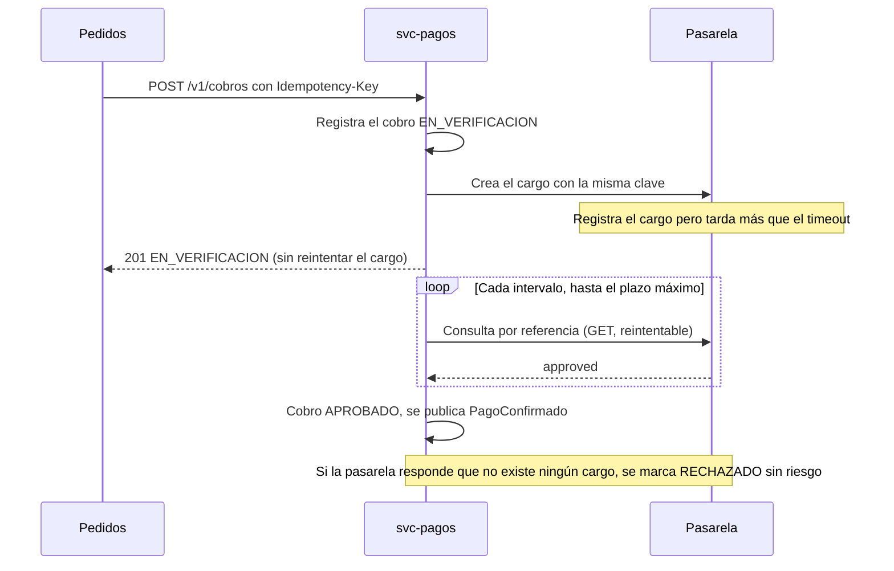
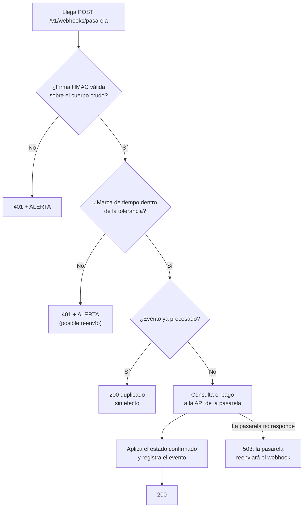
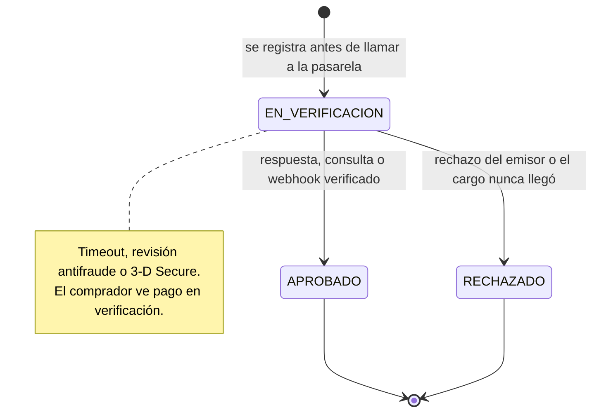
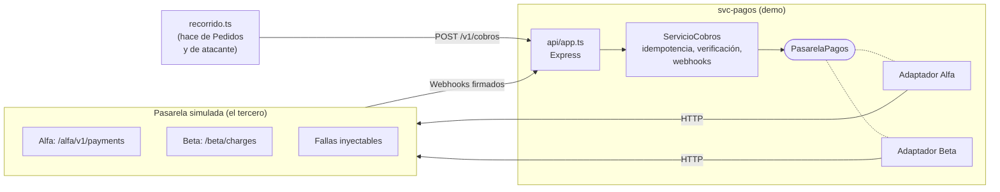

> [0. Acerca del Grupo](../../0.md) › [0.2. Temas Individuales (Informe + Video) / Video aporte al proyecto](../0.2.md) › [0.2.5. Integrante 5 (SEVILLANO)](0.2.5.md)

# 0.2.5. Integrante 5 (SEVILLANO)

**Tema individual:** Integración con APIs de Terceros · **Módulo:** Pagos y Liquidaciones ([2.1.5](../../../2/2.1/2.1.5/2.1.5.md))

El módulo de Pagos es el que más depende de sistemas que Qhatu no controla: la pasarela de pagos, el proveedor de facturación electrónica y el reporte diario de conciliación. Este informe explica cómo integrarse con APIs de terceros sin que sus fallas, sus formatos o sus cambios se conviertan en fallas de Qhatu, y lo demuestra con un `svc-pagos` reducido que se integra con dos pasarelas simuladas.

| Parte | Contenido |
|---|---|
| [1. Desarrollo conceptual](#1-desarrollo-conceptual) | Qué es, motivación, conceptos con diagramas y relación con la arquitectura |
| [2. Consideraciones técnicas](#2-consideraciones-técnicas) | Puesta en marcha (demo, sandbox real y AWS), aplicabilidad, trade-offs y alternativas |
| [3. Demo (código)](#3-demo-código) | Escenario del módulo de Pagos, código clave, ejecución, evidencia y pruebas |
| [4. Videos](#4-videos) | Tema individual y aporte al proyecto |

---

# 1. Desarrollo conceptual

## 1.1 Qué es y qué problema resuelve

Una **integración con una API de terceros** es la conexión de nuestro sistema con un servicio que **opera, versiona y factura otra organización**, a través de la interfaz que esa organización publica: una pasarela de pagos, un proveedor de facturación electrónica, un courier, un servicio de identidad o una plataforma de mensajería.

Técnicamente se parece a llamar a otro módulo propio, pero las reglas cambian por completo:

| Aspecto | Integración entre módulos propios | Integración con un tercero |
|---|---|---|
| Contrato | Lo acuerda el equipo y se cambia en conjunto | Lo define el proveedor; cambia según su calendario |
| Disponibilidad | Se mide y se corrige internamente | Depende de un SLA ajeno; las caídas no se pueden arreglar, solo tolerar |
| Visibilidad de fallas | Logs y trazas de ambos lados | Solo se ve la respuesta (o su ausencia) |
| Confianza | Red interna, identidades propias | Internet: hay que autenticar en ambos sentidos |
| Modelo de datos | El mismo lenguaje del dominio | El vocabulario del proveedor (`approved`, `in_process`, montos decimales, códigos `00`/`51`) |
| Pruebas | Se levanta el otro módulo | Sandbox con límites, o dobles de prueba |

**Problema que resuelve la disciplina de integración:** convertir una dependencia externa, que no controlamos, en una dependencia **explícita, aislada y tolerante a fallas**. El objetivo no es que el tercero nunca falle, sino que, cuando falle o cambie, el daño quede contenido en un solo lugar del sistema.

---

## 1.2 Motivación

Es el Cyber Wow, 21:00 h. Una compradora paga S/ 349.90 en Qhatu y la pasarela, saturada, tarda 12 segundos en responder. Hay cuatro formas ingenuas de manejarlo y las cuatro terminan mal:

1. **Reintentar el cobro.** La primera solicitud sí llegó a la pasarela y la tarjeta ya se cargó; el reintento la carga otra vez. Resultado: **doble cobro**, reclamo y contracargo.
2. **Darlo por fallido.** El sistema muestra «pago rechazado», la compradora paga de nuevo con otra tarjeta y la primera transacción se aprueba minutos después. Resultado: **dos cobros o un pedido cancelado con el dinero ya cobrado**.
3. **Confiar en cualquier aviso de «pago aprobado».** El endpoint que recibe los webhooks es público. Si no se verifica quién lo llama, cualquiera puede enviar `{"status":"approved"}` y **confirmar pedidos sin pagar**.
4. **Llamar al SDK del proveedor desde la lógica de negocio.** Todo funciona hasta que hay que cambiar de pasarela o el proveedor publica una versión nueva de su API: los estados, los montos y los errores del proveedor están repartidos por todo el módulo. Resultado: **cambiar de proveedor es reescribir Pagos**.

**Lo que no alcanza:**

- Un `try/catch` con reintento automático: confunde «no hubo respuesta» con «no se hizo», que es justamente el error del punto 1.
- HTTPS: autentica al servidor frente a quien lo llama, pero no dice nada de quién está llamando a nuestro endpoint de webhooks (punto 3).
- El SDK oficial: resuelve la comunicación, pero no las decisiones de negocio ante un resultado desconocido, ni el aislamiento del dominio (punto 4).

Integrar bien con un tercero consiste en responder de forma deliberada a cuatro preguntas: cómo nos comunicamos, qué pasa cuando falla, cómo confiamos y cómo evolucionamos sin rompernos.

---

## 1.3 Conceptos y componentes principales

### Pregunta 1: ¿cómo nos comunicamos? (estilos de interacción)

| Estilo | Cómo funciona | Cuándo conviene | Ejemplo en Qhatu |
|---|---|---|---|
| **Solicitud–respuesta síncrona** (REST/HTTP) | Se llama y se espera la respuesta | Cuando el usuario espera el resultado en la misma interacción | Crear el cobro en la pasarela |
| **Notificación push** (webhook o *callback*) | El tercero llama a un endpoint nuestro cuando algo cambia | Resultados que llegan después: revisión antifraude, 3-D Secure | La pasarela avisa que el pago se aprobó |
| **Consulta periódica** (*polling*) | Preguntamos el estado cada cierto tiempo | Como respaldo cuando el push no llega, o si el tercero no ofrece push | Consultar un cobro que quedó sin respuesta |
| **Intercambio de archivos por lotes** | Un archivo diario por SFTP, S3 o descarga | Grandes volúmenes sin urgencia, terceros sin API | Reporte diario para la conciliación; couriers sin API |

Los estilos se **combinan**: el push da rapidez, la consulta da garantía y el archivo diario da la verdad contable.

### Pregunta 2: ¿qué pasa cuando falla? (resiliencia)

| Concepto | Qué es |
|---|---|
| **Tiempo de espera** (*timeout*) | Límite de cuánto se espera una respuesta. Sin él, un tercero lento agota los hilos y las conexiones de nuestro servicio |
| **Resultado desconocido** | Tras un *timeout*, no sabemos si la operación se hizo. Es el caso más peligroso: no es éxito ni fracaso, y hay que **averiguarlo**, no suponerlo |
| **Idempotencia** | Repetir la misma solicitud produce el mismo efecto que hacerla una vez. Se logra enviando una **clave de idempotencia** (`Idempotency-Key`) que el tercero usa para reconocer repeticiones |
| **Reintento con espera exponencial y *jitter*** | Repetir solo operaciones idempotentes (consultas, o solicitudes con clave), esperando cada vez más y con una variación aleatoria para no saturar al tercero cuando se recupera |
| **Límites de tasa** | El tercero responde `429` (o `503`) con `Retry-After`; hay que respetarlo |
| **Interruptor de circuito** | Tras varias fallas seguidas, se deja de llamar por un tiempo para no insistir sobre un servicio caído (lo usa Logística con los couriers, [5.4](../../../5/5.4/5.4.md)) |
| **Consistencia eventual y conciliación** | Nuestro registro y el del tercero pueden diferir por un tiempo; un proceso de conciliación compara ambos y resuelve diferencias |

### Pregunta 3: ¿cómo confiamos? (seguridad en ambos sentidos)

| Concepto | Qué es |
|---|---|
| **Autenticación saliente** | Cómo nos identificamos ante el tercero: clave de API, token Bearer, OAuth 2.0 (*client credentials*) o mTLS |
| **Autenticación entrante (firma de webhooks)** | El tercero firma cada notificación con un **HMAC** y un secreto compartido. Verificamos la firma sobre los bytes exactos recibidos, con **comparación en tiempo constante** |
| **Protección contra reenvío** | La firma incluye una **marca de tiempo**; un mensaje auténtico pero viejo (capturado y reenviado) se rechaza |
| **«La firma prueba quién, no qué»** | Aunque la firma sea válida, el estado se confirma **consultando la API del tercero**; el cuerpo del webhook solo sirve como aviso |
| **Minimizar datos sensibles** | La pasarela **tokeniza** la tarjeta en el navegador: nuestro backend solo maneja un token, lo que reduce el alcance de PCI DSS (RES-02) |
| **Gestión de secretos** | Credenciales y secretos de firma fuera del código, en un gestor de secretos, y rotables |

### Pregunta 4: ¿cómo evolucionamos sin rompernos? (aislamiento)

| Concepto | Qué es |
|---|---|
| **Contrato** | La especificación de la API del tercero (por ejemplo, OpenAPI), con su versión |
| **Puertos y adaptadores / capa anticorrupción** | El dominio define **su propia interfaz** (puerto) en su propio lenguaje; cada tercero se conecta con un **adaptador** que traduce formatos, estados, errores y firmas. El vocabulario del proveedor no cruza el adaptador |
| **Pruebas de contrato** | Una misma batería de pruebas que todo adaptador debe pasar; garantiza que cambiar de proveedor no cambia el comportamiento |
| **Sandbox** | Entorno de pruebas del proveedor con credenciales y tarjetas de prueba |
| **Versionado y deprecación** | Los proveedores retiran versiones de su API; el adaptador concentra la migración |

### Diagrama 1: puertos y adaptadores en el módulo de Pagos

El dominio de Pagos solo conoce sus puertos. Cada proveedor, presente o futuro, es un adaptador.



### Diagrama 2: cobro con resultado desconocido

Cuando la pasarela no responde a tiempo, el cobro **no se reintenta**: queda en verificación y se averigua su estado.



### Diagrama 3: verificación de un webhook



### Diagrama 4: estados del cobro

Un cobro solo sale de `EN_VERIFICACION` una vez. Un aviso tardío que contradice un estado final no se aplica: pasa a la conciliación.



---

## 1.4 Relación con la arquitectura

### Atributos de calidad

| Atributo | Efecto | Cómo y por qué |
|---|---|---|
| **Interoperabilidad** | Favorece | Es el atributo central: el adaptador traduce formatos, estados y protocolos del tercero a un modelo común (táctica *adaptar la interfaz*, ESC-PAG-09) |
| **Mantenibilidad** | Favorece | Con puertos y adaptadores, cambiar o agregar un proveedor afecta un solo componente (táctica *usar un intermediario*, ESC-PAG-11) |
| **Disponibilidad** | Favorece y compromete | El tercero se vuelve una dependencia crítica que no controlamos. Bien diseñada, la integración **tolera** sus fallas: tiempos de espera, estado en verificación y consulta posterior (ESC-PAG-01) |
| **Seguridad** | Favorece y compromete | Se agrega una superficie de ataque nueva (endpoint público de webhooks), que se protege con firmas, marcas de tiempo y confirmación por API (ESC-PAG-06). La tokenización saca los datos de tarjeta del sistema (ESC-PAG-05) |
| **Rendimiento** | Compromete | La latencia del tercero se suma y no se puede optimizar desde adentro; por eso ESC-PAG-03 mide la latencia interna **sin contar la pasarela**, y las operaciones lentas se resuelven de forma asíncrona |
| **Testeabilidad** | Favorece | El puerto permite probar el dominio con dobles de prueba y someter a cada adaptador a la misma batería de pruebas de contrato |
| **Costo** | Compromete | Comisiones por transacción, planes por volumen y riesgo de dependencia de un proveedor (*vendor lock-in*), que el adaptador reduce pero no elimina |

### Decisiones de arquitectura en las que influye

| Categoría | Decisión en Qhatu | Cómo influye el tema |
|---|---|---|
| Asignación de responsabilidades | [ADR-PAG-01 (4.5)](../../../4/4.5/4.5.md): componentes de `svc-pagos` con los puertos `PasarelaPagos` y `ProveedorFacturacion` | Define dónde vive la traducción (adaptadores) y qué nunca debe conocer el dominio |
| Modelo de coordinación | [ADR-PAG-02 (4.5)](../../../4/4.5/4.5.md): confirmación por webhook firmado más consulta de estado | Elige los estilos de interacción (síncrono + push + consulta) y el manejo del resultado desconocido |
| Elección de tecnología | [ADR-PAG-05 (4.5)](../../../4/4.5/4.5.md): pasarela principal · [ADR-PAG-06 (4.5)](../../../4/4.5/4.5.md): proveedor OSE/PSE (RES-04) | Los criterios de elección son propiedades de la integración: tokenización, 3-D Secure, webhooks verificables, API de consulta y sandbox |
| Tácticas | [ADR-TAC-PAG-01, 06, 09 y 11 (5.5)](../../../5/5.5/5.5.md) | Tiempo de espera y manejo de excepciones; verificar integridad de mensajes; adaptar la interfaz; usar un intermediario |
| Modelo de datos | [ADR-PAG-03 (4.5)](../../../4/4.5/4.5.md): libro mayor en céntimos | El dominio guarda montos enteros; la conversión a decimales del proveedor ocurre solo en el adaptador |
| Mapeo a la infraestructura | [6.2](../../../6/6.2/6.2.md) y [6.4](../../../6/6.4/6.4.md) | Endpoint de webhooks expuesto por el API Gateway; secretos de la pasarela en AWS Secrets Manager |

### Aplicación en Qhatu

El mismo patrón aplica a **todas** las integraciones externas del sistema ([diagrama de contexto, 6.1](../../../6/6.1/6.1.md)), no solo a Pagos:

| Tercero | Módulo | Estilos de interacción | Puerto en el diseño | Riesgo principal que cubre la integración |
|---|---|---|---|---|
| Pasarelas de pago | Pagos | REST + webhooks firmados + reporte diario | `PasarelaPagos` | Doble cobro y pagos falsos (ESC-PAG-01, ESC-PAG-06) |
| Proveedor de facturación electrónica | Pagos | REST, con reintento desde una cola | `ProveedorFacturacion` | Comprobantes no emitidos ante SUNAT (RES-04) |
| Proveedor de consultas RENIEC / SUNAT | Vendedores | Consulta asíncrona con reintentos | `ProveedorIdentidad` | Registros bloqueados si el servicio cae (ESC-VEN-01) |
| Couriers | Logística | API/webhook o archivo diario | `Courier` | Formatos heterogéneos (ESC-LOG-07) |
| Mensajería (WhatsApp y correo) | Pedidos | REST con cola y reintentos | `CanalNotificacion` | Notificaciones perdidas (ESC-PED-02) |

---

# 2. Consideraciones técnicas

## 2.1 Herramientas utilizadas en la demo

| Herramienta | Rol | Versión |
|---|---|---|
| Node.js | Entorno de ejecución (el mismo de los microservicios de Qhatu, ADR-GLO-07) | 22 LTS o superior |
| TypeScript | Lenguaje; los tipos del puerto obligan a cada adaptador a cumplir el contrato | 5.8 o superior |
| Express | API de `svc-pagos` y de la pasarela simulada | 5.1 o superior |
| `fetch` y `AbortSignal.timeout` (nativos de Node) | Llamadas HTTP con tiempo de espera, sin librerías extra | Incluidos en Node 22 |
| `node:crypto` (nativo) | HMAC-SHA256 y comparación en tiempo constante (`timingSafeEqual`) | Incluido en Node 22 |
| `node:test` + `tsx` | Pruebas automáticas y ejecución de TypeScript sin compilar | tsx 4.20 o superior |

La demo **no necesita** Docker, base de datos ni cuentas en ninguna pasarela: los dos proveedores están simulados.

## 2.2 Puesta en marcha

### a) Demo local (paso a paso)

1. Instalar **Node.js 22 LTS** y verificarlo con `node -v`.
2. Ubicarse en la carpeta de la demo (`demo-pasarela-pagos/`) e instalar las dependencias:
   ```cmd
   npm install
   ```
3. Ejecutar el recorrido guiado de cinco pasos:
   ```cmd
   npm run demo
   ```
4. Ejecutar las pruebas automáticas:
   ```cmd
   npm test
   ```
5. (Opcional) Probar a mano en dos terminales: `npm run pasarela` levanta la pasarela simulada en el puerto 4000 y `npm start` levanta `svc-pagos` en el 3000. Con `set PASARELA=beta` (cmd) o `$env:PASARELA="beta"` (PowerShell) antes de `npm start` se usa la otra pasarela.

### b) Con una pasarela real en modo sandbox (ejemplo: Mercado Pago)

Los pasos son análogos para cualquier pasarela; se toma Mercado Pago como ejemplo porque es la candidata de [ADR-PAG-05](../../../4/4.5/4.5.md). Los nombres de pantallas y cabeceras corresponden a su documentación de *webhooks* vigente en octubre de 2026.

1. **Crear la aplicación y obtener credenciales de prueba.** En el panel de desarrolladores (*Tus integraciones*) se crea una aplicación y se obtienen la **Public Key** (para el navegador) y el **Access Token** (para el backend).
2. **Tokenizar en el navegador.** El formulario de pago usa el SDK de JavaScript de la pasarela, que envía los datos de tarjeta directamente a la pasarela y devuelve un **token**. El backend de Qhatu solo recibe ese token (RES-02, ESC-PAG-05).
3. **Crear el pago desde el backend** con `POST /v1/payments`, el Access Token como `Bearer` y la cabecera de idempotencia `X-Idempotency-Key`. En Qhatu, la clave es el identificador del cobro.
4. **Configurar los webhooks.** En la aplicación: *Webhooks › Configurar notificaciones*, se indica la URL HTTPS pública y los eventos de pagos; al guardar se genera la **clave secreta** de firma. Para probar desde una PC se expone el puerto local con un túnel HTTPS (por ejemplo, `ngrok` o `cloudflared`).
5. **Validar cada notificación.** La pasarela envía `x-signature` con el formato `ts=<marca>,v1=<firma>` y `x-request-id`. Se arma el texto `id:<data.id>;request-id:<x-request-id>;ts:<ts>;`, se calcula su HMAC-SHA256 en hexadecimal con la clave secreta y se compara con `v1` en tiempo constante. Es el mismo esquema que implementa la «Pasarela Alfa» de la demo.
6. **Confirmar el estado** con `GET /v1/payments/{id}` antes de dar el pago por aprobado, y responder `200` rápido. Si no recibe confirmación, la pasarela reintenta el envío, por lo que el procesamiento debe ser idempotente.
7. **Probar con tarjetas y usuarios de prueba** del sandbox, incluyendo los casos de rechazo y de pago pendiente.
8. **Escribir el adaptador** `PasarelaMercadoPago` que implemente el puerto `PasarelaPagos` y pase la misma batería de pruebas de contrato que los adaptadores de la demo.

### c) En la arquitectura de Qhatu (AWS)

| Elemento de la demo | En producción ([6.2](../../../6/6.2/6.2.md), [6.4](../../../6/6.4/6.4.md)) |
|---|---|
| Secretos en variables de entorno con valores de demo | AWS Secrets Manager; `svc-pagos` los carga al iniciar y se pueden rotar |
| Endpoint de webhooks en `localhost` | `POST /v1/webhooks/pasarela` expuesto por el API Gateway hacia `svc-pagos` en ECS Fargate |
| Repositorio en memoria | Base `pagos` en RDS PostgreSQL, con restricción `UNIQUE` sobre la clave de idempotencia y sobre el `eventId` de los eventos procesados |
| Bucle de verificación dentro del proceso | Cobros en verificación persistidos y consultados por una tarea programada, para sobrevivir a reinicios |
| Registros `ALERTA` en consola | Logs estructurados en CloudWatch con una alarma ante firmas inválidas |
| Tiempos de la demo (1.5 s, 0.5 s, 8 s) | Valores de ESC-PAG-01: tiempo de espera de 10 s, consulta cada 30 s y plazo de 5 min |

## 2.3 Aplicabilidad

| Situación | ¿Aplicar el patrón completo (puerto, adaptador, idempotencia, firma, consulta)? |
|---|---|
| Operaciones con dinero o efectos irreversibles (cobros, reembolsos, transferencias) | **Sí, siempre.** Un resultado desconocido mal manejado cuesta dinero |
| Se reciben notificaciones en un endpoint público | **Sí**, al menos la verificación de firma y la confirmación por API |
| Hay o puede haber más de un proveedor para la misma función | **Sí**: el puerto permite cambiarlo o tener uno de respaldo |
| Contrato del tercero inestable o con versiones que se retiran | **Sí**: el adaptador concentra la migración |
| Consulta de solo lectura, sin efectos y de bajo impacto (por ejemplo, el tipo de cambio del día) | **Parcial**: tiempo de espera y caché bastan; un puerto propio es opcional |
| Prototipo o prueba de concepto de pocos días | **No**: el SDK directo es más rápido; el patrón se agrega antes de producción |
| Servicio interno de la misma organización con contrato estable | **No**: es integración entre módulos, no con un tercero |

**Señal de complejidad innecesaria:** adaptadores que solo copian campos sin traducir nada, o capas de abstracción para un proveedor que nunca va a cambiar y no tiene fallas que tolerar.

## 2.4 Trade-offs

| Decisión de diseño | Lo que se gana | Lo que se paga |
|---|---|---|
| Puerto propio con un adaptador por proveedor | Cambiar de proveedor sin tocar el dominio; pruebas con dobles | Más código y un nivel más de indirección; hay que mantener la traducción |
| Ante un *timeout*, estado en verificación y consulta (en vez de reintentar) | 0 cobros duplicados | El comprador ve «pago en verificación» unos segundos o minutos; más estados y procesos |
| Confirmar cada webhook consultando la API | Inmune a cuerpos manipulados | Una llamada extra por notificación y dependencia de la disponibilidad de la API |
| Webhooks + consulta + conciliación diaria | Rapidez y garantía a la vez | Tres mecanismos que operar y monitorear |
| Tolerancia de marca de tiempo corta | Protección contra reenvíos | Requiere relojes sincronizados; una tolerancia muy corta rechaza mensajes legítimos demorados |
| Tokenización en el navegador | Los datos de tarjeta nunca tocan Qhatu; menor alcance de PCI DSS | Dependencia del SDK de la pasarela en el frontend |

## 2.5 Alternativas y cómo elegir

| Alternativa | En qué consiste | A favor | En contra | Cuándo elegirla |
|---|---|---|---|---|
| **SDK oficial llamado directamente** | Usar la librería del proveedor desde la lógica de negocio | Rápido de implementar; mantenido por el proveedor | Acopla el dominio al proveedor; el SDK no decide qué hacer ante un resultado desconocido | Prototipos, o **dentro** del adaptador (son combinables) |
| **Puertos y adaptadores propios** (el de esta demo) | Interfaz del dominio y un adaptador por tercero | Aislamiento, pruebas de contrato y cambio de proveedor | Más código propio | Integraciones críticas o con varios proveedores |
| **Orquestador o agregador de pagos** | Un intermediario comercial que se integra con muchas pasarelas y expone una sola API | Un solo contrato para muchos medios de pago; enrutamiento entre pasarelas | Otra comisión y otro tercero del cual depender | Cuando se necesitan muchos medios de pago o países |
| **Plataforma de integración (iPaaS) o bus de integración** | Herramientas como MuleSoft o Apache Camel que concentran conectores y transformaciones | Conectores listos; integración gestionada fuera del código | Costo y una pieza central más; lógica de negocio fuera del servicio | Organizaciones con muchas integraciones entre sistemas empresariales |
| **Proxy de salida o *service mesh*** | La infraestructura (por ejemplo, Envoy) aplica tiempos de espera, reintentos e interruptores | Resiliencia sin tocar el código | No entiende el negocio: puede reintentar un cobro que no debía repetirse | Como complemento para consultas idempotentes, nunca como única protección de un cobro |
| **Librerías de resiliencia** (`opossum`, `cockatiel`) | Interruptor de circuito, reintentos y *bulkheads* en el código | Patrones probados y configurables | Cubren solo la parte técnica, no el aislamiento del dominio | Dentro de los adaptadores, como en Logística |

**Cómo elegir:** se parte del **costo de un error** (¿mueve dinero, es irreversible?), de **cuántos proveedores** hay o habrá para la misma función y de **cuánto cambia** su contrato. Para los cobros de Qhatu los tres factores son altos, por lo que se combinan puertos y adaptadores propios con el SDK o la API REST de la pasarela dentro del adaptador y una librería de resiliencia solo para las consultas.

## 2.6 Conclusión

Integrarse con un tercero no es «llamar a su API», sino **diseñar para lo que no controlamos**: su lenguaje se traduce en el borde, sus silencios se tratan como resultados desconocidos que se averiguan, sus avisos se verifican antes de creerlos y sus cambios quedan encerrados en un adaptador. En el módulo de Pagos esto se traduce en dos métricas concretas: **0 cobros duplicados** y **0 pagos confirmados sin verificación**.

---

# 3. Demo (código)

## 3.1 Escenario

La demo implementa una versión reducida de `svc-pagos` del módulo **Pagos y Liquidaciones** y la integra con dos pasarelas **simuladas** que tienen contratos distintos:

| | Pasarela Alfa | Pasarela Beta |
|---|---|---|
| Inspirada en | El esquema de Mercado Pago | Un procesador con códigos de respuesta |
| Montos | Decimales en soles (`125.5`) | Céntimos enteros (`12550`) |
| Estados | `approved`, `rejected`, `in_process` | Códigos `00`, `51`, `PE` |
| Autenticación | `Authorization: Bearer` | `X-Api-Key` |
| Idempotencia | `X-Idempotency-Key` | `Idempotency-Key` |
| Firma de webhooks | HMAC-SHA256 en hexadecimal sobre `id;request-id;ts` | HMAC-SHA256 en base64 sobre `<t>.<cuerpo completo>` |

A la pasarela simulada se le pueden **inyectar fallas**: que registre el cargo pero responda tarde, o que caiga antes de registrarlo. Así se reproducen los escenarios del módulo:

| Requisito o escenario | Qué demuestra la demo |
|---|---|
| RF-PAG-01, RF-PAG-03 · **ESC-PAG-01** (la pasarela no responde) | El cobro queda `EN_VERIFICACION`, no se reintenta el cargo y se resuelve consultando: 0 cobros duplicados |
| RF-PAG-02 · **ESC-PAG-06** (webhook falso) | Webhooks sin firma, con firma inventada o reenviados se rechazan con `401` y quedan como `ALERTA`; el estado solo cambia con un webhook auténtico confirmado por la API |
| **ESC-PAG-10** (evento duplicado) | Un webhook repetido se reconoce por su identificador y no tiene efecto |
| **ESC-PAG-11** (nueva pasarela) | El mismo servicio funciona con la Pasarela Beta cambiando solo la variable `PASARELA`; el dominio no cambia |
| RES-02, **ESC-PAG-05** | La API rechaza cualquier valor que no sea un token de la pasarela (`tok_...`): un número de tarjeta nunca se acepta |

### Componentes de la demo



## 3.2 Estructura del código

El dominio y el servicio no importan nada de los adaptadores; `composicion.ts` es el único archivo que sabe qué pasarela se usa.

```text
demo-pasarela-pagos/
├── package.json · tsconfig.json · README.md
├── src/
│   ├── dominio/
│   │   ├── cobro.ts                 Modelo propio: estados y reglas de transición
│   │   └── puertos.ts               Puerto PasarelaPagos y errores del dominio
│   ├── aplicacion/
│   │   └── servicio-cobros.ts       Idempotencia, timeout → EN_VERIFICACION, consulta y webhooks
│   ├── adaptadores/
│   │   ├── pasarela-alfa.ts         Traducción del contrato Alfa
│   │   ├── pasarela-beta.ts         Traducción del contrato Beta
│   │   ├── http.ts                  fetch con tiempo de espera; reintentos solo en GET
│   │   ├── firma.ts                 HMAC, comparación en tiempo constante, tolerancia
│   │   └── repositorio-memoria.ts
│   ├── api/app.ts                   POST /v1/cobros · GET /v1/cobros/:id · POST /v1/webhooks/pasarela
│   ├── terceros/pasarela-simulada.ts  Las dos pasarelas, con fallas inyectables
│   ├── composicion.ts               Elige el adaptador según PASARELA
│   └── recorrido.ts                 Recorrido guiado de cinco pasos
└── test/pagos.test.ts               13 pruebas automáticas
```

## 3.3 Código clave

**El puerto.** Es lo único que el servicio conoce de una pasarela. Nótese que `verificarNotificacion` no devuelve el estado del pago, solo qué pago cambió:

```ts
export interface PasarelaPagos {
  readonly nombre: string;
  crearCobro(solicitud: SolicitudCobro): Promise<ResultadoPasarela>;
  consultarPorId(idExterno: string): Promise<ResultadoPasarela>;
  consultarPorReferencia(referencia: string): Promise<ResultadoPasarela | null>;
  // Verifica que la notificación venga de la pasarela. No devuelve el estado:
  // el estado siempre se obtiene consultando la API (ADR-PAG-02).
  verificarNotificacion(cabeceras: Cabeceras, cuerpoCrudo: string): NotificacionVerificada;
}
```

**Dos errores con significados opuestos.** La diferencia entre «no respondió» y «respondió que no» decide si hubo cargo:

```ts
// La pasarela no respondió a tiempo o la red falló: el resultado es DESCONOCIDO.
export class PasarelaNoRespondio extends Error {}
// La pasarela respondió y rechazó la solicitud (4xx): el cargo NO se hizo.
export class SolicitudRechazada extends Error {}
```

**El cobro ante un resultado desconocido** (`servicio-cobros.ts`, extracto). El cobro se registra **antes** de llamar a la pasarela y, si no hay respuesta, no se reintenta el cargo:

```ts
this.repo.guardar(cobro); // existe aunque el proceso caiga a mitad de la llamada
try {
  const r = await this.pasarela.crearCobro({ referencia: cobro.id, /* ... */ });
  aplicarResultado(cobro, r.estado, 'respuesta de la pasarela', r.detalle);
} catch (e) {
  if (e instanceof SolicitudRechazada) {
    aplicarResultado(cobro, 'RECHAZADO', 'solicitud rechazada por la pasarela', e.message);
  } else {
    // Resultado desconocido: repetir el POST podría cobrar dos veces (ESC-PAG-01).
    this.bitacora.aviso('La pasarela no respondió: el cobro queda EN_VERIFICACION y NO se reintenta el cargo');
  }
}
if (cobro.estado === 'EN_VERIFICACION') this.programarVerificacion(cobro.id);
```

**Reintentos solo donde es seguro** (`http.ts`). Un `GET` se puede repetir; el `POST` que crea un cargo, nunca:

```ts
const maxIntentos = op.metodo === 'GET' ? 1 + (op.reintentos ?? 0) : 1;
// ...
signal: AbortSignal.timeout(op.timeoutMs), // tiempo de espera de cada llamada
```

**Verificación de la firma de Alfa** (`pasarela-alfa.ts`, extracto):

```ts
const { ts, v1 } = leerPares(firma);                       // "ts=...,v1=..."
if (!dentroDeTolerancia(Number(ts), this.cfg.toleranciaFirmaSeg)) {
  throw new NotificacionInvalida('marca de tiempo fuera de tolerancia (posible reenvío)');
}
const manifiesto = `id:${dataId};request-id:${requestId};ts:${ts};`;
if (!igualesSeguro(hmacSha256(this.cfg.secretoWebhook, manifiesto, 'hex'), v1)) {
  throw new NotificacionInvalida('firma inválida');
}
```

**La firma prueba quién, no qué** (`servicio-cobros.ts`, extracto):

```ts
if (this.repo.eventoProcesado(notificacion.eventoId)) return { resultado: 'duplicado' };
const r = await this.pasarela.consultarPorId(notificacion.idExterno); // no se confía en el cuerpo
const resultado = aplicarResultado(cobro, r.estado, 'webhook verificado + consulta a la API', r.detalle);
```

**La capa anticorrupción** (`pasarela-beta.ts`). El vocabulario de Beta muere en el adaptador:

```ts
// '00' aprobado, 'PE' en revisión; cualquier otro código es un rechazo del emisor.
const estado: EstadoCobro = c.outcome.code === '00' ? 'APROBADO' : c.outcome.code === 'PE' ? 'EN_VERIFICACION' : 'RECHAZADO';
```

**Cambiar de pasarela es configuración** (`composicion.ts`):

```ts
return cfg.proveedor === 'beta'
  ? new PasarelaBeta({ ...comun, ...cfg.credenciales.beta })
  : new PasarelaAlfa({ ...comun, ...cfg.credenciales.alfa });
```

## 3.4 Cómo ejecutarla

Requisito: Node.js 22 LTS. Desde la carpeta `demo-pasarela-pagos/`:

```cmd
npm install
npm run demo
npm test
```

`npm run demo` levanta la pasarela simulada y `svc-pagos` en puertos libres, recorre los cinco pasos y termina solo. Cada paso imprime las solicitudes, lo que registra cada lado (`pasarela │` y `svc-pagos │`) y las comprobaciones (`✔`); si alguna comprobación falla, el recorrido se detiene con un error.

## 3.5 Evidencia de funcionamiento

Salida real de `npm run demo` (los identificadores cambian en cada ejecución).

### Paso 1. Cobro aprobado e idempotencia

```text
▶ Pedidos solicita el cobro de S/ 125.50 con Idempotency-Key = PED-1001-e7e5
    pasarela  │ [alfa] POST cobro cob_cb514922 → cargo 1000000001 registrado (aprobado)
    svc-pagos │ [INFO] Pasarela alfa respondió APROBADO {"cobro":"cob_cb514922","idExterno":"1000000001"}
  ← 201 APROBADO · cobro cob_cb514922 · id en Alfa 1000000001

▶ Pedidos no recibió la respuesta y repite la MISMA solicitud
    svc-pagos │ [INFO] Solicitud repetida: se devuelve el cobro existente sin llamar a la pasarela {"cobro":"cob_cb514922"}
  ← 200 APROBADO · cobro cob_cb514922 · Idempotent-Replayed: true

▶ Alguien reutiliza la clave con otro monto
  ← 409 La Idempotency-Key ya se usó con otros datos
  ✔ El cobro se aprobó
  ✔ La repetición devolvió el mismo cobro
  ✔ La clave reutilizada con otros datos se rechazó (409)
  ✔ La pasarela registra 1 solo cargo
```

### Paso 2. La pasarela no responde a tiempo (ESC-PAG-01)

La pasarela registra el cargo pero tarda 4 s; `svc-pagos` espera 1.5 s, deja el cobro en verificación y lo resuelve consultando, sin repetir el cargo. En la variante, la pasarela cae antes de registrar el cargo: la consulta confirma que no existe y el cobro se rechaza sin riesgo.

```text
    pasarela  │ [alfa] POST cobro cob_901fbcf3 → cargo 1000000002 registrado (aprobado)
    pasarela  │ [alfa] ...la respuesta tardará 4000 ms (falla inyectada)
    svc-pagos │ [AVISO] La pasarela no respondió: el cobro queda EN_VERIFICACION y NO se reintenta el cargo {"cobro":"cob_901fbcf3","error":"POST http://localhost:35131/alfa/v1/payments: sin respuesta en 1500 ms"}
  ← 201 EN_VERIFICACION en 1506 ms · el comprador ve «pago en verificación»

▶ svc-pagos NO repite el cargo: consulta el estado por referencia hasta resolverlo
    svc-pagos │ [INFO] Consulta de estado: el cobro quedó APROBADO {"cobro":"cob_901fbcf3","ms":505}
    estado final: APROBADO · historial: EN_VERIFICACION (creacion) → APROBADO (consulta de estado)
  ✔ Ante el timeout, el cobro quedó EN_VERIFICACION (no se asumió nada)
  ✔ La consulta de estado lo resolvió como APROBADO
  ✔ 0 cobros duplicados: la pasarela tiene 1 solo cargo

▶ Variante: la pasarela cae ANTES de registrar el cargo (503)
    pasarela  │ [alfa] POST cobro cob_6408c510 → 503 (falla inyectada, no se registra)
    svc-pagos │ [INFO] El cobro nunca llegó a la pasarela: se marca RECHAZADO sin riesgo de cargo {"cobro":"cob_6408c510"}
    estado final: RECHAZADO · motivo: el cobro no llegó a la pasarela; no hubo cargo
  ✔ Sin cargo en la pasarela: se rechaza sin riesgo y el comprador puede reintentar
```

### Paso 3. Resultado por webhook firmado (ESC-PAG-06, ESC-PAG-10)

```text
▶ La pasarela aprueba y envía un webhook firmado (x-signature + x-request-id)
    pasarela  │ [alfa] revisión terminada: pago 1000000003 aprobado; envía webhook firmado
    svc-pagos │ [INFO] Webhook verificado: cobro APROBADO {"cobro":"cob_2b3dfdf1"}
  ← svc-pagos respondió 200 {"resultado":"aplicado","cobroId":"cob_2b3dfdf1","estado":"APROBADO"}

▶ La pasarela reenvía el mismo webhook (no recibió nuestra confirmación a tiempo)
    svc-pagos │ [INFO] Webhook duplicado: ya fue procesado, no tiene efecto {"evento":"alfa:57cee9ac-6711-49d3-a122-740a10cbba66"}
  ← svc-pagos respondió 200 {"resultado":"duplicado"}
  ✔ Firma verificada y estado confirmado consultando la API: APROBADO
  ✔ El webhook repetido se reconoció como duplicado y no tuvo efecto
```

### Paso 4. Webhooks falsos (ESC-PAG-06)

```text
▶ Un atacante envía «pago aprobado» sin firma
    svc-pagos │ [ALERTA] Webhook rechazado: faltan las cabeceras x-signature o x-request-id {"pasarela":"alfa"}
  ← 401

▶ Un atacante inventa la firma
    svc-pagos │ [ALERTA] Webhook rechazado: firma inválida {"pasarela":"alfa"}
  ← 401

▶ Un atacante reenvía un webhook auténtico capturado hace 10 minutos
    svc-pagos │ [ALERTA] Webhook rechazado: marca de tiempo fuera de tolerancia (posible reenvío) {"pasarela":"alfa"}
  ← 401
  ✔ Los tres intentos se rechazaron con 401
  ✔ El cobro NO se confirmó: sigue EN_VERIFICACION
  ✔ Cada intento quedó registrado como ALERTA

▶ La pasarela rechaza el pago de verdad y avisa con un webhook auténtico
    svc-pagos │ [INFO] Webhook verificado: cobro RECHAZADO {"cobro":"cob_caa22aee"}
  ✔ Solo el webhook auténtico cambió el estado: RECHAZADO
```

### Paso 5. Otra pasarela, mismo dominio (ESC-PAG-11)

```text
▶ Se levanta svc-pagos con PASARELA=beta: otro contrato (céntimos, códigos 00/51/PE, X-Api-Key, firma base64)
  ← tarjeta aprobada: APROBADO (ch_caf1f02c9579)
  ← sin fondos:       RECHAZADO (respuesta de la pasarela)
  ← en revisión:      EN_VERIFICACION
    pasarela  │ [beta] revisión terminada: pago ch_6fd606a144f0 aprobado; envía webhook firmado
    svc-pagos │ [INFO] Webhook verificado: cobro APROBADO {"cobro":"cob_fc785e3c"}
    tras el webhook Beta: APROBADO
  ✔ Los tres casos funcionan con Beta
  ✔ Cambiaron solo el adaptador y la variable PASARELA; el dominio y el servicio son los mismos
```

### Resumen del recorrido

```text
━━ RESUMEN ━━━━━━━━━━━━━━━━━━━━━━━━━━━━━━━━━━━━━━━━━━━━━━━━━━━━━━━━━━━━━━━
  Solicitudes de cobro que recibió la pasarela: Alfa 5 · Beta 3
  Cargos registrados en la pasarela:           Alfa 4 · Beta 3
  Alertas de seguridad registradas por svc-pagos: 3
  ✔ Recorrido completo: 0 cobros duplicados y 0 webhooks falsos aceptados
```

Alfa recibió 5 solicitudes y registró 4 cargos: la diferencia es la solicitud que cayó con `503` antes de registrarse (variante del paso 2). La solicitud repetida del paso 1 no llegó a la pasarela porque `svc-pagos` la resolvió con su propia idempotencia.

## 3.6 Pruebas automáticas

`npm test` ejecuta 13 pruebas. La parte central es una **prueba de contrato del puerto**: la misma batería corre contra los dos adaptadores, lo que garantiza que cualquier pasarela nueva se comporte igual ante el dominio.

```text
▶ Contrato del puerto PasarelaPagos · adaptador alfa
  ✔ traduce aprobado, rechazado y en revisión al modelo de Qhatu
  ✔ la misma referencia no genera un segundo cargo (idempotencia del proveedor)
  ✔ consulta por referencia: encuentra el pago o devuelve null
  ✔ verifica un webhook auténtico y rechaza uno alterado o viejo
  ✔ credenciales inválidas → SolicitudRechazada; sin respuesta → PasarelaNoRespondio
▶ Contrato del puerto PasarelaPagos · adaptador beta
  ✔ (las mismas 5 pruebas)
▶ svc-pagos (API)
  ✔ valida Idempotency-Key, montos en céntimos y que llegue un token, no un número de tarjeta
  ✔ ESC-PAG-01: timeout → EN_VERIFICACION → resuelto por consulta, con 1 solo cargo
  ✔ ESC-PAG-06: webhook falso → 401 y alerta; auténtico → aplica; repetido → sin efecto
ℹ tests 13
ℹ pass 13
ℹ fail 0
```

## 3.7 Alcance y limitaciones de la demo

- Las pasarelas son **simuladas**: reproducen contratos y fallas realistas, pero no son las APIs de un proveedor real. El paso a una pasarela real es escribir un adaptador nuevo que pase la misma prueba de contrato ([2.2 b](#b-con-una-pasarela-real-en-modo-sandbox-ejemplo-mercado-pago)).
- Los datos viven en memoria y la verificación de cobros corre dentro del proceso; en `svc-pagos` serían tablas de PostgreSQL y una tarea programada ([2.2 c](#c-en-la-arquitectura-de-qhatu-aws)).
- La demo no publica `PagoConfirmado` en RabbitMQ ni registra el libro mayor: se enfoca en la integración con la pasarela, que es el tema individual.

---

## Aporte al proyecto

Además del tema individual, mi aporte al proyecto corresponde al módulo **Pagos y Liquidaciones**:

| Sección | Contenido |
|---|---|
| [2.1.5](../../../2/2.1/2.1.5/2.1.5.md) | Requisitos funcionales del módulo (RF-PAG-01 a RF-PAG-09) |
| [2.2.5](../../../2/2.2/2.2.5/2.2.5.md) | Escenarios de calidad (ESC-PAG-01 a ESC-PAG-12) |
| [4.5](../../../4/4.5/4.5.md) | Decisiones de arquitectura del módulo (ADR-PAG) |
| [5.5](../../../5/5.5/5.5.md) | Tácticas del módulo (ADR-TAC-PAG) |
| [6.3](../../../6/6.3/6.3.md#pagos-y-liquidaciones-svc-pagos-y-pagos-procesos) | Componentes de `svc-pagos` y `pagos-procesos` |

---

# 4. Videos

Video del tema individual: https://youtu.be/PENDIENTE

Video de aporte al proyecto: https://youtu.be/PENDIENTE

---

[⬅️ Anterior](../0.2.4/0.2.4.md) | [🏠 Home](../../../README.md)
