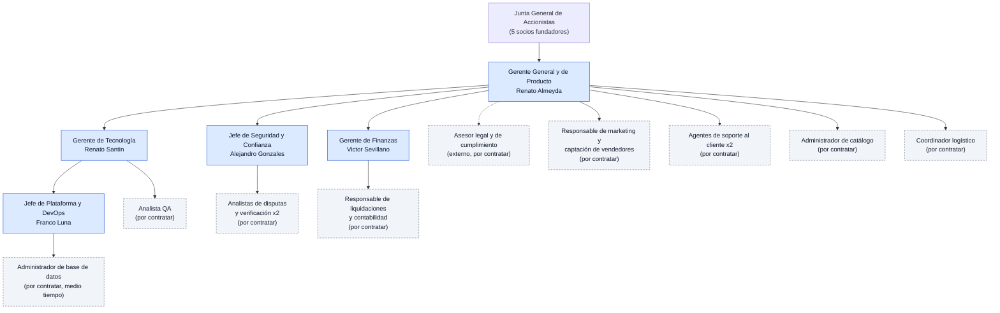

> [1. Caso de Negocio](../1.md) › [1.3. Estructura del Equipo](1.3.md)

# 1.3. Estructura del Equipo

El equipo fundador está formado por los 5 integrantes del grupo. Cada uno combina un rol directivo en Qhatu S.A.C. con la responsabilidad técnica de un módulo del sistema (RES-10). Para el lanzamiento se requieren además roles operativos que se contratarán en las fases indicadas en la [línea de tiempo (1.1)](../1.1/1.1.md).

## Organigrama

> Recuadros azules: socios fundadores (integrantes del grupo). Recuadros grises con borde punteado: roles por contratar. La línea punteada indica un servicio externo.

## Roles de los socios fundadores

### 1. Gerente General y de Producto — Renato Almeyda · Módulo 1: Carrito, Pedidos y Notificaciones

Dirige la empresa y define la hoja de ruta del producto. En el sistema gestiona el flujo completo de compra: asegura que vendedores y compradores interactúen de manera correcta desde que se agrega un producto al carrito hasta que se confirma el pedido. Sus funciones incluyen la gestión del carrito de compras, el proceso de checkout, el cálculo de tarifas de envío en coordinación con Logística y el envío de notificaciones ante cambios de estado del pedido. También valida que los precios no sean manipulados antes de confirmar una compra. Su módulo se relaciona con Vendedores, Pagos y Logística.

### 2. Jefe de Seguridad y Confianza — Alejandro Gonzales · Módulo 2: Vendedores, Reputación y Disputas

Garantiza que solo emprendedores verificados puedan operar en Qhatu y que la confianza entre las partes esté protegida frente a intentos de fraude. Se ocupa de validar la identidad de los vendedores (RUC/DNI) antes de habilitar sus productos, gestionar el sistema de reseñas para que solo compradores reales puedan calificar y supervisar la resolución de disputas entre vendedores y compradores. Su módulo se relaciona con Pagos, para ordenar reembolsos o liberar el dinero retenido según el resultado de una disputa.

### 3. Jefe de Plataforma y DevOps — Franco Luna · Módulo 3: Catálogo y Búsqueda

Gestiona la publicación y administración de los productos disponibles en la plataforma: creación de categorías configurables, indexación de productos y un motor de búsqueda capaz de responder rápidamente incluso con miles de consultas simultáneas en campañas de alta demanda. También filtra productos prohibidos y contenido malicioso antes de su publicación. A nivel de plataforma es responsable de la integración y el despliegue continuo, la infraestructura como código y la observabilidad. Su módulo se relaciona con Carrito y Pedidos, para asegurar que los productos mostrados reflejen su precio y disponibilidad reales.

### 4. Gerente de Tecnología — Renato Santin · Módulo 4: Logística

Lidera las decisiones técnicas transversales del sistema. En su módulo implementa los mecanismos que permiten coordinar la entrega de productos entre vendedores y compradores: integra la plataforma con múltiples couriers (cada uno con su propia forma de comunicación), publica el evento de entrega confirmada que libera el pago al vendedor y reasigna el envío a otro courier en caso de caída del servicio. También rechaza confirmaciones de entrega falsas para evitar liberaciones indebidas de dinero. Su módulo se relaciona con Pedidos y Pagos, para asegurar que la liberación de fondos corresponda a entregas reales.

### 5. Gerente de Finanzas — Victor Sevillano · Módulo 5: Pagos y Liquidaciones

Administra la planificación financiera y la relación con la pasarela de pagos. En el sistema gestiona las transacciones económicas, el módulo de mayor riesgo económico: procesa los pagos de los compradores, retiene el dinero hasta la confirmación de entrega y libera el pago al vendedor al finalizar el servicio. También gestiona reembolsos, verifica la autenticidad de las notificaciones de la pasarela de pago y mantiene un historial de transacciones y conciliaciones. Su módulo se relaciona con Pedidos y Disputas, para validar operaciones y asegurar la trazabilidad financiera.

## Roles por contratar para el lanzamiento

| Rol | Cantidad | Reporta a | Fase de ingreso | Responsabilidad |
|---|---:|---|---|---|
| Asesor legal y de cumplimiento (externo) | 1 | Gerente General | 1. Constitución | Ley 29733, PCI DSS, normativa SUNAT y términos y condiciones |
| Analista QA | 1 | Gerente de Tecnología | 2. MVP | Pruebas funcionales, de carga y de integración entre módulos |
| Administrador de base de datos (medio tiempo) | 1 | Jefe de Plataforma y DevOps | 2. MVP | Respaldos, rendimiento y seguridad de las bases de datos |
| Analista de disputas y verificación | 2 | Jefe de Seguridad y Confianza | 3. Piloto | Revisar registros observados y reseñas sospechosas; resolver disputas (RF-VEN-03, RF-VEN-09) |
| Administrador de catálogo | 1 | Gerente General | 3. Piloto | Configurar categorías y moderar publicaciones (RF-CAT-08, RF-CAT-09) |
| Coordinador logístico | 1 | Gerente General | 3. Piloto | Tarifas, cobertura, couriers y entregas fallidas (RF-LOG-02, RF-LOG-10, RF-LOG-12) |
| Responsable de liquidaciones y contabilidad | 1 | Gerente de Finanzas | 3. Piloto | Liquidaciones semanales y conciliación (RF-PAG-07, RF-PAG-09) |
| Agente de soporte al cliente | 2 | Gerente General | 4. Lanzamiento | Atender consultas de compradores y vendedores |
| Responsable de marketing y captación | 1 | Gerente General | 4. Lanzamiento | Campañas y adquisición de vendedores |

---

[⬅️ Anterior](../1.2/1.2.md) | [🏠 Home](../../README.md) | [Siguiente ➡️](../1.4/1.4.md)
