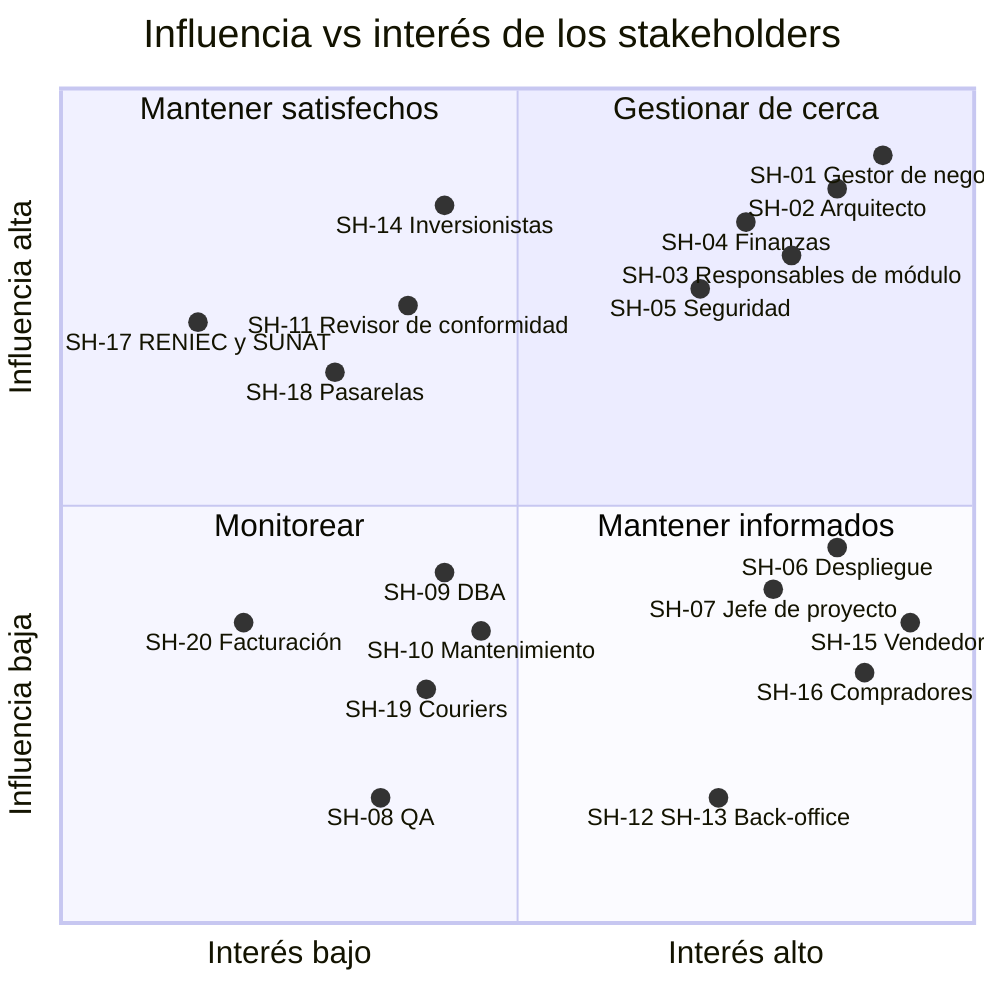

> [1. Caso de Negocio](../1.md) › [1.4. Listado de Stakeholders](1.4.md)

# 1.4. Listado de Stakeholders

Stakeholders de Qhatu según el catálogo de roles visto en clase (*Contextos y Stakeholders*). Para cada uno se indica su rol en el [organigrama (1.3)](../1.3/1.3.md) o la organización externa de la que proviene, su categoría y el sustento de esa categoría, su responsabilidad, su interés en la arquitectura y su nivel de influencia e interés.

**Influencia:** poder de decisión sobre el sistema. **Interés:** grado en que el éxito o fracaso del sistema lo afecta. Escala: Alta · Media · Baja.

## Stakeholders internos

| ID | Stakeholder | Rol en el proyecto | Categoría (catálogo) | Sustento de la categoría | Responsabilidad | Interés en la arquitectura | Influencia / Interés |
|---|---|---|---|---|---|---|---|
| SH-01 | Renato Almeyda | Gerente General y de Producto | Gestor de Negocio | Responsable ejecutivo de la unidad de negocio dueña del sistema. | Definir los procesos de negocio: comisiones, reglas de verificación y políticas de disputa. | Que la arquitectura permita lograr los objetivos: confianza entre las partes y soporte de campañas (Cyber Wow). | Alta / Alta |
| SH-02 | Renato Santin | Gerente de Tecnología | Arquitecto | Lidera las decisiones técnicas transversales y su documentación. | Desarrollar la arquitectura y su documentación. | Tomar decisiones de diseño y evidenciar que se cumplen los escenarios de calidad. | Alta / Alta |
| SH-03 | Los 5 socios como responsables de módulo | Dueños de cada módulo | Diseñador, Implementador, Integrador | Cada uno lleva la arquitectura al diseño y código de su módulo y lo integra con los demás. | Diseñar, implementar e integrar su módulo. | Conocer las restricciones y los contratos entre módulos (p. ej. `EntregaConfirmada`, `DisputaResuelta`). | Alta / Alta |
| SH-04 | Victor Sevillano | Gerente de Finanzas | Gestor de Negocio | Responsable de los procesos financieros de la empresa. | Definir comisiones, liquidaciones y conciliación. | Trazabilidad financiera, cero cobros duplicados y cumplimiento tributario (`RES-04`). | Alta / Alta |
| SH-05 | Alejandro Gonzales | Jefe de Seguridad y Confianza | Analista (especialista en seguridad) | Contrasta la arquitectura con los requisitos de seguridad. | Analizar que la arquitectura satisfaga los escenarios de seguridad. | Que se cumplan los escenarios de seguridad y la protección de datos (`RES-01`, `RES-02`). | Alta / Alta |
| SH-06 | Franco Luna | Jefe de Plataforma y DevOps | Especialista en Despliegue | Hace que el software esté operativo en la nube. | Desplegar el sistema y dejarlo operativo. | Saber qué se instala y dónde, y escalar solo en picos de campaña (`RES-09`). | Media / Alta |
| SH-07 | Coordinador del proyecto (rol rotativo entre socios) | Designado por la Junta General | Jefe de Proyecto | Planifica y asigna recursos del desarrollo. | Planificar el cronograma y asignar recursos. | Monitorear el avance y resolver conflictos de recursos en el desarrollo (`RES-10`). | Media / Alta |
| SH-08 | Analista QA | Por contratar, reporta al Gerente de Tecnología | Responsable de pruebas | Verifica el sistema contra requisitos y arquitectura. | Probar los módulos y su integración. | Crear pruebas por comportamiento y verificar las medidas de los escenarios. | Baja / Media |
| SH-09 | Administrador de base de datos | Por contratar, reporta al Jefe de Plataforma | Administrador de Base de Datos (DBA) | Diseña, optimiza y asegura las bases de datos. | Diseñar, optimizar y asegurar la base de datos. | Entender cómo los módulos crean y usan los datos, y las propiedades de la base de datos para seguridad y disponibilidad. | Media / Media |
| SH-10 | Equipo de desarrollo tras la entrega | Socios y futuros desarrolladores | Responsable de Mantenimiento | Corrige errores y provee mejoras durante la vida del sistema. | Corregir errores y proveer mejoras. | Entender el impacto de un cambio (p. ej. cambiar el proveedor de validación de RUC/DNI). | Media / Media |
| SH-11 | Asesor legal y de cumplimiento | Externo, reporta al Gerente General | Revisor de Conformidad | Asegura el alineamiento con estándares y normas. | Asegurar el cumplimiento de la Ley 29733, PCI DSS y las normas de SUNAT. | Que la implementación siga la arquitectura que garantiza el cumplimiento (`RES-01`, `RES-02`, `RES-04`). | Alta / Media |
| SH-12 | Analistas de disputas y verificación | Por contratar, reportan al Jefe de Seguridad | Usuario (back-office) | Usuarios internos de la plataforma. | Revisar registros observados y reseñas sospechosas, y resolver disputas. | Evidencias y trazabilidad para decidir, y que su decisión se traduzca en reembolso o liberación (`ESC-VEN-07`). | Baja / Alta |
| SH-13 | Administrador de catálogo, coordinador logístico y responsable de liquidaciones | Por contratar | Usuario (back-office) | Usuarios internos que configuran y operan el sistema. | Configurar categorías, tarifas y couriers, y ejecutar liquidaciones. | Configurar sin desplegar código (`ESC-CAT-09`, `ESC-LOG-10`, `ESC-PAG-12`). | Baja / Alta |

## Stakeholders externos

| ID | Stakeholder | Rol en el proyecto | Categoría (catálogo) | Sustento de la categoría | Responsabilidad | Interés en la arquitectura | Influencia / Interés |
|---|---|---|---|---|---|---|---|
| SH-14 | Inversionistas (fondo semilla y ángeles) | Financian las fases 2 a 5 ([1.1](../1.1/1.1.md)) | Cliente | Pagan por el sistema y exigen su entrega. | Financiar el desarrollo y asegurar su entrega. | Recibir la funcionalidad y calidad requeridas dentro del presupuesto (`RES-09`). | Alta / Media |
| SH-15 | Vendedores | Publican y venden | Usuario | Usuarios finales del sistema. | Registrarse, verificarse, publicar, gestionar pedidos y responder disputas. | Disponibilidad, cobro seguro al confirmarse la entrega y disputas justas (`ESC-VEN-01`). | Media / Alta |
| SH-16 | Compradores | Buscan, compran y reseñan | Usuario | Usuarios finales del sistema. | Comprar, pagar, reseñar y abrir disputas. | Búsquedas rápidas en campañas (`ESC-CAT-03`) y pago protegido hasta recibir el pedido. | Media / Alta |
| SH-17 | RENIEC y SUNAT | Validan DNI y RUC | Representante de Sistema Externo | Responsables de los sistemas con los que se valida la identidad. | Mantener las consultas de identidad. | Definir las condiciones de integración; la arquitectura debe tolerar sus caídas (`RES-03`). | Alta / Baja |
| SH-18 | Pasarelas de pago | Procesan los cobros | Representante de Sistema Externo | Responsables del sistema que procesa los cobros. | Cobrar, tokenizar tarjetas y notificar por webhooks firmados. | Definir la integración y poder cambiar o agregar pasarelas (`RES-05`). | Alta / Media |
| SH-19 | Couriers | Entregan los pedidos | Representante de Sistema Externo | Responsables de los sistemas que reportan los estados de envío. | Entregar y reportar estados por API o archivo. | Acordar la interfaz y el modelo común de estados (`RES-06`). | Media / Media |
| SH-20 | Proveedor de facturación electrónica | Emite los comprobantes de las comisiones | Representante de Sistema Externo | Responsable del sistema que valida y emite los comprobantes. | Validar y emitir los comprobantes ante SUNAT. | Formato y plazos de emisión de comprobantes (`RES-04`). | Media / Baja |

## Matriz de influencia e interés

- **Gestionar de cerca** (influencia e interés altos): los socios en sus roles de gestor de negocio, arquitecto, finanzas, seguridad y responsables de módulo. Participan en todas las decisiones de arquitectura y en el QAW ([sección 3](../../3/3.md)).
- **Mantener satisfechos** (influencia alta, interés medio o bajo): inversionistas, revisor de conformidad, pasarelas y RENIEC/SUNAT. Sus condiciones aparecen como restricciones ([2.3](../../2/2.3/2.3.md)).
- **Mantener informados** (interés alto, influencia media o baja): especialista en despliegue, jefe de proyecto, vendedores, compradores y usuarios de back-office. Sus preocupaciones entran como escenarios de calidad.
- **Monitorear**: DBA, responsables de mantenimiento, couriers, QA y el proveedor de facturación, cuyos cambios de interfaz o de condiciones se siguen de cerca.

---

[⬅️ Anterior](../1.3/1.3.md) | [🏠 Home](../../README.md) | [Siguiente ➡️](../1.5/1.5.md)
