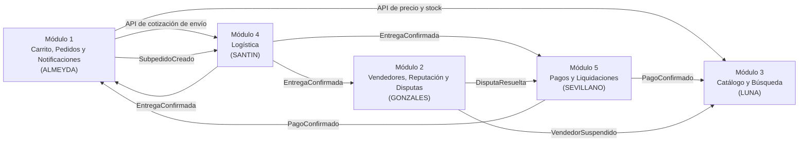

> [1. Caso de Negocio](../1.md) › [1.5. Estructura Inicial de Subsistemas / Módulos](1.5.md)

# 1.5. Estructura Inicial de Subsistemas / Módulos

El sistema se divide en cinco módulos de negocio, uno por integrante (RES-10), definidos por funcionalidad y cada uno con un desafío principal ligado a un atributo de calidad. Los módulos se comunican mediante eventos y APIs con contratos versionados ([2.1.6](../../2/2.1/2.1.6/2.1.6.md)), y cada uno se implementa como un microservicio independiente con su propia base de datos ([ADR-GLO-01, 4.6.1](../../4/4.6/4.6.1/4.6.1.md)).

| Módulo | Responsable | Desafío principal de calidad |
|---|---|---|
| 1. Carrito, Pedidos y Notificaciones | ALMEYDA | Rendimiento del checkout en campaña e integridad del precio (ESC-PED-03, ESC-PED-05) |
| 2. Vendedores, Reputación y Disputas | GONZALES | Seguridad frente a suplantación y reseñas falsas (ESC-VEN-05, ESC-VEN-06) |
| 3. Catálogo y Búsqueda | LUNA | Rendimiento y disponibilidad de la búsqueda en Cyber Wow (ESC-CAT-01, ESC-CAT-03) |
| 4. Logística | SANTIN | Interoperabilidad con couriers heterogéneos (ESC-LOG-07, ESC-LOG-08) |
| 5. Pagos y Liquidaciones | SEVILLANO | Disponibilidad y seguridad de los cobros (ESC-PAG-01, ESC-PAG-05) |

### Módulo 1: Carrito, Pedidos y Notificaciones (Almeyda)

Maneja el flujo completo de compra: agregar productos al carrito, proceso de checkout, cálculo de tarifas de envío en coordinación con Logística y confirmación del pedido. Gestiona el estado de cada pedido, valida que los precios no sean manipulados y envía notificaciones a ambas partes ante cada cambio de estado.

### Módulo 2: Vendedores, Reputación y Disputas (Gonzales)

Gestión del registro y verificación de identidad de los vendedores mediante RUC/DNI, bloqueando el acceso a quienes intenten suplantar identidad. Administra el sistema de reseñas, permitiendo calificar únicamente a compradores que completaron una compra real, y gestiona la resolución de disputas entre vendedores y compradores, coordinando con Pagos para reembolsos o liberación de dinero.

### Módulo 3: Catálogo y Búsqueda (Luna)

Permite a los vendedores publicar, editar y eliminar productos, incluyendo descripción, imágenes, precio y disponibilidad. Los compradores pueden buscar y filtrar productos por categoría, precio y otros atributos configurables. Incorpora un motor de búsqueda optimizado para responder en menos de 1 segundo incluso en picos de campaña, además de mecanismos de filtrado de productos prohibidos y contenido malicioso.

### Módulo 4: Logística (Santin)

Coordina la entrega de productos integrando a la plataforma con múltiples couriers, cada uno con su propia forma de comunicación (API o archivo). Publica el evento de entrega confirmada que libera el pago al vendedor, reasigna envíos a otro courier en caso de caída del servicio y rechaza confirmaciones de entrega falsas para evitar liberaciones indebidas de dinero.

### Módulo 5: Pagos y Liquidaciones (Sevillano)

Procesa los pagos de los compradores, incluyendo el cobro, la retención del monto hasta la confirmación de entrega y la liberación del pago al vendedor al finalizar el servicio. Gestiona también los reembolsos por disputas o cancelaciones, verifica la autenticidad de las notificaciones de la pasarela de pago y mantiene un historial de transacciones y conciliaciones diarias.

### Componentes transversales

Además de los módulos, el sistema necesita piezas compartidas que no pertenecen a un solo módulo:

| Componente | Función | Decisión |
|---|---|---|
| API Gateway e identidad | Punto único de entrada a las APIs; registro, inicio de sesión y roles de compradores, vendedores y personal interno. | [ADR-GLO-02 (4.6.1)](../../4/4.6/4.6.1/4.6.1.md) |
| Bus de eventos | Comunicación asíncrona entre módulos mediante eventos de dominio versionados. | [ADR-GLO-03 (4.6.2)](../../4/4.6/4.6.2/4.6.2.md) |
| Integración y despliegue continuo, infraestructura como código y observabilidad | Construcción, pruebas y despliegue automatizados; definición de la infraestructura; logs, métricas y alarmas. Responsable: LUNA. | [4.3](../../4/4.3/4.3.md) y [4.6.5](../../4/4.6/4.6.5/4.6.5.md) |

---

[⬅️ Anterior](../1.4/1.4.md) | [🏠 Home](../../README.md)
