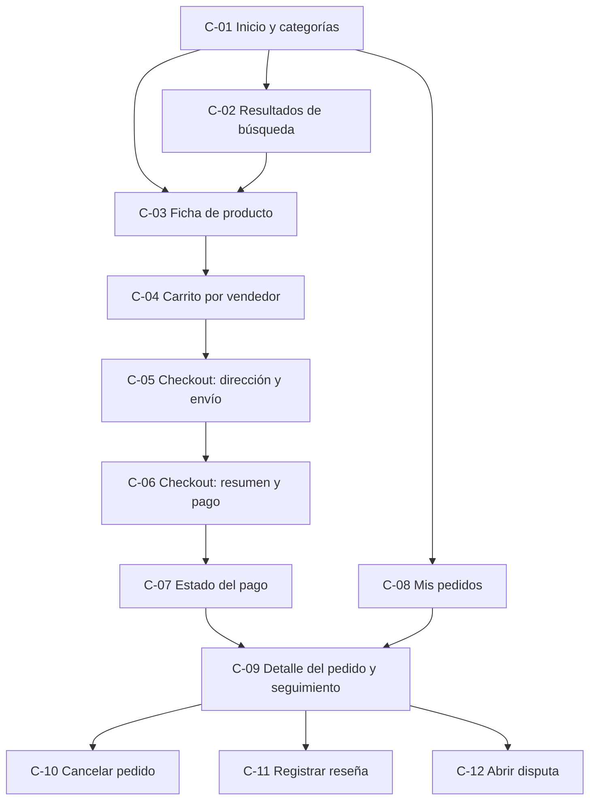
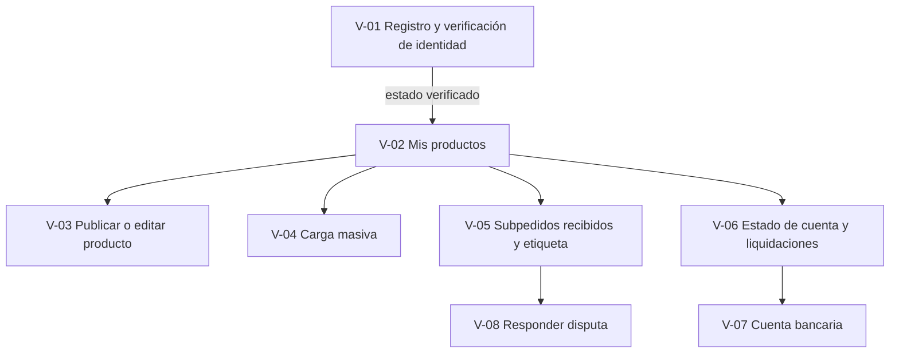
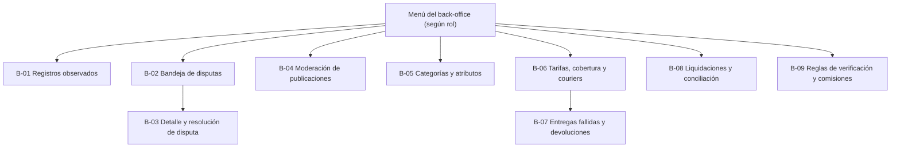

> [2. Requisitos del Sistema](../../2.md) › [2.1. Requisitos Funcionales](../2.1.md) › [2.1.7. Prototipos de Interfaz (Unificado)](2.1.7.md)

# 2.1.7. Prototipos de Interfaz (Unificado)

## Introducción

Esta sección reúne en un solo lugar los prototipos de interfaz de Qhatu. Su objetivo es mostrar que cada requisito funcional de los cinco módulos (2.1.1 a 2.1.5) tiene una pantalla donde el usuario lo ejecuta o donde ve su efecto. Qhatu tiene dos aplicaciones cliente, ambas web (ADR-GLO-08):

| Aplicación | Usuarios | Tecnología (ADR-GLO-08) |
|---|---|---|
| **Web Qhatu** | Compradores y vendedores. Un mismo usuario puede comprar y, si se registra como vendedor, entrar a la sección *Vender* | Web responsive (PWA) en React + TypeScript, usable desde computadoras y celulares (RES-08) |
| **Back-office** | Personal interno: analista de disputas, administrador de catálogo, coordinador logístico, responsable de liquidaciones y área de negocio | Web React + TypeScript, solo para usuarios internos |

Todas las aplicaciones entran por el API Gateway con un token JWT que emite el proveedor de identidad (ADR-GLO-02). El inicio de sesión no aparece como pantalla porque no es un requisito funcional de ningún módulo: lo resuelve el proveedor de identidad. Cada servicio autoriza por propiedad del recurso. Por eso, por ejemplo, un comprador solo ve sus pedidos (ESC-PED-06).

**Convención usada**

- Los wireframes son de **baja fidelidad** y están en texto: cajas con `+-|`, botones como `[ Botón ]`, campos como `[______]`, casillas como `[x]` / `[ ]`, opciones como `(o)` / `( )` y listas desplegables como `[Opción  v]`.
- Cada pantalla tiene un código (`C-nn` web compradores, `V-nn` web vendedores y `B-nn` back-office). Ese código se usa en los mapas de navegación y en la matriz de cobertura.
- Debajo de cada wireframe se indican los **requisitos cubiertos**, las **opciones disponibles**, el **flujo de datos** (qué se ingresa, a qué servicio va, qué responde y qué evento de 2.1.6 se dispara) y, cuando corresponde, la **táctica de usabilidad** visible.
- Los nombres de eventos y APIs son los del [Listado Consolidado (2.1.6)](../2.1.6/2.1.6.md): `PagoConfirmado`, `SubpedidoCreado`, `EntregaConfirmada`, `DisputaResuelta`, `VendedorSuspendido`, la API de precio y stock y la API de cotización de envío. Si una acción no publica ninguno de esos eventos, se indica así.

> **Nota sobre Figma.** El enunciado sugiere diseñar los prototipos en una herramienta como Figma o MarvelApp. Estos wireframes son la base del prototipo en Figma: este fija el contenido y la navegación, y Figma agregará el diseño visual. Cuando esté listo, sus capturas se agregarán en esta sección junto a cada wireframe. Las imágenes se guardarán en el repositorio, porque el enunciado no permite enlaces a herramientas externas como única fuente.

## Mapas de navegación

### Web Qhatu: compradores



### Web Qhatu: vendedores (sección *Vender*)



### Back-office



| Rol interno | Pantallas |
|---|---|
| Analista de disputas | B-01, B-02, B-03 |
| Administrador de catálogo | B-04, B-05 |
| Coordinador logístico | B-06, B-07 |
| Responsable de liquidaciones | B-08 |
| Área de negocio | B-09 |

## Web Qhatu: compradores

### C-01 Inicio y navegación por categorías

```text
+--------------------------------------------------------------------------+
| QHATU   [ Buscar productos...                         ] [ Buscar ]       |
|         Categorías v   Mis pedidos   Carrito (3)   Vender   Mi cuenta    |
+--------------------------------------------------------------------------+
| ! La búsqueda no está disponible en este momento. Puedes seguir          |
|   navegando por categorías y abrir cualquier producto.  (modo degradado) |
+--------------------------------------------------------------------------+
| CATEGORÍAS                    | DESTACADOS DE LA CATEGORÍA               |
|  > Moda                       |  +-----------+ +-----------+             |
|     - Polos                   |  | [imagen]  | | [imagen]  |             |
|     - Casacas                 |  | Polo alg. | | Casaca    |             |
|  > Hogar                      |  | S/ 39.90  | | S/ 129.00 |             |
|  > Tecnología                 |  | **** 4.6  | | **** 4.2  |             |
|  > Alimentos                  |  +-----------+ +-----------+             |
|  > Ver todas                  |  [ Ver más de Polos ]                    |
+--------------------------------------------------------------------------+
```

**Requisitos cubiertos:** RF-CAT-06, RF-CAT-04 (punto de entrada), RF-CAT-13 (punto de entrada).

**Opciones disponibles:** recorrer el árbol de categorías y subcategorías, abrir un producto, escribir en el buscador, ir al carrito, a Mis pedidos o a la sección *Vender*.

**Flujo de datos:** al cargar la pantalla se pide el árbol de categorías y los productos de la categoría elegida a `svc-catalogo` (REST `/v1` a través del API Gateway). Este servicio responde aunque el motor de búsqueda (`svc-busqueda`) esté caído. Si `svc-busqueda` no responde, la web muestra el aviso de **modo degradado** y la navegación por categorías y las fichas siguen funcionando (ESC-CAT-01). No se dispara ningún evento.

**Táctica de usabilidad visible:** *Mantener el modelo de sistema*. El aviso explica al usuario qué parte del sistema no está disponible y qué puede seguir haciendo.

### C-02 Resultados de búsqueda con filtros y orden

```text
+--------------------------------------------------------------------------+
| QHATU   [ polo alg                                    ] [ Buscar ]       |
|         +-----------------------------------------+                      |
|         | polo algodón hombre                     |  <- sugerencias      |
|         | polo algodón mujer                      |     (autocompletar)  |
|         | polo algodón pima                       |                      |
|         +-----------------------------------------+                      |
+--------------------------------------------------------------------------+
| FILTROS                  | 1,284 resultados para "polo algodón"          |
| Categoría                | Ordenar por: [ Relevancia        v ]          |
|  [x] Moda > Polos        |              (Relevancia / Precio / Novedad)  |
| Precio (S/)              |-----------------------------------------------|
|  De [____] a [____]      | [img] Polo algodón pima      S/ 49.90         |
| Talla                    |       Tienda Andina  **** 4.7  (230 reseñas)  |
|  [ ] S  [x] M  [ ] L     |       [ Ver producto ]                        |
| Color                    |-----------------------------------------------|
|  [ ] Negro [x] Blanco    | [img] Polo básico            S/ 29.90         |
| Reputación del vendedor  |       Moda Lima      ***  3.9  (41 reseñas)   |
|  ( ) 4 o más  ( ) 3 o más|       [ Ver producto ]                        |
| [ Aplicar ] [ Limpiar ]  |   < Anterior   1  2  3 ... 65   Siguiente >   |
+--------------------------------------------------------------------------+
```

**Requisitos cubiertos:** RF-CAT-04, RF-CAT-05, RF-CAT-13.

**Opciones disponibles:** escribir el texto y elegir una sugerencia, filtrar por categoría, rango de precio, atributos de la categoría (talla, color, etc.) y reputación del vendedor, ordenar por relevancia, precio o novedad, limpiar filtros, paginar y abrir un producto.

**Flujo de datos:** mientras el comprador escribe, la web pide sugerencias a `svc-busqueda`, que responde con una lista corta de términos. Al buscar se envían el texto, los filtros, el orden y la página a `svc-busqueda`, que consulta el índice y responde con los resultados, el total y los filtros disponibles (p95 de 1 s o menos, ESC-CAT-03). Los atributos que aparecen como filtro salen de la configuración de la categoría (B-05). No se dispara ningún evento. El índice se mantiene actualizado con `ProductoActualizado`, el evento interno Catálogo → Búsqueda.

**Táctica de usabilidad visible:** *Mantener el modelo de tareas*. El autocompletar anticipa lo que el comprador quiere buscar.

### C-03 Ficha de producto

```text
+--------------------------------------------------------------------------+
| QHATU   Moda > Polos > Polo algodón pima                                 |
+--------------------------------------------------------------------------+
|  +----------------------+   Polo algodón pima                            |
|  |                      |   S/ 49.90                                     |
|  |      [imagen 1]      |   Stock: 12 unidades                           |
|  |                      |   Talla: [ M  v ]   Color: [ Blanco v ]        |
|  +----------------------+   Cantidad: [ - ] 1 [ + ]                      |
|  [img2] [img3] [img4]       [ Agregar al carrito ]                       |
|                                                                          |
|  VENDEDOR                                                                |
|  Tienda Andina  (identidad verificada)                                   |
|  Reputación: **** 4.7 de 5  -  230 reseñas de compras reales             |
|  [ Ver perfil y reseñas ]                                                |
|--------------------------------------------------------------------------|
|  DESCRIPCIÓN                                                             |
|  Polo 100% algodón pima, cuello redondo...                               |
|  Material: algodón pima   Talla: S, M, L   Color: blanco, negro          |
|--------------------------------------------------------------------------|
|  RESEÑAS RECIENTES                                                       |
|  ***** "Llegó rápido y la tela es buena"  - comprador verificado         |
|  ****  "Talla un poco grande"              - comprador verificado        |
+--------------------------------------------------------------------------+
```

**Requisitos cubiertos:** RF-CAT-07, RF-VEN-06 (efecto), RF-CAT-11 (efecto: stock vigente), RF-PED-01 (agregar al carrito).

**Opciones disponibles:** ver imágenes, elegir los atributos de la variante y la cantidad, agregar al carrito, ver el perfil y las reseñas del vendedor.

**Flujo de datos:** la ficha se pide a `svc-catalogo`, que responde con los datos del producto, sus atributos, su precio y su stock. La descripción se muestra sanitizada (ESC-CAT-06). La reputación y las reseñas vienen del servicio de Vendedores (p95 de 800 ms o menos, ESC-VEN-03). Al pulsar *Agregar al carrito* se envían el producto, la variante y la cantidad al servicio de Pedidos, que responde con el carrito actualizado. No se dispara ningún evento. La ficha sigue disponible en modo degradado (ESC-CAT-01).

### C-04 Carrito agrupado por vendedor

```text
+--------------------------------------------------------------------------+
| MI CARRITO (3 productos)                                                 |
+--------------------------------------------------------------------------+
| VENDEDOR: Tienda Andina                                                  |
|  [img] Polo algodón pima  M / Blanco   [ - ] 2 [ + ]  S/  99.80 [Quitar] |
|  [img] Gorro de lana                   [ - ] 1 [ + ]  S/  35.00 [Quitar] |
|  Subtotal S/ 134.80   Envío estimado S/ 10.00   Total grupo S/ 144.80    |
|--------------------------------------------------------------------------|
| VENDEDOR: Casa Nazca                                                     |
|  [img] Juego de tazas x4               [ - ] 1 [ + ]  S/  59.00 [Quitar] |
|  Subtotal S/  59.00   Envío estimado S/ 12.00   Total grupo S/  71.00    |
|--------------------------------------------------------------------------|
| i Se eliminó "Lámpara de mesa" del carrito.   [ Deshacer ]               |
|--------------------------------------------------------------------------|
| Total (2 subpedidos): S/ 215.80                                          |
|                         [ Seguir comprando ]  [ Continuar con la compra ]|
+--------------------------------------------------------------------------+
```

**Requisitos cubiertos:** RF-PED-01, RF-PED-02.

**Opciones disponibles:** cambiar cantidades, quitar un producto, deshacer la eliminación, seguir comprando, continuar al checkout.

**Flujo de datos:** cada cambio de cantidad o eliminación se envía al servicio de Pedidos, que responde con el carrito agrupado por vendedor, el subtotal y el envío estimado de cada grupo. El carrito se guarda en el servidor para que se conserve entre sesiones (p95 de 300 ms o menos, ESC-PED-03). *Deshacer* vuelve a agregar el producto quitado. No se dispara ningún evento.

**Tácticas de usabilidad visibles:** *Deshacer* (recuperar el producto quitado) y *Agrupar* (el carrito se organiza en un grupo por vendedor, que será un subpedido).

### C-05 Checkout: dirección y cotización de envío

```text
+--------------------------------------------------------------------------+
| CHECKOUT    1. Dirección y envío  >  2. Resumen y pago  >  3. Estado     |
+--------------------------------------------------------------------------+
| DIRECCIÓN DE ENTREGA                                                     |
|  Nombre de quien recibe  [______________________________]                |
|  Departamento [ Lima  v ]  Provincia [ Lima v ]  Distrito [ Surco   v ]  |
|  Dirección    [______________________________________________]           |
|  Referencia   [______________________________________________]           |
|  Teléfono     [___________]                                              |
|  [ Cotizar envío ]                                                       |
|--------------------------------------------------------------------------|
| ENVÍO POR SUBPEDIDO                                                      |
|  Tienda Andina    S/ 10.00   llega en 2 a 3 días hábiles                 |
|  Casa Nazca       S/ 12.00   llega en 3 a 4 días hábiles                 |
|  i Para Casa Nazca se aplicó la tarifa estándar del distrito.            |
|--------------------------------------------------------------------------|
|                                  [ Volver al carrito ]  [ Continuar ]    |
+--------------------------------------------------------------------------+
```

**Requisitos cubiertos:** RF-PED-03, RF-LOG-01 (efecto).

**Opciones disponibles:** ingresar o editar la dirección, cotizar el envío, volver al carrito, continuar al resumen.

**Flujo de datos:** el distrito de destino se envía al servicio de Pedidos. Pedidos llama a la **API de cotización de envío** de Logística para cada subpedido (distrito de origen y destino, peso y dimensiones), y Logística responde con el costo y el plazo (p95 de 800 ms o menos, ESC-LOG-03). Si el cotizador no responde, Pedidos aplica la tarifa de respaldo por distrito y la pantalla lo indica con un aviso, sin bloquear la compra (ESC-PED-01). No se dispara ningún evento.

**Táctica de usabilidad visible:** *Mantener el modelo de sistema*. La barra de pasos 1-2-3 muestra en qué punto del checkout está el comprador, y el aviso de tarifa de respaldo explica de dónde sale el costo.

### C-06 Checkout: resumen y pago (pasarela y 3-D Secure)

```text
+--------------------------------------------------------------------------+
| CHECKOUT    1. Dirección y envío  >  2. Resumen y pago  >  3. Estado     |
+--------------------------------------------------------------------------+
| RESUMEN                                                                  |
|  Tienda Andina   2 productos   S/ 134.80 + envío S/ 10.00 = S/ 144.80    |
|  Casa Nazca      1 producto    S/  59.00 + envío S/ 12.00 = S/  71.00    |
|  TOTAL A PAGAR                                           S/ 215.80       |
|  ! El precio de "Gorro de lana" cambió de S/ 35.00 a S/ 38.00.           |
|    Revisa el resumen antes de pagar.        [ Actualizar resumen ]       |
|--------------------------------------------------------------------------|
| MEDIO DE PAGO                                                            |
|  (o) Tarjeta de crédito o débito   ( ) Otros medios de la pasarela       |
|  +--------------------------------------------------------------------+  |
|  | Campos de la pasarela (no los almacena Qhatu)                      |  |
|  | Número de tarjeta [____ ____ ____ ____]                            |  |
|  | Vencimiento [__/__]   CVV [___]   Titular [____________________]   |  |
|  +--------------------------------------------------------------------+  |
|  Tu dinero queda retenido hasta que recibas tu pedido (pago protegido).  |
|                                       [ Volver ]  [ Pagar S/ 215.80 ]    |
+--------------------------------------------------------------------------+

  Ventana de autenticación 3-D Secure (la muestra el banco emisor):
  +--------------------------------------------------+
  | Verificación de tu banco                         |
  | Ingresa el código enviado a tu celular ***-*12   |
  | Código [______]                                  |
  |                     [ Cancelar ]  [ Confirmar ]  |
  +--------------------------------------------------+
```

**Requisitos cubiertos:** RF-PED-04, RF-PED-05, RF-PAG-01, RF-CAT-10 (efecto).

**Opciones disponibles:** revisar el resumen por subpedido, actualizar el resumen si cambió un precio, elegir el medio de pago, ingresar los datos de la tarjeta, autenticarse con 3-D Secure, volver.

**Flujo de datos:**

1. Al confirmar, la web envía al servicio de Pedidos los productos, las cantidades, los montos mostrados y la dirección.
2. Pedidos consulta la **API de precio y stock** del Catálogo (p95 de 300 ms o menos, ESC-CAT-07). Si los montos no coinciden con los vigentes, rechaza la solicitud y la pantalla muestra el aviso de precio cambiado (ESC-PED-05). Si coinciden, crea el pedido y un subpedido por vendedor, y solicita el cobro al servicio de Pagos.
3. Los datos de la tarjeta se escriben en los campos de la pasarela y se tokenizan allí. El backend de Qhatu solo recibe el token y los últimos 4 dígitos (ESC-PAG-05).
4. El banco emisor puede pedir la autenticación 3-D Secure (ESC-PAG-08).

Todavía no se dispara ningún evento: `PagoConfirmado` se publica después, cuando llega el webhook verificado (C-07).

**Táctica de usabilidad visible:** *Cancelar*. El comprador puede cancelar la autenticación 3-D Secure y volver al resumen sin que se cobre nada.

### C-07 Estado del pago

```text
+--------------------------------------------------------------------------+
| CHECKOUT    1. Dirección y envío  >  2. Resumen y pago  >  3. Estado     |
+--------------------------------------------------------------------------+
|  Estado del pago del pedido N.º 10234                                    |
|                                                                          |
|  [####################..........]  Esperando confirmación del banco      |
|                                                                          |
|  ( ) Procesando   El pago se envió a la pasarela.                        |
|  (o) Pendiente    La pasarela tarda en responder. No vuelvas a pagar:    |
|                   estamos consultando el estado y te avisaremos.         |
|  ( ) Confirmado   Pedido confirmado. Recibirás un correo y un WhatsApp.  |
|  ( ) Rechazado    El banco rechazó el pago.  [ Intentar con otro medio ] |
|                                                                          |
|                         [ Ir a Mis pedidos ]  [ Seguir comprando ]       |
+--------------------------------------------------------------------------+
```

**Requisitos cubiertos:** RF-PAG-02 (efecto), RF-PAG-03 (efecto), RF-PED-06 (efecto), RF-PED-11 (efecto).

**Opciones disponibles:** esperar la confirmación, ir a Mis pedidos, seguir comprando, intentar con otro medio si el pago fue rechazado.

**Flujo de datos:** la web consulta el estado del pago al servicio de Pagos. Cuando la pasarela envía el webhook con firma válida, Pagos publica **`PagoConfirmado`** (ESC-PAG-06). Pedidos lo consume, confirma el pedido una sola vez y publica **`SubpedidoCreado`** para Logística y el vendedor (ESC-PED-07, ESC-PED-08). Catálogo también consume `PagoConfirmado` para descontar el stock. Si la pasarela no responde, el pago queda *Pendiente* y se resuelve sin cobrar dos veces (ESC-PAG-01).

**Táctica de usabilidad visible:** *Mantener el modelo de sistema*. La barra de progreso y el estado explícito (procesando, pendiente, confirmado o rechazado) evitan que el comprador pague dos veces por no saber qué pasó.

### C-08 Mis pedidos

```text
+--------------------------------------------------------------------------+
| MIS PEDIDOS                       Estado: [ Todos            v ]         |
+--------------------------------------------------------------------------+
| Pedido     Fecha        Total       Estado                               |
|--------------------------------------------------------------------------|
| N.º 10234  15/10/2026   S/ 215.80   En preparación (2 subpedidos)        |
|                                                         [ Ver detalle ]  |
| N.º 10187  02/10/2026   S/  89.00   Entregado                            |
|                                                         [ Ver detalle ]  |
| N.º 10101  20/09/2026   S/  45.50   Cancelado - reembolso realizado      |
|                                                         [ Ver detalle ]  |
+--------------------------------------------------------------------------+
```

**Requisitos cubiertos:** RF-PED-08, RF-PED-07 (efecto).

**Opciones disponibles:** filtrar por estado (pendiente de pago, pagado, en preparación, enviado, entregado, cancelado) y abrir el detalle.

**Flujo de datos:** la web pide al servicio de Pedidos la lista de pedidos del usuario del token. Pedidos responde solo con los pedidos de ese usuario (ESC-PED-06). Los estados se actualizan con los eventos `PagoConfirmado` y `EntregaConfirmada` y con los estados de Logística. No se dispara ningún evento.

### C-09 Detalle del pedido y seguimiento

```text
+--------------------------------------------------------------------------+
| PEDIDO N.º 10234            Pagado el 15/10/2026          [ Cancelar ]   |
+--------------------------------------------------------------------------+
| SUBPEDIDO A - Tienda Andina                       Estado: ENTREGADO      |
|  Polo algodón pima x2, Gorro de lana x1          Courier: Courier Sur    |
|  Seguimiento                                                             |
|   [x] Pagado              15/10 10:02                                    |
|   [x] En preparación      15/10 14:30                                    |
|   [x] Enviado             16/10 09:10                                    |
|   [x] Entregado           17/10 16:45  (evidencia: firma del receptor)   |
|  Plazo para reclamar: hasta el 24/10/2026                                |
|  [ Calificar al vendedor ]   [ Tengo un problema: abrir disputa ]        |
|--------------------------------------------------------------------------|
| SUBPEDIDO B - Casa Nazca                          Estado: ENVIADO        |
|  Juego de tazas x4                               Courier: Rápido Express |
|  Seguimiento                                                             |
|   [x] Pagado              15/10 10:02                                    |
|   [x] Enviado             16/10 11:20                                    |
|   [ ] Entregado                                                          |
|  ! Seguimiento no disponible por el momento.                             |
|    Último estado conocido: Enviado, 16/10 11:20.                         |
+--------------------------------------------------------------------------+
```

**Requisitos cubiertos:** RF-PED-08, RF-PED-07 (efecto), RF-LOG-08, RF-LOG-06 (efecto), RF-LOG-07 (efecto), RF-LOG-09 (efecto), RF-PAG-04 (efecto), RF-VEN-05 (punto de entrada), RF-VEN-08 (punto de entrada), RF-PED-10 (punto de entrada).

**Opciones disponibles:** ver cada subpedido con su courier y su historial de estados, ir a cancelar el pedido (solo si aún no fue despachado), calificar al vendedor y abrir una disputa (solo en subpedidos entregados y dentro del plazo de reclamo).

**Flujo de datos:** el detalle se pide al servicio de Pedidos (con control de propiedad, ESC-PED-06). El historial de cada envío se pide al servicio de seguimiento de Logística. Ese historial se arma con los estados que los couriers envían por API o webhook autenticado y con su archivo diario (ESC-LOG-04, ESC-LOG-07). Si el servicio de seguimiento falla, se muestra el último estado conocido con su fecha y hora (ESC-LOG-02). Cuando Logística publica **`EntregaConfirmada`**:

- Pagos inicia el periodo de reclamo (se muestra el plazo para reclamar).
- Vendedores habilita la reseña (ESC-VEN-08).
- Pedidos cambia el estado a *Entregado*.

Esta pantalla no dispara eventos.

### C-10 Cancelar pedido

```text
+--------------------------------------------------------------------------+
| CANCELAR PEDIDO N.º 10234                                                |
+--------------------------------------------------------------------------+
|  Solo puedes cancelar los subpedidos que aún no fueron despachados.      |
|                                                                          |
|  [x] Subpedido A - Tienda Andina   En preparación   S/ 144.80            |
|  [ ] Subpedido B - Casa Nazca      Enviado (no se puede cancelar)        |
|                                                                          |
|  Monto a reembolsar: S/ 144.80 al mismo medio de pago                    |
|                                                                          |
|  ¿Confirmas la cancelación?                                              |
|                     [ No, volver al pedido ]  [ Sí, cancelar pedido ]    |
|--------------------------------------------------------------------------|
|  Resultado: Cancelación registrada. Reembolso: en proceso.               |
+--------------------------------------------------------------------------+
```

**Requisitos cubiertos:** RF-PED-10, RF-PAG-06 (efecto), RF-CAT-11 (efecto: reposición de stock).

**Opciones disponibles:** elegir los subpedidos aún no despachados, confirmar la cancelación o volver sin cambios.

**Flujo de datos:** la web envía el pedido y los subpedidos elegidos al servicio de Pedidos. Pedidos verifica que no estén despachados, pasa el estado a *cancelado* y solicita el reembolso a Pagos, que lo ejecuta (RF-PAG-06, ESC-PAG-09). Catálogo repone el stock de esos productos (RF-CAT-11). En 2.1.6 no hay un evento con nombre propio para la cancelación: cómo se comunica Pedidos con Pagos y con Catálogo lo define el ADR de cada módulo. El comprador recibe la notificación del cambio de estado (RF-PED-11).

**Táctica de usabilidad visible:** *Cancelar*. La cancelación pide confirmación y el comprador puede volver sin cambios.

### C-11 Registrar reseña

```text
+--------------------------------------------------------------------------+
| CALIFICAR AL VENDEDOR - Subpedido A, Tienda Andina                       |
+--------------------------------------------------------------------------+
|  Entregado el 17/10/2026 - compra verificada                             |
|                                                                          |
|  Calificación:   ( )1   ( )2   ( )3   ( )4   (o)5                        |
|  Comentario:                                                             |
|  [______________________________________________________________]        |
|  [______________________________________________________________]        |
|                                                                          |
|                                      [ Cancelar ]  [ Publicar reseña ]   |
+--------------------------------------------------------------------------+
  Si el subpedido no fue entregado: "Podrás calificar cuando recibas tu
  pedido." (el botón Publicar reseña aparece deshabilitado)
```

**Requisitos cubiertos:** RF-VEN-05, RF-VEN-06 (efecto), RF-VEN-07 (proceso que se ejecuta al recibir la reseña).

**Opciones disponibles:** elegir una calificación de 1 a 5, escribir un comentario, publicar o cancelar.

**Flujo de datos:** la calificación, el comentario y el subpedido se envían al servicio de Vendedores. Este acepta la reseña solo si ya recibió `EntregaConfirmada` para ese subpedido (ESC-VEN-06), recalcula la reputación (visible en 1 min o menos, ESC-VEN-04) y revisa si hay patrones sospechosos (RF-VEN-07). No se dispara ningún evento de integración.

### C-12 Abrir disputa con evidencias

```text
+--------------------------------------------------------------------------+
| ABRIR DISPUTA - Subpedido A, Tienda Andina                               |
+--------------------------------------------------------------------------+
|  Plazo para reclamar: hasta el 24/10/2026                                |
|                                                                          |
|  Motivo:  [ Producto distinto al publicado            v ]                |
|           (No llegó / Llegó dañado / Distinto al publicado / Otro)       |
|  Descripción:                                                            |
|  [______________________________________________________________]        |
|  Evidencias (fotos o documentos):                                        |
|  [ Adjuntar archivo ]   foto_polo_1.jpg  [Quitar]                        |
|                         foto_etiqueta.jpg [Quitar]                       |
|                                                                          |
|  Mientras la disputa esté abierta, el pago al vendedor queda retenido.   |
|                                   [ Cancelar ]  [ Enviar disputa ]       |
+--------------------------------------------------------------------------+
```

**Requisitos cubiertos:** RF-VEN-08, RF-PAG-04 (efecto: el pago sigue retenido y no se libera mientras haya disputa abierta).

**Opciones disponibles:** elegir el motivo, describir el problema, adjuntar y quitar evidencias, enviar o cancelar.

**Flujo de datos:** el motivo, la descripción y las evidencias se envían al servicio de Vendedores (disputas). Este valida que el subpedido esté dentro del periodo de reclamo y registra la disputa sin perder casos aunque falle una instancia (ESC-VEN-02). Mientras la disputa siga abierta, Pagos no libera los fondos. Aquí no se dispara ningún evento: `DisputaResuelta` se publica recién cuando el analista resuelve el caso (B-03).

## Web Qhatu: vendedores

### V-01 Registro y verificación de identidad

```text
+--------------------------------------------------------------------------+
| VENDER EN QHATU - Registro de vendedor                                   |
+--------------------------------------------------------------------------+
|  Tipo:  (o) Persona natural (DNI)   ( ) Empresa (RUC)                    |
|  Nombres y apellidos / Razón social [______________________________]     |
|  DNI / RUC   [___________]                                               |
|  Correo      [______________________]  Celular [_________]               |
|  Dirección de despacho (distrito) [ Surco  v ] [__________________]      |
|  Documentos adicionales de la categoría (si aplica):                     |
|   Registro sanitario (Alimentos)  [ Adjuntar archivo ]                   |
|                                              [ Enviar registro ]         |
|--------------------------------------------------------------------------|
|  ESTADO DE VERIFICACIÓN                                                  |
|  ( ) PENDIENTE  Estamos validando tu identidad con RENIEC/SUNAT.         |
|                 Si el servicio no responde, lo reintentamos solo.        |
|  (o) VERIFICADO Ya puedes publicar productos.  [ Ir a Mis productos ]    |
|  ( ) OBSERVADO  Los datos no coinciden con el titular del documento.     |
|                 Un analista revisará tu registro.                        |
+--------------------------------------------------------------------------+
```

**Requisitos cubiertos:** RF-VEN-01, RF-VEN-02 (efecto), RF-VEN-04 (efecto), RF-VEN-11 (efecto: documentos exigidos por categoría).

**Opciones disponibles:** elegir persona natural o empresa, ingresar los datos y el documento, adjuntar los documentos que exija la categoría, enviar el registro y consultar el estado.

**Flujo de datos:** los datos se envían al servicio de Vendedores. El registro siempre se acepta y queda *pendiente* mientras se valida la titularidad con RENIEC/SUNAT. Si ese servicio externo no responde, se reintenta automáticamente (ESC-VEN-01). El resultado es *verificado* u *observado*. Un registro observado pasa a revisión manual (B-01, ESC-VEN-05). Solo con estado *verificado* se habilita la publicación (V-02). No se dispara ningún evento de 2.1.6.

**Táctica de usabilidad visible:** *Mantener el modelo de sistema*. El estado de verificación se muestra de forma explícita, con el motivo y el siguiente paso.

### V-02 Mis productos (editar y despublicar)

```text
+--------------------------------------------------------------------------+
| VENDER > MIS PRODUCTOS                                                   |
|   [ + Publicar producto ]  [ Carga masiva ]   Buscar [____________]      |
+--------------------------------------------------------------------------+
| Producto              Precio     Stock  Estado                Acciones   |
|--------------------------------------------------------------------------|
| Polo algodón pima     S/ 49.90   12     Publicado     [Editar] [Pausar]  |
|                                                                [Eliminar]|
| Gorro de lana         S/ 38.00    0     Pausado       [Editar] [Activar] |
| Crema artesanal       S/ 25.00   30     En revisión   [Editar]           |
|                                         (moderación)                     |
|--------------------------------------------------------------------------|
| i "Gorro de lana" quedó pausado.                         [ Deshacer ]    |
+--------------------------------------------------------------------------+
  Si el vendedor no está verificado: "Podrás publicar cuando tu identidad
  esté verificada." (los botones de publicar aparecen deshabilitados)
```

**Requisitos cubiertos:** RF-CAT-16, RF-CAT-02, RF-VEN-04 (efecto), RF-CAT-09 (efecto: estado *En revisión*).

**Opciones disponibles:** publicar un producto nuevo, ir a la carga masiva, buscar en los productos propios, editar, pausar, activar, eliminar y deshacer la última pausa.

**Flujo de datos:** la lista se pide a `svc-catalogo`, que responde solo con los productos del vendedor del token. Pausar, activar o eliminar envía el cambio de estado a `svc-catalogo`, que lo guarda y publica `ProductoActualizado` (evento interno Catálogo → Búsqueda) para actualizar el índice. Ningún evento sale del módulo.

**Táctica de usabilidad visible:** *Deshacer*. La pausa de un producto se puede revertir desde el aviso.

### V-03 Publicar o editar producto (atributos por categoría)

```text
+--------------------------------------------------------------------------+
| VENDER > PUBLICAR PRODUCTO                                               |
+--------------------------------------------------------------------------+
|  Categoría   [ Moda > Polos                  v ]                         |
|  Título      [__________________________________________]                |
|  Descripción [__________________________________________]                |
|              [__________________________________________]                |
|  Precio S/   [________]     Stock [_____]                                |
|  Imágenes    [ Subir imágenes ]  img1.jpg  img2.jpg  [Quitar]            |
|--------------------------------------------------------------------------|
|  ATRIBUTOS DE LA CATEGORÍA "Polos"   (los define el catálogo)            |
|   Talla *     [x] S  [x] M  [x] L  [ ] XL                                |
|   Color *     [ Blanco  v ]  [ + Agregar color ]                         |
|   Material    [ Algodón pima v ]                                         |
|--------------------------------------------------------------------------|
|  i Las publicaciones con términos o categorías prohibidas pasan a        |
|    revisión antes de ser visibles.                                       |
|                          [ Cancelar ]  [ Guardar borrador ] [ Publicar ] |
+--------------------------------------------------------------------------+
```

**Requisitos cubiertos:** RF-CAT-01, RF-CAT-02, RF-CAT-08 (efecto: atributos configurables), RF-CAT-09 (efecto), RF-VEN-04 (efecto).

**Opciones disponibles:** elegir la categoría (el formulario carga sus atributos), completar los datos, subir y quitar imágenes, guardar como borrador, publicar o cancelar.

**Flujo de datos:**

1. Al elegir la categoría se piden sus atributos a `svc-catalogo` (configurados en B-05).
2. Las imágenes se suben al almacenamiento de imágenes (S3 + CloudFront) y la web recibe sus referencias.
3. Al publicar se envían los datos y las referencias a `svc-catalogo`. Este verifica que el vendedor esté verificado (RF-VEN-04), sanitiza la descripción (ESC-CAT-06) y revisa los términos prohibidos.
4. Si todo está bien, publica el producto. Si encuentra términos o categorías prohibidas, lo retiene *En revisión* (ESC-CAT-05).
5. Se publica `ProductoActualizado` (interno) para indexar el producto.

**Táctica de usabilidad visible:** *Cancelar*. El vendedor puede salir sin guardar.

### V-04 Carga masiva con progreso y reporte

```text
+--------------------------------------------------------------------------+
| VENDER > CARGA MASIVA                                                    |
+--------------------------------------------------------------------------+
|  1. Descarga la plantilla de la categoría: [ Moda > Polos v ] [Plantilla]|
|  2. Sube el archivo:  [ Seleccionar archivo ]  polos_octubre.csv         |
|                                                     [ Iniciar carga ]    |
|--------------------------------------------------------------------------|
|  PROGRESO                                                                |
|  [##########################..............]  1,300 de 2,000 filas (65%)  |
|  Aceptadas: 1,262   Rechazadas: 38   Tiempo estimado: 3 min              |
|  Puedes salir de esta pantalla: la carga sigue en segundo plano.         |
|                                                   [ Cancelar carga ]     |
|--------------------------------------------------------------------------|
|  REPORTE (al terminar)                                                   |
|  Fila  Producto            Resultado   Motivo                            |
|  14    Polo rayas          Rechazada   Falta el atributo "Talla"         |
|  87    Polo estampado      Rechazada   Precio inválido                   |
|  ...                                          [ Descargar reporte ]      |
+--------------------------------------------------------------------------+
```

**Requisitos cubiertos:** RF-CAT-03, RF-CAT-14, RF-CAT-08 (efecto: la plantilla usa los atributos de la categoría), RF-CAT-09 (efecto: filas retenidas por moderación).

**Opciones disponibles:** elegir la categoría y descargar su plantilla, seleccionar el archivo, iniciar la carga, ver el avance, cancelar la carga y descargar el reporte de filas aceptadas y rechazadas.

**Flujo de datos:**

1. El archivo se envía a `svc-catalogo`, que lo acepta y lo procesa en segundo plano. La web consulta el avance de la carga (filas procesadas, aceptadas y rechazadas).
2. Cada fila aceptada se valida como en V-03 y genera `ProductoActualizado` (interno) para indexarla. Los productos quedan visibles en 10 min o menos sin afectar la búsqueda (ESC-CAT-04).
3. *Cancelar carga* detiene las filas que aún no se procesaron. El reporte indica cuáles quedaron cargadas.

Ningún evento sale del módulo.

**Tácticas de usabilidad visibles:** *Mantener el modelo de sistema* (barra de progreso con filas procesadas y tiempo estimado), *Cancelar* (detener la carga en curso) y *Agrupar* (una sola operación publica muchos productos).

### V-05 Subpedidos recibidos y etiqueta de envío

```text
+--------------------------------------------------------------------------+
| VENDER > SUBPEDIDOS RECIBIDOS        Estado: [ Por despachar v ]         |
+--------------------------------------------------------------------------+
| Subpedido  Fecha   Productos              Courier         Estado         |
|--------------------------------------------------------------------------|
| A-10234    15/10   Polo pima x2, Gorro x1 Courier Sur     En preparación |
|            [ Ver etiqueta ]  [ Marcar listo para despacho ]              |
| A-10240    15/10   Polo básico x1         Reasignando...  Guía en        |
|            (la guía se generará en breve)                 generación     |
| A-10198    10/10   Gorro x2               Rápido Express  Enviado        |
|            [ Ver seguimiento ]                                           |
| A-10150    05/10   Polo pima x1           Courier Sur     En disputa     |
|            [ Responder disputa ]                                         |
+--------------------------------------------------------------------------+

  ETIQUETA DE ENVÍO - Subpedido A-10234
  +--------------------------------------------------+
  | Courier Sur          Guía N.º CS-558812          |
  | Destinatario: María P.   Distrito: Surco         |
  | Dirección: Av. ... (visible hasta 30 días        |
  |            después de la entrega)                |
  | Bultos: 1   Peso: 0.8 kg                         |
  |                        [ Imprimir ] [ Cerrar ]   |
  +--------------------------------------------------+
```

**Requisitos cubiertos:** RF-PED-09, RF-LOG-03 (efecto), RF-LOG-04 (efecto), RF-LOG-05 (efecto), RF-LOG-08, RF-LOG-11 (efecto), RF-VEN-09 (punto de entrada).

**Opciones disponibles:** filtrar por estado, ver e imprimir la etiqueta, marcar el subpedido como listo para despacho, ver el seguimiento y responder una disputa.

**Flujo de datos:** cuando Pedidos publica **`SubpedidoCreado`**, el subpedido aparece en esta lista y Logística asigna el courier y genera la guía. Si la API del courier no responde, el subpedido muestra *Reasignando* o *Guía en generación* mientras Logística lo reasigna o reintenta (ESC-LOG-01). La lista se pide al servicio de Pedidos. La etiqueta y el seguimiento se piden a Logística, que solo entrega los datos mínimos del destinatario y por tiempo limitado (ESC-LOG-06). *Marcar listo para despacho* envía el cambio de estado a Pedidos. No se dispara ningún evento de 2.1.6.

### V-06 Estado de cuenta y liquidaciones

```text
+--------------------------------------------------------------------------+
| VENDER > ESTADO DE CUENTA            Periodo: [ Octubre 2026 v ]         |
+--------------------------------------------------------------------------+
|  Retenido        En periodo de reclamo     Liberado       Comisiones     |
|  S/ 1,250.00     S/ 430.00                 S/ 2,980.00    S/ 298.00      |
|--------------------------------------------------------------------------|
|  MOVIMIENTOS                                                             |
|  Fecha  Subpedido  Concepto                      Monto      Estado       |
|  17/10  A-10234    Venta                         S/ 144.80  En reclamo   |
|                    (se libera el 24/10 si no hay disputa)                |
|  12/10  A-10198    Venta                         S/  76.00  Liberado     |
|  12/10  A-10198    Comisión categoría Moda (10%) -S/   7.60              |
|  08/10  A-10150    Venta                         S/  49.90  Retenido     |
|                    (disputa abierta)                                     |
|  05/10  A-10101    Reembolso por cancelación     -S/  45.50              |
|--------------------------------------------------------------------------|
|  LIQUIDACIONES                                                           |
|  Semana        Monto transferido   Cuenta        Estado                  |
|  06-12/10      S/ 1,540.00         BCP ***4521   Transferida             |
|                                   [ Cuenta bancaria ] [ Descargar ]      |
+--------------------------------------------------------------------------+
```

**Requisitos cubiertos:** RF-PAG-04 (efecto: montos retenidos, en reclamo y liberados), RF-PAG-05 (efecto: comisión descontada), RF-PAG-06 (efecto: reembolsos), RF-PAG-07 (efecto: liquidaciones).

**Opciones disponibles:** elegir el periodo, ver los saldos y los movimientos, ver las liquidaciones, descargar el estado de cuenta e ir a la cuenta bancaria.

**Flujo de datos:** la web pide al servicio de Pagos el estado de cuenta del vendedor del token. Pagos responde con los saldos y los movimientos:

- Un monto queda *retenido* al confirmarse el pago.
- Pasa a *En reclamo* cuando llega `EntregaConfirmada`.
- Se *libera* (descontando la comisión de la categoría) al vencer el plazo de reclamo sin disputa.
- Los reembolsos vienen de `DisputaResuelta` o de una cancelación.

Esta pantalla no dispara eventos.

### V-07 Cuenta bancaria (segundo factor y periodo de espera)

```text
+--------------------------------------------------------------------------+
| VENDER > CUENTA BANCARIA DE LIQUIDACIÓN                                  |
+--------------------------------------------------------------------------+
|  Cuenta actual: BCP  Ahorros  ***4521   Titular: Tienda Andina SAC       |
|--------------------------------------------------------------------------|
|  CAMBIAR CUENTA                                                          |
|  Banco [ Interbank v ]  Tipo [ Corriente v ]                             |
|  N.º de cuenta / CCI [______________________]                            |
|  Titular (debe coincidir con el vendedor) [______________________]       |
|                                               [ Continuar ]              |
|--------------------------------------------------------------------------|
|  SEGUNDO FACTOR                                                          |
|  Ingresa el código enviado a tu celular ***-*12   [______]               |
|                                  [ Cancelar ]  [ Confirmar cambio ]      |
|--------------------------------------------------------------------------|
|  ! Cambio registrado. Te avisamos por correo (canal alterno).            |
|    La nueva cuenta se usará para liquidar desde el 21/10/2026 18:00      |
|    (periodo de espera de 48 h). Hasta entonces se usa la cuenta actual.  |
+--------------------------------------------------------------------------+
```

**Requisitos cubiertos:** RF-PAG-08.

**Opciones disponibles:** ver la cuenta actual, ingresar la nueva cuenta, confirmar con el segundo factor o cancelar el cambio.

**Flujo de datos:** los datos de la nueva cuenta se envían al servicio de Pagos, que pide el segundo factor. Al validarlo, registra la cuenta como *en espera*, avisa al vendedor por un canal alterno en menos de 1 min y no la usa para liquidar hasta que pasen 48 h (ESC-PAG-07). No se dispara ningún evento de 2.1.6.

**Táctica de usabilidad visible:** *Cancelar*. El vendedor puede abandonar el cambio antes de confirmar el segundo factor.

### V-08 Responder disputa

```text
+--------------------------------------------------------------------------+
| VENDER > DISPUTA D-0451  (Subpedido A-10150)          Estado: ABIERTA    |
+--------------------------------------------------------------------------+
|  Motivo del comprador: Producto distinto al publicado                    |
|  Evidencias del comprador: foto_polo_1.jpg  foto_etiqueta.jpg            |
|  El pago de este subpedido está retenido hasta que se resuelva.          |
|--------------------------------------------------------------------------|
|  MENSAJES                                                                |
|  [Comprador 18/10 10:00] La talla no es la que pedí.                     |
|  [Analista  18/10 15:20] Vendedor, por favor envíe su evidencia.         |
|--------------------------------------------------------------------------|
|  Tu respuesta:                                                           |
|  [______________________________________________________________]        |
|  Evidencias:  [ Adjuntar archivo ]  guia_despacho.pdf  [Quitar]          |
|                                                [ Enviar respuesta ]      |
+--------------------------------------------------------------------------+
```

**Requisitos cubiertos:** RF-VEN-09 (parte del vendedor: evidencias y mensajes).

**Opciones disponibles:** ver el motivo y las evidencias del comprador, leer los mensajes, responder y adjuntar evidencias.

**Flujo de datos:** el mensaje y las evidencias se envían al servicio de Vendedores (disputas), que los agrega al caso para que el analista los revise en B-03. No se dispara ningún evento: `DisputaResuelta` se publica solo cuando el analista resuelve el caso.

## Back-office

### B-01 Revisión de registros observados

```text
+--------------------------------------------------------------------------+
| BACK-OFFICE > VENDEDORES > REGISTROS OBSERVADOS           Analista: J.R. |
+--------------------------------------------------------------------------+
| Fecha   Vendedor             Documento     Motivo de la observación      |
|--------------------------------------------------------------------------|
| 18/10   Tienda Andina SAC    RUC 205...    Titular no coincide con DNI   |
|                                                         [ Revisar ]      |
| 18/10   Juan Q.              DNI 4567...   Nombre distinto en RENIEC     |
|                                                         [ Revisar ]      |
|--------------------------------------------------------------------------|
| DETALLE - Tienda Andina SAC                                              |
|  Datos ingresados: razón social, RUC, representante, contacto            |
|  Respuesta RENIEC/SUNAT: representante legal distinto                    |
|  Documentos adjuntos: ficha_ruc.pdf                                      |
|  Comentario [________________________________________________]           |
|                                     [ Rechazar ]  [ Aprobar ]            |
+--------------------------------------------------------------------------+
```

**Requisitos cubiertos:** RF-VEN-03, RF-VEN-02 (efecto).

**Opciones disponibles:** ver la cola de registros observados, abrir el detalle, comentar y aprobar o rechazar.

**Flujo de datos:** la cola y el detalle se piden al servicio de Vendedores. La decisión y el comentario vuelven al mismo servicio. Si se aprueba, el vendedor pasa a *verificado* y se le habilita la publicación. Si se rechaza, no puede publicar (ESC-VEN-05). No se dispara ningún evento de 2.1.6.

### B-02 Bandeja de disputas

```text
+--------------------------------------------------------------------------+
| BACK-OFFICE > DISPUTAS     [ Disputas ]  [ Reseñas marcadas (4) ]        |
|   Estado [ Abiertas v ]   Buscar subpedido o vendedor [____________]     |
+--------------------------------------------------------------------------+
| Disputa  Abierta  Subpedido  Comprador  Vendedor        Motivo    Estado |
|--------------------------------------------------------------------------|
| D-0451   18/10    A-10150    María P.   Tienda Andina   Distinto  Abierta|
| D-0447   17/10    B-10122    Luis R.    Casa Nazca      No llegó  Espera |
|                                                         vendedor         |
|--------------------------------------------------------------------------|
| Pestaña "Reseñas marcadas": reseñas que el sistema marcó como            |
| sospechosas (cuentas relacionadas, ráfagas) para revisión del analista.  |
+--------------------------------------------------------------------------+
```

**Requisitos cubiertos:** RF-VEN-09, RF-VEN-07 (efecto: pestaña *Reseñas marcadas*).

**Opciones disponibles:** filtrar por estado, buscar por subpedido o vendedor, abrir una disputa, ver las reseñas marcadas como sospechosas.

**Flujo de datos:** las listas se piden al servicio de Vendedores. Las reseñas marcadas son el resultado del proceso automático RF-VEN-07 (cuentas sospechosas marcadas en 24 h o menos, ESC-VEN-06). No se dispara ningún evento.

### B-03 Detalle y resolución de disputa

```text
+--------------------------------------------------------------------------+
| BACK-OFFICE > DISPUTA D-0451                          Estado: ABIERTA    |
+--------------------------------------------------------------------------+
|  Subpedido A-10150   Monto S/ 49.90   Entregado 06/10   Reclamo 07/10    |
|  EVIDENCIAS                                                              |
|   Comprador: foto_polo_1.jpg  foto_etiqueta.jpg                          |
|   Vendedor:  guia_despacho.pdf                                           |
|  MENSAJES                                                                |
|   [Comprador] La talla no es la que pedí.                                |
|   [Vendedor]  Se envió la talla indicada en el pedido.                   |
|   Nuevo mensaje para [ Ambos v ] [____________________________] [Enviar] |
|--------------------------------------------------------------------------|
|  RESOLUCIÓN                                                              |
|   (o) A favor del comprador - reembolso total (S/ 49.90)                 |
|   ( ) A favor del comprador - reembolso parcial  S/ [______]             |
|   ( ) A favor del vendedor - liberar el pago                             |
|   Sustento [________________________________________________]            |
|                                [ Cancelar ]  [ Resolver disputa ]        |
|--------------------------------------------------------------------------|
|  [ Suspender vendedor por fraude o incumplimiento ]                      |
|   -> "¿Suspender a Tienda Andina? Sus productos dejarán de mostrarse."   |
|                                [ No ]  [ Sí, suspender ]                 |
+--------------------------------------------------------------------------+
```

**Requisitos cubiertos:** RF-VEN-09, RF-VEN-10, RF-PAG-06 (efecto), RF-CAT-12 (efecto).

**Opciones disponibles:** revisar las evidencias de ambas partes, enviar mensajes, elegir la resolución (reembolso total, reembolso parcial o liberación del pago), escribir el sustento, resolver, y suspender al vendedor con confirmación.

**Flujo de datos:**

- **Resolver:** la resolución y el monto se envían al servicio de Vendedores. Este cierra el caso y publica **`DisputaResuelta`** con el monto a reembolsar, en 30 s o menos (ESC-VEN-07). Pagos lo consume y ejecuta el reembolso o libera el pago.
- **Suspender:** se envía la suspensión al servicio de Vendedores, que publica **`VendedorSuspendido`**. Catálogo lo consume y oculta todos los productos del vendedor del catálogo y del índice en 5 min o menos (ESC-CAT-08).

**Táctica de usabilidad visible:** *Cancelar*. La resolución se puede abandonar antes de confirmarla, y la suspensión pide una confirmación explícita.

### B-04 Moderación de publicaciones

```text
+--------------------------------------------------------------------------+
| BACK-OFFICE > CATÁLOGO > MODERACIÓN          Pendientes: 23              |
+--------------------------------------------------------------------------+
| Fecha   Producto             Vendedor        Motivo de retención         |
|--------------------------------------------------------------------------|
| 18/10   "Crema artesanal"    Hierbas Cusco   Término: "medicinal"        |
|                                                        [ Revisar ]       |
| 18/10   "Réplica reloj X"    Moda Lima       Término: "réplica"          |
|                                                        [ Revisar ]       |
|--------------------------------------------------------------------------|
| REVISIÓN - "Crema artesanal"                                             |
|  [imagen]  Categoría: Belleza   Precio: S/ 25.00                         |
|  Descripción (sanitizada): Crema de hierbas andinas, uso medicinal...    |
|  Término detectado resaltado: >medicinal<                                |
|  Motivo del rechazo [ Producto prohibido v ] [______________________]    |
|                                     [ Rechazar ]  [ Aprobar ]            |
+--------------------------------------------------------------------------+
```

**Requisitos cubiertos:** RF-CAT-09.

**Opciones disponibles:** ver la cola de publicaciones retenidas, revisar cada una con el término detectado, aprobar o rechazar con un motivo.

**Flujo de datos:** la cola y el detalle se piden a `svc-catalogo`. La decisión vuelve al mismo servicio. Si se aprueba, el producto se hace visible y se publica `ProductoActualizado` (interno) para indexarlo. Si se rechaza, el producto no se publica y el vendedor ve el motivo en V-02. La revisión se hace en 24 h o menos (ESC-CAT-05). Ningún evento sale del módulo.

### B-05 Configurar categorías y atributos

```text
+--------------------------------------------------------------------------+
| BACK-OFFICE > CATÁLOGO > CATEGORÍAS Y ATRIBUTOS                          |
+--------------------------------------------------------------------------+
| ÁRBOL DE CATEGORÍAS          | CATEGORÍA: Moda > Polos                   |
|  > Moda                      |  Nombre [ Polos               ]           |
|     - Polos   <              |  Categoría padre [ Moda       v ]         |
|     - Casacas                |  Términos prohibidos de la categoría      |
|  > Hogar                     |   [ réplica, imitación        ]           |
|  > Alimentos                 |-------------------------------------------|
| [ + Nueva categoría ]        |  ATRIBUTOS                                |
|                              |  Nombre    Tipo        Valores    Oblig.  |
|                              |  Talla     Lista       S,M,L,XL   [x]     |
|                              |  Color     Lista       (abierta)  [x]     |
|                              |  Material  Lista       Algodón..  [ ]     |
|                              |  [ + Agregar atributo ]                   |
|                              |              [ Cancelar ] [ Guardar ]     |
+--------------------------------------------------------------------------+
| ÍNDICE DE BÚSQUEDA   Última reconstrucción: 12/11 03:10 (100,000 prod.)  |
|                      [ Reconstruir índice ]   Avance: ---                |
+--------------------------------------------------------------------------+
```

**Requisitos cubiertos:** RF-CAT-08, RF-CAT-15, RF-CAT-09 (configuración de los términos prohibidos que usa la moderación).

**Opciones disponibles:** recorrer el árbol, crear una categoría, editar el nombre y la categoría padre, mantener los términos prohibidos, agregar o editar atributos (tipo, valores, obligatorio), guardar o cancelar, y reconstruir el índice de búsqueda viendo su avance.

**Flujo de datos:** la categoría y sus atributos se envían a `svc-catalogo`, que guarda la configuración. Queda vigente sin cambios de código ni despliegues (ESC-CAT-09). A partir de ella se arman los formularios de V-03, las plantillas de V-04 y los filtros de C-02. *Reconstruir índice* pide a `svc-busqueda` que cree un índice nuevo a partir de todos los productos de `svc-catalogo` y cambie el alias al terminar, sin cortar la búsqueda (ADR-CAT-02). Ningún evento sale del módulo.

### B-06 Tarifas, cobertura y couriers

```text
+--------------------------------------------------------------------------+
| BACK-OFFICE > LOGÍSTICA    [ Tarifas y cobertura ]  [ Couriers ]         |
+--------------------------------------------------------------------------+
| TARIFAS POR DISTRITO                   Courier [ Courier Sur v ]         |
|  Origen     Destino      Hasta 1 kg   Kg adic.   Plazo     Cobertura     |
|  Surco      Miraflores   S/ 8.00      S/ 1.50    1-2 días  [x]           |
|  Surco      Arequipa     S/ 18.00     S/ 3.00    3-4 días  [x]           |
|  Surco      Iquitos      -            -          -         [ ]           |
|  Tarifa de respaldo del distrito (si el cotizador falla): S/ [_____]     |
|  [ + Agregar fila ]                       [ Cancelar ]  [ Guardar ]      |
|--------------------------------------------------------------------------|
| COURIERS                                                                 |
|  Courier          Integración          Estado       Acciones             |
|  Courier Sur      API / webhook        Activo       [Editar][Desactivar] |
|  Rápido Express   API / webhook        Activo       [Editar][Desactivar] |
|  Envíos Norte     Archivo diario       Inactivo     [Editar][Activar]    |
|  [ + Registrar courier ]                                                 |
+--------------------------------------------------------------------------+
```

**Requisitos cubiertos:** RF-LOG-02, RF-LOG-12, RF-PED-03 (efecto: tarifa de respaldo).

**Opciones disponibles:** elegir el courier, editar tarifas, plazos y cobertura por distrito, definir la tarifa de respaldo, registrar, editar, activar o desactivar couriers y elegir su forma de integración (API o archivo).

**Flujo de datos:** las tarifas, la cobertura y los datos de los couriers se envían al servicio de Logística. La configuración queda vigente en 1 h o menos sin desplegar código (ESC-LOG-10) y la usan la cotización (C-05) y la asignación de courier. Un courier nuevo se integra sin cambios en Pedidos ni en Pagos (ESC-LOG-09). No se dispara ningún evento de 2.1.6.

**Táctica de usabilidad visible:** *Cancelar*. Los cambios en la tabla no se aplican hasta pulsar *Guardar*.

### B-07 Entregas fallidas y devoluciones

```text
+--------------------------------------------------------------------------+
| BACK-OFFICE > LOGÍSTICA > ENTREGAS FALLIDAS                              |
+--------------------------------------------------------------------------+
| Subpedido  Courier         Intentos  Último motivo         Acción        |
|--------------------------------------------------------------------------|
| B-10122    Rápido Express  2         Destinatario ausente  [ Gestionar ] |
|--------------------------------------------------------------------------|
| GESTIONAR - B-10122                                                      |
|  Intento 1: 16/10 - Destinatario ausente                                 |
|  Intento 2: 17/10 - Dirección no encontrada                              |
|  (o) Reprogramar entrega   Fecha [__/__/____]                            |
|  ( ) Devolver al vendedor  (Casa Nazca)                                  |
|  Observación [__________________________________________]                |
|                                     [ Cancelar ]  [ Registrar ]          |
+--------------------------------------------------------------------------+
```

**Requisitos cubiertos:** RF-LOG-10, RF-LOG-08 (efecto: el estado se refleja en el seguimiento).

**Opciones disponibles:** ver los subpedidos con entregas fallidas y sus intentos, reprogramar la entrega o gestionar la devolución al vendedor, registrar una observación.

**Flujo de datos:** la decisión se envía al servicio de Logística, que registra el intento, reprograma la entrega con el courier o inicia la devolución. El nuevo estado se ve en el seguimiento (C-09 y V-05). No se publica `EntregaConfirmada` porque la entrega no se concretó.

### B-08 Liquidaciones y conciliación

```text
+--------------------------------------------------------------------------+
| BACK-OFFICE > PAGOS        [ Liquidaciones ]  [ Conciliación ]           |
+--------------------------------------------------------------------------+
| LIQUIDACIÓN SEMANAL                Semana [ 13-19/10/2026 v ]            |
|  Vendedores con saldo liberado: 4,812     Total: S/ 1,284,300.00         |
|  Excluidos: 37 (cuenta bancaria en periodo de espera)                    |
|                          [ Generar órdenes de transferencia ]            |
|  [##############################..........]  3,600 de 4,812 (75%)        |
|  Lote  Vendedores  Monto              Estado                             |
|  L-41  4,812       S/ 1,284,300.00    En generación   [ Descargar ]      |
|--------------------------------------------------------------------------|
| CONCILIACIÓN DIARIA                Fecha [ 18/10/2026 v ]                |
|  Reporte de la pasarela: [ Importar reporte ]  reporte_1810.csv          |
|  Transacciones: 9,950   Conciliadas: 9,941   Diferencias: 9              |
|  Transacción   Qhatu        Pasarela     Diferencia                      |
|  TX-88121      S/ 120.00    S/ 102.00    S/ 18.00     [ Ver ]            |
|  TX-88340      registrada   no figura    -            [ Ver ]            |
|                                         [ Exportar diferencias ]         |
+--------------------------------------------------------------------------+
```

**Requisitos cubiertos:** RF-PAG-07, RF-PAG-09, RF-PAG-04 (efecto: saldos liberados), RF-PAG-08 (efecto: cuentas en espera excluidas).

**Opciones disponibles:** elegir la semana, generar las órdenes de transferencia, ver el avance y descargar el lote; elegir la fecha, importar el reporte de la pasarela, ver las diferencias y exportarlas.

**Flujo de datos:**

- **Liquidación:** la solicitud se envía al servicio de Pagos, que genera las órdenes de transferencia de los saldos liberados en segundo plano, en 30 min o menos y sin afectar el checkout (ESC-PAG-04). Excluye las cuentas en periodo de espera (ESC-PAG-07).
- **Conciliación:** el reporte importado va al servicio de Pagos, que lo cruza con sus transacciones y responde con las conciliadas y las diferencias, antes de las 09:00 del día siguiente (ESC-PAG-09).

No se dispara ningún evento de 2.1.6.

**Táctica de usabilidad visible:** *Mantener el modelo de sistema*. La barra de progreso de la generación de órdenes.

### B-09 Reglas de verificación y comisiones

```text
+--------------------------------------------------------------------------+
| BACK-OFFICE > CONFIGURACIÓN DE NEGOCIO                                   |
|        [ Reglas de verificación ]  [ Comisiones por categoría ]          |
+--------------------------------------------------------------------------+
| REGLAS DE VERIFICACIÓN (Vendedores)                                      |
|  Categoría     Documento adicional exigido          Obligatorio          |
|  Alimentos     Registro sanitario                   [x]                  |
|  Belleza       Notificación sanitaria               [x]                  |
|  [ + Agregar regla ]                      [ Cancelar ]  [ Guardar ]      |
|--------------------------------------------------------------------------|
| COMISIONES POR CATEGORÍA (Pagos)                                         |
|  Categoría     Tasa actual   Nueva tasa   Vigente desde                  |
|  Moda          10%           [ 12 ]%      [ 20/10/2026 ]                 |
|  Hogar          8%           [____]%      [__________]                   |
|  i La nueva tasa aplica solo a pedidos creados desde su vigencia.        |
|                                           [ Cancelar ]  [ Guardar ]      |
+--------------------------------------------------------------------------+
```

**Requisitos cubiertos:** RF-VEN-11, RF-PAG-05 (configuración de la tasa que el sistema aplica).

**Opciones disponibles:** agregar o editar los documentos exigidos por categoría, cambiar la tasa de comisión de una categoría con su fecha de vigencia, guardar o cancelar.

**Flujo de datos:**

- **Reglas de verificación:** van al servicio de Vendedores y se exigen en los registros nuevos de esa categoría (V-01, ESC-VEN-09).
- **Comisiones:** van al servicio de Pagos y quedan vigentes en 1 h o menos sin desplegar código. Solo aplican a pedidos nuevos (ESC-PAG-12).

No se dispara ningún evento de 2.1.6.

## Matriz de cobertura

Abreviaturas: **Web-C** = web Qhatu (compradores), **Web-V** = web Qhatu (vendedores) y **BO** = back-office.

| RF | Requisito | Pantalla(s) | Aplicación |
|---|---|---|---|
| RF-PED-01 | Gestionar carrito | C-03, C-04 | Web-C |
| RF-PED-02 | Agrupar carrito por vendedor | C-04 | Web-C |
| RF-PED-03 | Cotizar envío en el checkout | C-05 (tarifa de respaldo configurada en B-06) | Web-C, BO |
| RF-PED-04 | Validar precio y stock | Proceso del sistema (sin pantalla). Su efecto se ve en C-06 (aviso de precio cambiado) | Web-C |
| RF-PED-05 | Crear pedido y subpedidos | C-06 | Web-C |
| RF-PED-06 | Confirmar pedido tras el pago | Proceso del sistema (sin pantalla). Su efecto se ve en C-07 (pedido confirmado) y V-05 (subpedido recibido) | Web-C, Web-V |
| RF-PED-07 | Gestionar estados del pedido | Proceso del sistema (sin pantalla). Su efecto se ve en C-08 y C-09 | Web-C |
| RF-PED-08 | Consultar mis pedidos | C-08, C-09 | Web-C |
| RF-PED-09 | Gestionar subpedidos recibidos | V-05 | Web-V |
| RF-PED-10 | Cancelar pedido | C-09, C-10 | Web-C |
| RF-PED-11 | Notificar cambios de estado | Proceso del sistema (correo y WhatsApp). Su efecto se ve en el aviso de C-07 y en el historial de C-09 | Web-C |
| RF-VEN-01 | Registrar vendedor | V-01 | Web-V |
| RF-VEN-02 | Verificar identidad | Proceso del sistema (sin pantalla). Su efecto se ve en V-01 (pendiente, verificado u observado) y B-01 | Web-V, BO |
| RF-VEN-03 | Revisar registros observados | B-01 | BO |
| RF-VEN-04 | Habilitar publicación | Proceso del sistema (sin pantalla). Su efecto se ve en V-01, V-02 y V-03 (publicación habilitada o bloqueada) | Web-V |
| RF-VEN-05 | Registrar reseña | C-09, C-11 | Web-C |
| RF-VEN-06 | Calcular y mostrar reputación | Proceso del sistema (sin pantalla). Su efecto se ve en C-02 y C-03 | Web-C |
| RF-VEN-07 | Detectar reseñas sospechosas | Proceso del sistema (sin pantalla). Su efecto se ve en B-02 (pestaña *Reseñas marcadas*) | BO |
| RF-VEN-08 | Abrir disputa | C-09, C-12 | Web-C |
| RF-VEN-09 | Gestionar y resolver disputa | B-02, B-03 (analista), V-08 (respuesta del vendedor) | BO, Web-V |
| RF-VEN-10 | Suspender vendedor | B-03 | BO |
| RF-VEN-11 | Configurar reglas de verificación | B-09 (su efecto se ve en V-01) | BO |
| RF-CAT-01 | Publicar producto | V-03 | Web-V |
| RF-CAT-02 | Editar y despublicar producto | V-02, V-03 | Web-V |
| RF-CAT-03 | Carga masiva de productos | V-04 | Web-V |
| RF-CAT-04 | Buscar productos | C-01, C-02 | Web-C |
| RF-CAT-05 | Filtrar y ordenar resultados | C-02 | Web-C |
| RF-CAT-06 | Navegar por categorías | C-01 | Web-C |
| RF-CAT-07 | Ver ficha de producto | C-03 | Web-C |
| RF-CAT-08 | Configurar categorías y atributos | B-05 (su efecto se ve en V-03, V-04 y C-02) | BO |
| RF-CAT-09 | Moderar publicaciones | B-04, B-05 (términos prohibidos); su efecto se ve en V-02 y V-03 (*En revisión*) | BO, Web-V |
| RF-CAT-10 | Exponer precio y stock vigentes | Proceso del sistema (API para Pedidos, sin pantalla). Su efecto se ve en C-06 | Web-C |
| RF-CAT-11 | Descontar stock | Proceso del sistema (sin pantalla). Su efecto se ve en C-03 (stock) y C-10 (reposición al cancelar) | Web-C |
| RF-CAT-12 | Ocultar productos de vendedor suspendido | Proceso del sistema (sin pantalla). Su efecto se ve en C-02 y C-03 (los productos dejan de aparecer); se origina en B-03 | Web-C, BO |
| RF-CAT-13 | Autocompletar búsquedas | C-02 | Web-C |
| RF-CAT-14 | Ver progreso y cancelar la carga masiva | V-04 | Web-V |
| RF-CAT-15 | Reconstruir el índice de búsqueda | B-05 | BO |
| RF-CAT-16 | Consultar mis publicaciones | V-02 | Web-V |
| RF-LOG-01 | Cotizar envío | Proceso del sistema (API para Pedidos, sin pantalla). Su efecto se ve en C-05 | Web-C |
| RF-LOG-02 | Configurar tarifas y cobertura | B-06 | BO |
| RF-LOG-03 | Asignar courier | Proceso del sistema (sin pantalla). Su efecto se ve en V-05 y C-09 (courier asignado) | Web-V, Web-C |
| RF-LOG-04 | Generar guía de envío | Proceso del sistema (sin pantalla). Su efecto se ve en V-05 | Web-V |
| RF-LOG-05 | Reasignar envío | Proceso del sistema (sin pantalla). Su efecto se ve en V-05 (*Reasignando*, *Guía en generación*) | Web-V |
| RF-LOG-06 | Recibir estados por API | Proceso del sistema (sin pantalla). Su efecto se ve en C-09 | Web-C |
| RF-LOG-07 | Importar archivo de estados | Proceso del sistema (sin pantalla). Su efecto se ve en C-09 | Web-C |
| RF-LOG-08 | Seguir envío | C-09, V-05 | Web-C, Web-V |
| RF-LOG-09 | Confirmar entrega | Proceso del sistema (sin pantalla). Su efecto se ve en C-09 | Web-C |
| RF-LOG-10 | Gestionar entrega fallida y devolución | B-07 | BO |
| RF-LOG-11 | Restringir datos de envío | Proceso del sistema (sin pantalla). Su efecto se ve en V-05 | Web-V |
| RF-LOG-12 | Administrar couriers | B-06 | BO |
| RF-PAG-01 | Procesar pago | C-06 | Web-C |
| RF-PAG-02 | Confirmar pago por webhook | Proceso del sistema (sin pantalla). Su efecto se ve en C-07 (*Confirmado*) | Web-C |
| RF-PAG-03 | Gestionar pagos pendientes | Proceso del sistema (sin pantalla). Su efecto se ve en C-07 (*Pendiente*) | Web-C |
| RF-PAG-04 | Retener y liberar fondos | Proceso del sistema (sin pantalla). Su efecto se ve en C-12 (aviso de pago retenido), C-09 (plazo para reclamar), V-06 (*Retenido*, *En reclamo*, *Liberado*) y B-08 (saldos a liquidar) | Web-C, Web-V, BO |
| RF-PAG-05 | Cobrar comisión | Proceso del sistema; la tasa se configura en B-09. Su efecto se ve en V-06 (línea de comisión) | BO, Web-V |
| RF-PAG-06 | Procesar reembolsos | Proceso del sistema (sin pantalla). Se origina en C-10 y B-03; su efecto se ve en C-08, C-10 y V-06 | Web-C, BO, Web-V |
| RF-PAG-07 | Liquidar a vendedores | B-08 (su efecto se ve en V-06, sección Liquidaciones) | BO, Web-V |
| RF-PAG-08 | Gestionar cuenta bancaria | V-07 | Web-V |
| RF-PAG-09 | Conciliar transacciones | B-08 | BO |

**Resumen:** los 59 requisitos funcionales de 2.1.1 a 2.1.5 tienen al menos una pantalla en la que se ejecutan o en la que se ve su efecto. Hay 29 pantallas: 12 de la web para compradores, 8 de la web para vendedores y 9 del back-office. Como la web es responsive, las mismas pantallas se usan desde el celular.

---

[⬅️ Anterior](../2.1.6/2.1.6.md) | [🏠 Home](../../../README.md)
