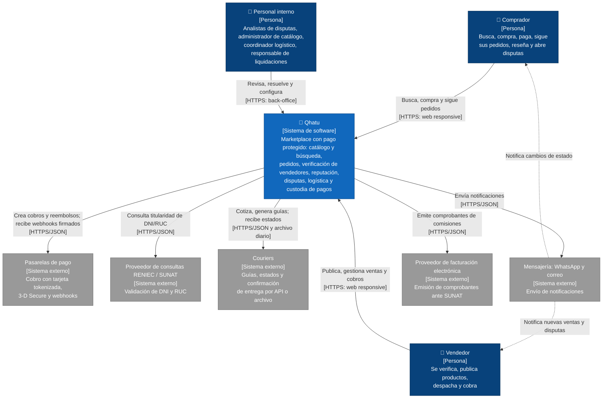

> [6. Documentación de Arquitectura (Bosquejo)](../6.md) › [6.1. Diagrama de Contexto](6.1.md)

# 6.1. Diagrama de Contexto

Nivel 1 del modelo C4: Qhatu como un único sistema, las personas que lo usan y los sistemas externos con los que interactúa. Los diagramas se mantienen como código Mermaid en el repositorio (RES-11).

## Descripción de los elementos

### Personas

| Elemento | Propósito y responsabilidades | Interacción con Qhatu | Requisitos |
|---|---|---|---|
| Comprador | Encontrar productos, comprar con pago protegido, seguir sus pedidos, reseñar compras reales y abrir disputas. | Usa la web responsive por HTTPS, desde la computadora o el celular; recibe notificaciones por WhatsApp o correo. | RF-PED-01 a 11, RF-CAT-04 a 07, RF-VEN-05, RF-VEN-08, RF-PAG-01 |
| Vendedor | Verificar su identidad, publicar productos, despachar subpedidos y recibir sus liquidaciones. | Usa la web responsive por HTTPS, desde la computadora o el celular; recibe notificaciones de ventas y disputas. | RF-VEN-01, RF-CAT-01 a 03, RF-PED-09, RF-PAG-04, RF-PAG-08 |
| Personal interno | Revisar registros observados y reseñas sospechosas, resolver disputas, moderar el catálogo, configurar tarifas y couriers, y ejecutar liquidaciones y conciliaciones. | Usa el back-office web por HTTPS con roles específicos. | RF-VEN-03, RF-VEN-09, RF-CAT-08, RF-CAT-09, RF-LOG-02, RF-PAG-07, RF-PAG-09 |

### Sistema

| Elemento | Propósito y responsabilidades |
|---|---|
| Qhatu | Marketplace con pago protegido. Retiene el dinero del comprador hasta que la entrega se confirma y vence el periodo de reclamo, verifica la identidad de los vendedores, construye su reputación a partir de compras reales y coordina la entrega con couriers externos. Internamente se compone de cinco módulos ([1.5](../../1/1.5/1.5.md)); su estructura se detalla en el [diagrama de contenedores (6.2)](../6.2/6.2.md). |

### Sistemas externos

| Elemento | Propósito | Interacción | Restricción / escenario |
|---|---|---|---|
| Pasarelas de pago | Procesar cobros con tarjeta sin que los datos de tarjeta ingresen a Qhatu. | Qhatu crea cobros y reembolsos por API; la pasarela notifica el resultado por webhooks firmados y envía un reporte diario para la conciliación. | RES-02, RES-05, ESC-PAG-01, ESC-PAG-06, ESC-PAG-09 |
| Proveedor de consultas RENIEC / SUNAT | Validar la titularidad del DNI o RUC del vendedor contra las fuentes oficiales. | Qhatu consulta de forma asíncrona y reintenta si el servicio no responde. | RES-03, ESC-VEN-01, ESC-VEN-05 |
| Couriers | Entregar los pedidos y reportar sus estados. | Qhatu cotiza y genera guías por API; los couriers reportan estados por API/webhook o por un archivo diario. | RES-06, ESC-LOG-01, ESC-LOG-05, ESC-LOG-07 |
| Mensajería (WhatsApp y correo) | Hacer llegar las notificaciones a compradores y vendedores. | Qhatu envía los mensajes por API; si el proveedor no está disponible, los encola y reintenta. | ESC-PED-02, ESC-PED-04 |
| Proveedor de facturación electrónica | Emitir ante SUNAT los comprobantes electrónicos de las comisiones que cobra Qhatu. | Qhatu envía los datos de cada comisión liquidada y recibe el comprobante aceptado. | RES-04 |

---

[🏠 Home](../../README.md) | [Siguiente ➡️](../6.2/6.2.md)
