> [6. Documentación de Arquitectura (Bosquejo)](../6.md) › [6.2. Diagrama de Contenedores](6.2.md)

# 6.2. Diagrama de Contenedores

Nivel 2 del modelo C4: las aplicaciones, microservicios y almacenes de datos que forman Qhatu, con su tecnología y la forma en que se comunican. Cada módulo es un microservicio con su propia base de datos ([ADR-GLO-01](../../4/4.6/4.6.1/4.6.1.md)); se comunican por eventos de dominio en RabbitMQ y, solo para consultas que el usuario espera en el momento, por REST ([ADR-GLO-03](../../4/4.6/4.6.2/4.6.2.md)).

```mermaid
flowchart TB
    COMP["👤 Comprador"]
    VEND["👤 Vendedor"]
    STAFF["👤 Personal interno"]

    subgraph QHATU["Qhatu [Sistema de software]"]
        direction TB
        subgraph FE["Aplicaciones cliente"]
            WEB["Web Qhatu<br/>[React + TypeScript, PWA responsive]<br/>Compradores y vendedores"]
            BO["Back-office<br/>[React + TypeScript]<br/>Personal interno"]
        end

        IDP["Amazon Cognito<br/>[Proveedor de identidad]<br/>Usuarios, grupos y JWT"]
        GW["Amazon API Gateway<br/>[Punto único de entrada]<br/>Valida el JWT y enruta"]
        CDN["Amazon CloudFront<br/>[CDN]<br/>Imágenes de producto"]
        ALB["Application Load Balancer interno<br/>[Balanceo y health checks]"]

        subgraph SVC["Microservicios [Node.js + TypeScript + Express en ECS Fargate]"]
            PED["svc-pedidos<br/>Carrito, checkout,<br/>pedidos y estados"]
            NOT["svc-notificaciones<br/>Worker de WhatsApp y correo"]
            VENS["svc-vendedores<br/>Verificación, reputación<br/>y disputas · 2 instancias"]
            CAT["svc-catalogo<br/>Productos, categorías, moderación,<br/>precio y stock · 2 a 8 tareas"]
            WRK["svc-catalogo-worker<br/>Cargas masivas"]
            BUS["svc-busqueda<br/>Búsqueda y sugerencias<br/>2 a 12 tareas"]
            LOG["svc-logistica<br/>Cotización, couriers<br/>y seguimiento"]
            IMP["logistica-importador<br/>Tarea diaria de archivos<br/>de couriers"]
            PAG["svc-pagos<br/>Cobros, webhooks, custodia<br/>y reembolsos"]
            PRO["pagos-procesos<br/>Tareas programadas: liberación,<br/>conciliación y liquidación"]
        end

        MQ{{"Bus de eventos<br/>[RabbitMQ en Amazon MQ]<br/>Exchange qhatu.eventos"}}
        REDIS[("Caché clave-valor<br/>[Redis en Amazon ElastiCache]")]

        subgraph DATA["Bases de datos [PostgreSQL en Amazon RDS, una base por módulo]"]
            DBPED[("pedidos")]
            DBVEN[("vendedores<br/>réplica en otra zona")]
            DBCAT[("catalogo")]
            DBLOG[("logistica")]
            DBPAG[("pagos<br/>instancia propia")]
        end

        OS[("Índice productos<br/>[Amazon OpenSearch Service]")]
        S3[("Almacenamiento de objetos<br/>[Amazon S3]<br/>Imágenes, cargas y evidencias")]
        SEC["Gestor de secretos<br/>[AWS Secrets Manager]<br/>Clave maestra de cifrado<br/>y secretos de terceros"]
    end

    PASA["Pasarelas de pago<br/>[Sistema externo]"]
    IDN["Proveedor RENIEC / SUNAT<br/>[Sistema externo]"]
    COU["Couriers<br/>[Sistema externo]"]
    MSG["WhatsApp y correo<br/>[Sistema externo]"]
    FAC["Facturación electrónica<br/>[Sistema externo]"]

    COMP --> WEB
    VEND --> WEB
    STAFF --> BO
    FE -- "Inicio de sesión [HTTPS/OIDC]" --> IDP
    FE -- "API REST + JWT [HTTPS]" --> GW
    FE -- "Imágenes [HTTPS]" --> CDN
    CDN --> S3
    GW -- "[VPC Link]" --> ALB
    ALB --> SVC

    PED -- "Precio y stock [REST /v1]" --> CAT
    PED -- "Cotización de envío [REST /v1]" --> LOG
    PED -- "Inicio del cobro [REST /v1]" --> PAG
    SVC <-- "Eventos de dominio [AMQP]" --> MQ
    BUS -- "Exportación para reconstruir el índice [REST]" --> CAT

    PED --> DBPED
    NOT --> DBPED
    PED -- "Carrito e idempotencia" --> REDIS
    VENS --> DBVEN
    CAT --> DBCAT
    WRK --> DBCAT
    LOG --> DBLOG
    IMP --> DBLOG
    IMP -- "Archivos de couriers" --> S3
    PAG --> DBPAG
    PRO --> DBPAG
    VENS -- "Perfil y reputación [cache-aside]" --> REDIS
    BUS -- "Consultas e indexación [HTTPS]" --> OS
    CAT -- "URLs prefirmadas" --> S3
    WRK -- "Archivos de carga" --> S3
    VENS -- "Evidencias de disputas" --> S3
    VENS -- "Clave maestra" --> SEC
    PAG -- "Clave y secretos de la pasarela" --> SEC
    LOG -- "Clave y secretos de couriers" --> SEC

    PAG -- "Cobros, reembolsos y consultas [HTTPS]" --> PASA
    PASA -- "Webhooks firmados [HTTPS]" --> GW
    PRO -- "Comprobantes de comisiones [HTTPS]" --> FAC
    PRO -- "Reporte diario de conciliación [HTTPS]" --> PASA
    VENS -- "Validación de DNI/RUC [HTTPS]" --> IDN
    LOG -- "Guías y cotizaciones [HTTPS]" --> COU
    COU -- "Estados por webhook [HTTPS]" --> GW
    IMP -- "Descarga el archivo diario [SFTP]" --> COU
    NOT -- "Notificaciones [HTTPS]" --> MSG

    classDef persona fill:#08427b,stroke:#052e56,color:#ffffff
    classDef cont fill:#438dd5,stroke:#2e6295,color:#ffffff
    classDef infra fill:#85bbf0,stroke:#5d82a8,color:#0b2545
    classDef ext fill:#999999,stroke:#6b6b6b,color:#ffffff
    class COMP,VEND,STAFF persona
    class WEB,BO,PED,NOT,VENS,CAT,WRK,BUS,LOG,IMP,PAG,PRO cont
    class IDP,GW,CDN,ALB,MQ,REDIS,DBPED,DBVEN,DBCAT,DBLOG,DBPAG,OS,S3,SEC infra
    class PASA,IDN,COU,MSG,FAC ext
```

## Descripción de los contenedores

### Aplicaciones cliente

| Contenedor | Tecnología | Propósito y responsabilidades | Interacciones | Decisión |
|---|---|---|---|---|
| Web Qhatu | React + TypeScript, PWA responsive | Interfaz, usable desde la computadora y el celular (RES-08), de compradores (búsqueda, carrito, checkout, seguimiento, reseñas y disputas) y de vendedores (verificación, publicación, ventas y liquidaciones). | Inicia sesión en Cognito, consume las APIs a través del API Gateway con el JWT y carga las imágenes desde CloudFront. | ADR-GLO-08 |
| Back-office | React + TypeScript | Interfaz del personal interno: registros observados, disputas, moderación, categorías, tarifas, couriers, liquidaciones y conciliación. | Igual que la web; cada pantalla exige el grupo de Cognito correspondiente. | ADR-GLO-08, ADR-GLO-02 |

### Entrada, identidad y red

| Contenedor | Tecnología | Propósito y responsabilidades | Interacciones | Decisión |
|---|---|---|---|---|
| Proveedor de identidad | Amazon Cognito | Registro e inicio de sesión de compradores, vendedores y personal interno; segundo factor; grupos por rol; emisión de JWT. | Lo usan las tres aplicaciones cliente; el API Gateway valida los tokens que emite. | ADR-GLO-02 |
| Punto de entrada | Amazon API Gateway | Única puerta de entrada a las APIs: valida el JWT, propaga el usuario y sus grupos, y enruta cada ruta a su microservicio. También recibe los webhooks de la pasarela y de los couriers. | Recibe las solicitudes de los clientes y de los sistemas externos; las envía al ALB interno por VPC Link. | ADR-GLO-02 |
| CDN de imágenes | Amazon CloudFront | Entrega las imágenes de producto desde ubicaciones cercanas al comprador, sin pasar por `svc-catalogo`. | Lee el bucket de imágenes con Origin Access Control. | ADR-CAT-05 |
| Balanceador interno | Application Load Balancer | Reparte el tráfico entre las réplicas de cada microservicio y retira las que no pasan el health check; permite el despliegue blue/green. | Recibe del API Gateway y de las llamadas REST entre servicios. | ADR-GLO-06, ADR-TAC-VEN-02, ADR-CAT-09 |

### Microservicios

Todos se implementan en Node.js + TypeScript + Express ([ADR-GLO-07](../../4/4.6/4.6.5/4.6.5.md)) y se ejecutan en Amazon ECS sobre Fargate ([ADR-GLO-06](../../4/4.6/4.6.4/4.6.4.md)).

| Contenedor | Módulo | Propósito y responsabilidades | Interacciones | Decisión |
|---|---|---|---|---|
| `svc-pedidos` | Carrito, Pedidos y Notificaciones | Carrito, checkout con validación de precio y stock, división en subpedidos, inicio del cobro y estados del pedido. | Consulta a `svc-catalogo` (precio y stock) y a `svc-logistica` (cotización) por REST e inicia el cobro en `svc-pagos` por REST; publica `SubpedidoCreado` y `PedidoCancelado`; consume `PagoConfirmado`, `PagoRechazado` y `EntregaConfirmada`; guarda el carrito y las claves de idempotencia en Redis. | ADR-PED-01, ADR-PED-02, ADR-PED-03 |
| `svc-notificaciones` | Carrito, Pedidos y Notificaciones | Worker que envía las notificaciones de cambio de estado por WhatsApp y correo, con colas separadas para mensajes transaccionales y de campaña. | Consume los eventos de los demás módulos; envía a los proveedores de mensajería y reintenta si no responden. | ADR-PED-01, ADR-PED-06 |
| `svc-vendedores` | Vendedores, Reputación y Disputas | Verificación de identidad, reseñas y reputación, y disputas, como tres componentes de una sola unidad con 2 instancias activas. | Consulta al proveedor RENIEC/SUNAT; consume `EntregaConfirmada`; publica `DisputaResuelta` y `VendedorSuspendido` con outbox; usa Redis para el perfil público, S3 para las evidencias y el gestor de secretos para la clave de cifrado. | ADR-VEN-01, ADR-VEN-03, ADR-TAC-VEN-02, ADR-TAC-VEN-03, ADR-TAC-VEN-11 |
| `svc-catalogo` | Catálogo y Búsqueda | Fuente de verdad de productos, categorías, moderación, precio y stock. | Expone la API de precio y stock a Pedidos; consume `VendedorSuspendido` y `PagoConfirmado`; publica `ProductoActualizado` (interno del módulo) con outbox. | ADR-CAT-01, ADR-CAT-03, ADR-CAT-04 |
| `svc-catalogo-worker` | Catálogo y Búsqueda | Procesa las cargas masivas en segundo plano, sin quitarle CPU a la API. | Lee los archivos de S3 y escribe en la base `catalogo`. | ADR-CAT-05 |
| `svc-busqueda` | Catálogo y Búsqueda | Búsqueda por texto con filtros y sugerencias; entra en modo degradado si el índice falla. | Consume `ProductoActualizado` para mantener el índice; consulta OpenSearch. | ADR-CAT-01, ADR-CAT-02, ADR-CAT-06 |
| `svc-logistica` | Logística | Cotización de envíos con tarifas por distrito, asignación de courier, guías, seguimiento y confirmación de entregas. | Expone la cotización a Pedidos; consume `SubpedidoCreado` y `PedidoCancelado`; publica `EntregaConfirmada` con outbox; recibe los webhooks firmados de los couriers a través del API Gateway. | ADR-LOG-01, ADR-LOG-02 |
| `logistica-importador` | Logística | Tarea diaria que descarga el archivo de estados de los couriers sin API y lo convierte al modelo común. | Descarga por SFTP, guarda el archivo en S3 y escribe en la base `logistica`. | ADR-LOG-01, ADR-LOG-04 |
| `svc-pagos` | Pagos y Liquidaciones | Cobros, webhooks de la pasarela, custodia, reembolsos y cuentas bancarias de liquidación. | Recibe el inicio del cobro de Pedidos (`POST /v1/cobros`); se integra con la pasarela; publica `PagoConfirmado`, `PagoRechazado` y `CuentaBancariaCambiada`; consume `EntregaConfirmada`, `DisputaResuelta` y `PedidoCancelado`. | ADR-PAG-01, ADR-PAG-02 |
| `pagos-procesos` | Pagos y Liquidaciones | Tareas programadas: liberación de fondos al vencer el periodo de reclamo, conciliación diaria, liquidación semanal y comprobantes de comisiones. | Escribe en la base `pagos`; obtiene el reporte de la pasarela y emite los comprobantes con el proveedor de facturación. | ADR-PAG-04, ADR-PAG-06 |

### Mensajería y almacenes de datos

| Contenedor | Tecnología | Propósito | Usado por | Decisión |
|---|---|---|---|---|
| Bus de eventos | RabbitMQ en Amazon MQ | Transporte de los eventos de dominio entre módulos (exchange `qhatu.eventos`, una cola durable por consumidor y cola de mensajes fallidos); también la cola de reintentos de la verificación de identidad. | Todos los microservicios | ADR-GLO-03, ADR-TAC-VEN-01 |
| Bases de datos | PostgreSQL en Amazon RDS | Una base lógica y un usuario por módulo; ningún módulo lee la base de otro. La instancia compartida mantiene una réplica en espera en otra zona; Pagos usa una instancia propia, también con réplica. | Cada módulo, solo la suya | ADR-GLO-04, ADR-VEN-04, ADR-CAT-04, ADR-PED-04, ADR-LOG-03, ADR-PAG-03, ADR-PAG-04 |
| Caché clave-valor | Redis en Amazon ElastiCache | Un clúster compartido con prefijo de claves por módulo: carrito y claves de idempotencia de Pedidos, y perfil público y reputación de Vendedores. | `svc-pedidos`, `svc-vendedores` | ADR-PED-03, ADR-TAC-VEN-03 |
| Índice de búsqueda | Amazon OpenSearch Service | Copia desnormalizada y reconstruible de los productos para búsqueda, filtros, conteos y sugerencias. | `svc-busqueda` | ADR-CAT-06 |
| Almacenamiento de objetos | Amazon S3 | Imágenes de producto, archivos de carga masiva, evidencias de disputas y archivos diarios de couriers (las bases solo guardan la referencia). | `svc-catalogo`, `svc-catalogo-worker`, `svc-vendedores`, `logistica-importador`, CloudFront | ADR-CAT-04, ADR-CAT-05, ADR-VEN-04, ADR-LOG-04 |
| Gestor de secretos | AWS Secrets Manager | Clave maestra del cifrado por campo y secretos de terceros (pasarela y couriers). | `svc-vendedores`, `svc-pagos`, `svc-logistica` | ADR-TAC-VEN-11, ADR-TAC-PAG-06, ADR-TAC-LOG-05 |

Los sistemas externos se describen en el [diagrama de contexto (6.1)](../6.1/6.1.md). Los componentes internos de cada microservicio están en [6.3](../6.3/6.3.md) y la vista de despliegue en [6.4](../6.4/6.4.md).

---

[⬅️ Anterior](../6.1/6.1.md) | [🏠 Home](../../README.md) | [Siguiente ➡️](../6.3/6.3.md)
