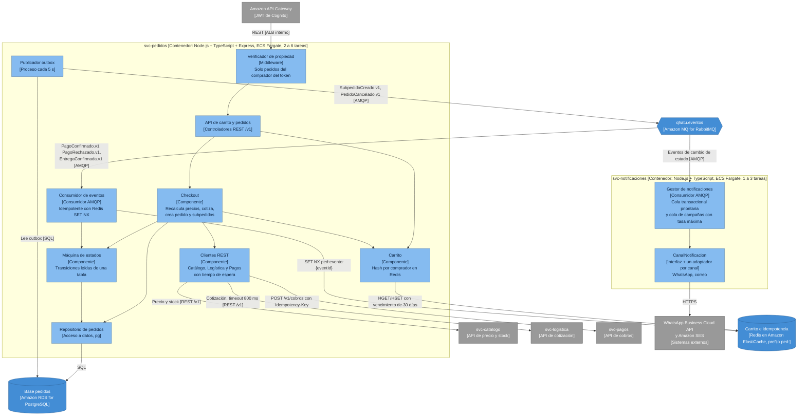
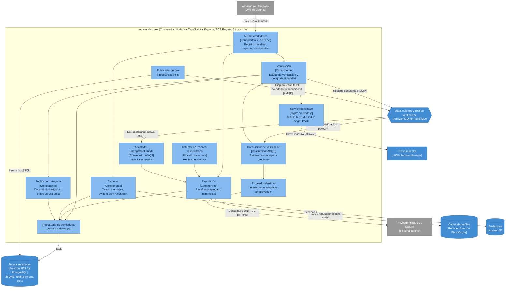
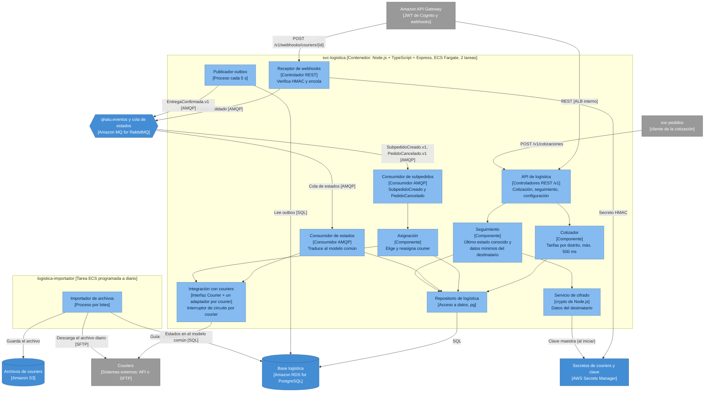
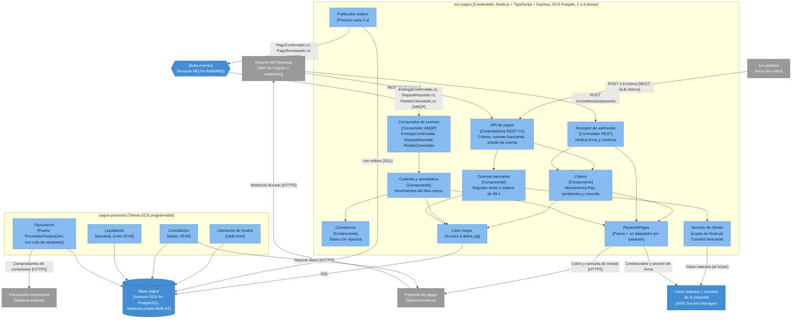

> [6. Documentación de Arquitectura (Bosquejo)](../6.md) › [6.3. Diagrama de Componentes](6.3.md)

# 6.3. Diagrama de Componentes

Nivel 3 del modelo C4: los componentes internos de los microservicios del [diagrama de contenedores (6.2)](../6.2/6.2.md). Cada sección corresponde a los contenedores de un módulo y solo muestra componentes sustentados por una decisión de sus secciones 4 y 5. Todos los microservicios comparten la misma base tecnológica (Node.js + TypeScript + Express en ECS Fargate, [ADR-GLO-07](../../4/4.6/4.6.5/4.6.5.md)), reciben las solicitudes del API Gateway a través del ALB interno e intercambian eventos por `qhatu.eventos` ([ADR-GLO-03](../../4/4.6/4.6.2/4.6.2.md)).

| Módulo | Contenedores | Sección |
|---|---|---|
| Carrito, Pedidos y Notificaciones | `svc-pedidos`, `svc-notificaciones` | [Carrito, Pedidos y Notificaciones](#carrito-pedidos-y-notificaciones-svc-pedidos-y-svc-notificaciones) |
| Vendedores, Reputación y Disputas | `svc-vendedores` | [Vendedores, Reputación y Disputas](#vendedores-reputación-y-disputas-svc-vendedores) |
| Catálogo y Búsqueda | `svc-catalogo`, `svc-catalogo-worker`, `svc-busqueda` | [Catálogo y Búsqueda](#catálogo-y-búsqueda-svc-catalogo-svc-catalogo-worker-y-svc-busqueda) |
| Logística | `svc-logistica`, `logistica-importador` | [Logística](#logística-svc-logistica-y-logistica-importador) |
| Pagos y Liquidaciones | `svc-pagos`, `pagos-procesos` | [Pagos y Liquidaciones](#pagos-y-liquidaciones-svc-pagos-y-pagos-procesos) |

---

## Carrito, Pedidos y Notificaciones: `svc-pedidos` y `svc-notificaciones`

Dos contenedores: `svc-pedidos` atiende el carrito, el checkout y los estados, y `svc-notificaciones` es un worker que envía los avisos sin compartir proceso con el checkout ([ADR-PED-01](../../4/4.1/4.1.md)).

| Componente | Propósito y responsabilidades | Interacciones | Tecnología | Escenarios / ADR |
|---|---|---|---|---|
| Verificador de propiedad | Valida el JWT y que el pedido consultado pertenezca al comprador del token; responde `404` ante pedidos ajenos y registra el intento. | Recibe las solicitudes del API Gateway por el ALB interno. | Middleware de Express | ESC-PED-06, ADR-TAC-PED-06 |
| API de carrito y pedidos | Carrito, checkout, mis pedidos, subpedidos del vendedor y cancelación. | Delega en Carrito, Checkout y Máquina de estados. | Express, REST `/v1` | RF-PED-01 a RF-PED-10 |
| Carrito | Guarda el carrito de cada comprador como un hash en Redis que se conserva entre sesiones. | Lee y escribe en Redis. | Redis (clave-valor) | ESC-PED-03, ADR-PED-03, ADR-TAC-PED-03 |
| Checkout | Recalcula precios con el Catálogo (no acepta precios del cliente), cotiza el envío, crea el pedido y un subpedido por vendedor e inicia el cobro. | Usa los clientes REST y el repositorio. | Componente interno | ESC-PED-01, ESC-PED-05, ADR-PED-02, ADR-TAC-PED-05 |
| Clientes REST | Llamadas a Catálogo, Logística y Pagos con tiempo de espera; si la cotización vence (800 ms), se usa la tarifa de respaldo por distrito. | Llaman a las APIs `/v1` por el ALB interno. | Componente interno | ESC-PED-01, ADR-TAC-PED-01 |
| Máquina de estados | Aplica las transiciones del pedido y sus subpedidos según la tabla `transicion_estado`. | La usan Checkout y el consumidor de eventos. | Tabla en PostgreSQL | ESC-PED-10, ADR-PED-04, ADR-TAC-PED-10 |
| Consumidor de eventos | Procesa `PagoConfirmado`, `PagoRechazado` y `EntregaConfirmada` una sola vez, aunque lleguen duplicados. | Registra cada `eventId` en Redis con `SET NX` y aplica una transición condicional en PostgreSQL. | Consumidor AMQP | ESC-PED-07, ADR-TAC-PED-07 |
| Repositorio de pedidos | Acceso a la base `pedidos`: pedidos, subpedidos, ítems, historial de estados y outbox. | Lo usan Checkout y la Máquina de estados. | `pg` sobre PostgreSQL | ADR-PED-04 |
| Publicador outbox | Publica `SubpedidoCreado.v1` y `PedidoCancelado.v1` con contrato versionado. | Lee la base y publica en `qhatu.eventos`. | Proceso dentro del servicio | ESC-PED-08, ADR-TAC-PED-08 |
| Gestor de notificaciones | Convierte los eventos en mensajes; usa una cola transaccional prioritaria y una de campañas con tasa máxima, y reintenta con espera creciente si el proveedor no responde. | Consume de RabbitMQ y envía por `CanalNotificacion`. | Consumidor AMQP | ESC-PED-02, ESC-PED-04, ADR-TAC-PED-02, ADR-TAC-PED-04 |
| `CanalNotificacion` | Interfaz con un adaptador por canal; un canal nuevo (p. ej. push) es un adaptador nuevo. | Llama a WhatsApp Business Cloud API y a Amazon SES. | Interfaz + adaptadores | ESC-PED-09, ADR-PED-06, ADR-TAC-PED-09 |

---

## Vendedores, Reputación y Disputas: `svc-vendedores`

Un solo desplegable con tres componentes de negocio, Verificación, Reputación y Disputas ([ADR-VEN-01](../../4/4.2/4.2.md)), con 2 instancias activas detrás del ALB interno ([ADR-TAC-VEN-02](../../5/5.2/5.2.md)).

| Componente | Propósito y responsabilidades | Interacciones | Tecnología | Escenarios / ADR |
|---|---|---|---|---|
| API de vendedores | Registro de vendedores, consulta de su estado, reseñas, disputas y perfil público. | Recibe las solicitudes del API Gateway por el ALB interno y las delega a los componentes de negocio. | Express, REST `/v1` | ADR-VEN-01 |
| Verificación | Acepta el registro, lo deja pendiente y coteja la titularidad del DNI/RUC con la fuente oficial; las inconsistencias pasan a revisión manual. Solo un vendedor verificado puede publicar. | Envía el registro a la cola de verificación; usa las reglas por categoría y el servicio de cifrado. | Componente interno | ESC-VEN-01, ESC-VEN-05, ADR-VEN-02, ADR-TAC-VEN-05 |
| Reglas por categoría | Documentos adicionales exigidos por categoría, configurables sin desplegar código. | Lo consulta Verificación; lee la tabla de reglas. | Tabla en PostgreSQL | ESC-VEN-09, ADR-TAC-VEN-09 |
| Consumidor de verificación | Consume la cola y consulta al proveedor; si no responde, reintenta con espera creciente (tope de 15 min). | Lee la cola de RabbitMQ; llama a `ProveedorIdentidad`. | Consumidor AMQP | ESC-VEN-01, ADR-TAC-VEN-01 |
| `ProveedorIdentidad` | Interfaz propia hacia RENIEC/SUNAT con un adaptador por proveedor, para cambiar de proveedor sin tocar la verificación. | Llama al proveedor externo por HTTPS. | Interfaz + adaptadores | ESC-VEN-10, ADR-TAC-VEN-10 |
| Reputación | Acepta reseñas solo de subpedidos entregados (una por subpedido) y actualiza el agregado del vendedor en la misma transacción. | Lee y escribe el perfil en Redis con *cache-aside* e invalida la clave al registrar una reseña. | Componente interno | ESC-VEN-03, ESC-VEN-04, ESC-VEN-06, ADR-VEN-05, ADR-TAC-VEN-03 |
| Detector de reseñas sospechosas | Marca cada hora patrones sospechosos (ráfagas, cuentas recién creadas o relacionadas con el vendedor) para revisión del analista. | Lee las reseñas de la base. | Proceso periódico | ESC-VEN-06, ADR-TAC-VEN-06 |
| Disputas | Casos con mensajes, evidencias y resolución trazable; la resolución se guarda junto con su evento. | Guarda las evidencias en S3 y su referencia en la base; escribe `DisputaResuelta` en el outbox. | Componente interno | ESC-VEN-02, ESC-VEN-07, ADR-VEN-04, ADR-TAC-VEN-07 |
| Adaptador `EntregaConfirmada` | Traduce el evento de Logística al modelo propio («subpedido habilitado para reseña») e ignora duplicados. | Consume de RabbitMQ; habilita la reseña en Reputación. | Consumidor AMQP | ESC-VEN-08, ADR-TAC-VEN-08 |
| Servicio de cifrado | Cifra DNI/RUC a nivel de campo con *envelope encryption* y calcula el índice ciego para comparar documentos sin descifrarlos; solo descifra para el rol autorizado. | Carga la clave maestra del gestor de secretos al iniciar; lo usa Verificación. | Módulo `crypto` de Node.js | ESC-VEN-11, ADR-TAC-VEN-11 |
| Repositorio de vendedores | Acceso a la base `vendedores`: vendedores, reseñas, agregados de reputación, disputas, reglas y outbox. | Lo usan todos los componentes de negocio. | `pg` sobre PostgreSQL | ADR-VEN-04 |
| Publicador outbox | Publica cada 5 s los eventos pendientes y reintenta los fallidos. | Lee la base y publica `DisputaResuelta` y `VendedorSuspendido` en `qhatu.eventos`. | Proceso dentro del servicio | ESC-VEN-07, ADR-VEN-03, ADR-TAC-VEN-07 |

---

## Catálogo y Búsqueda: `svc-catalogo`, `svc-catalogo-worker` y `svc-busqueda`

Componentes de los tres contenedores del módulo: `svc-catalogo` (API, fuente de verdad de productos, precio y stock), `svc-catalogo-worker` (cargas masivas, misma imagen con otro comando) y `svc-busqueda` (búsqueda y sugerencias sobre el índice). La separación en contenedores se decide en [ADR-CAT-01](../../4/4.3/4.3.md) y [ADR-CAT-05](../../4/4.3/4.3.md).

```mermaid
flowchart TB
    CLI["Web Qhatu / Back-office<br/>[Contenedores cliente: React]"]
    GW["Amazon API Gateway<br/>[JWT de Cognito]"]
    PED["Módulo de Pedidos<br/>[Microservicio externo al módulo]"]
    CDN["Amazon CloudFront<br/>[CDN de imágenes]"]

    subgraph CAT["svc-catalogo [Contenedor: Node.js + TypeScript + Express, ECS Fargate, 2 a 8 tareas]"]
        AUTH["Verificador de acceso<br/>[Middleware]<br/>Firma del JWT y propiedad del producto"]
        PROD["API de productos<br/>[Controlador REST /v1]<br/>Publicar, editar, despublicar, imágenes"]
        SAN["Sanitizador de contenido<br/>[sanitize-html]<br/>Lista de etiquetas permitidas"]
        MOD["Moderación<br/>[Componente]<br/>Reglas parametrizadas y cola de revisión"]
        CATG["Categorías y atributos<br/>[Componente]<br/>Definiciones y JSON Schema (Ajv)"]
        PS["API de precio y stock<br/>[Controlador REST /v1]<br/>Consulta por lote de hasta 50 productos"]
        CARG["API de cargas masivas<br/>[Controlador REST /v1]<br/>Registro, progreso y cancelación"]
        EXP["API interna de exportación<br/>[Controlador REST /v1/interno]<br/>Productos paginados para reconstruir el índice"]
        CVS["Adaptador VendedorSuspendido<br/>[Consumidor AMQP]<br/>Oculta productos del vendedor"]
        CPC["Consumidor de stock<br/>[Consumidor AMQP]<br/>PagoConfirmado descuenta y<br/>PedidoCancelado repone"]
        REPO["Repositorio de catálogo<br/>[Acceso a datos, pg]"]
        OUT["Publicador outbox<br/>[Proceso cada 1 s]<br/>Publica ProductoActualizado.v1"]
    end

    subgraph WRK["svc-catalogo-worker [Contenedor: misma imagen, ECS Fargate, 1 a 2 tareas]"]
        PROC["Procesador de cargas<br/>[Worker]<br/>Lotes de 100 filas, progreso y cancelación cooperativa"]
    end

    subgraph BUS["svc-busqueda [Contenedor: Node.js + TypeScript + Express, ECS Fargate, 2 a 12 tareas]"]
        BAPI["API de búsqueda<br/>[Controlador REST /v1/busqueda]<br/>Texto, filtros, orden y conteos"]
        SUG["Sugerencias<br/>[Controlador REST /v1/sugerencias]<br/>Autocompletar desde el 3.er carácter"]
        QB["Constructor de consultas<br/>[Componente]<br/>Estrategias de orden por nombre"]
        CB["Interruptor de circuito<br/>[opossum]<br/>Timeout de 800 ms y modo degradado"]
        IDX["Indexador<br/>[Consumidor AMQP]<br/>Peticiones _bulk con versión externa"]
        REB["Reconstructor de índice<br/>[Proceso bajo demanda]<br/>Índice nuevo y cambio de alias"]
    end

    DB[("Base catalogo<br/>[Amazon RDS for PostgreSQL Multi-AZ]<br/>Productos, JSONB de atributos, cargas, outbox")]
    OS[("Índice productos<br/>[Amazon OpenSearch Service, 2 zonas]")]
    S3I[("qhatu-catalogo-imagenes<br/>[Amazon S3 privado]")]
    S3C[("qhatu-catalogo-cargas<br/>[Amazon S3 privado, ciclo de vida 7 días]")]
    MQ{{"qhatu.eventos<br/>[Amazon MQ for RabbitMQ]"}}
    CW["Amazon CloudWatch<br/>[Métricas, logs y alarmas]"]

    CLI -- "HTTPS + JWT" --> GW
    CLI -- "Imágenes [HTTPS]" --> CDN
    CDN -- "Origin Access Control" --> S3I
    GW -- "/v1/productos, /v1/categorias, /v1/cargas [REST, ALB interno]" --> AUTH
    GW -- "/v1/busqueda, /v1/sugerencias [REST, ALB interno]" --> BAPI
    GW -- "/v1/sugerencias" --> SUG
    PED -- "POST /v1/precios-stock/consultas [REST, ALB interno]" --> PS

    AUTH --> PROD
    AUTH --> CARG
    PROD --> SAN
    PROD --> MOD
    PROD --> CATG
    PROD -- "URL prefirmada de subida" --> S3I
    CARG -- "URL prefirmada de subida" --> S3C
    PROD --> REPO
    MOD --> REPO
    CATG --> REPO
    PS --> REPO
    CARG --> REPO
    EXP --> REPO
    CVS --> REPO
    CPC --> REPO
    REPO -- "SQL" --> DB
    OUT -- "Lee outbox [SQL]" --> DB
    OUT -- "ProductoActualizado.v1 [AMQP]" --> MQ
    MQ -- "VendedorSuspendido.v1 [AMQP]" --> CVS
    MQ -- "PagoConfirmado.v1, PedidoCancelado.v1 [AMQP]" --> CPC

    PROC -- "Toma cargas con SKIP LOCKED [SQL]" --> DB
    PROC -- "Lee el archivo" --> S3C
    PROC --> SAN
    PROC --> MOD
    PROC --> CATG

    BAPI --> QB
    SUG --> QB
    QB --> CB
    CB -- "Consultas [HTTPS]" --> OS
    MQ -- "ProductoActualizado.v1 [AMQP]" --> IDX
    IDX -- "_bulk [HTTPS]" --> OS
    REB -- "GET /v1/interno/productos [REST]" --> EXP
    REB -- "Índice nuevo y alias [HTTPS]" --> OS

    CB -. "BusquedaModoDegradado" .-> CW
    MOD -. "ModeracionPendienteMasAntiguaHoras" .-> CW
    AUTH -. "acceso_denegado" .-> CW

    classDef ext fill:#999999,stroke:#6b6b6b,color:#ffffff
    classDef comp fill:#85bbf0,stroke:#5d82a8,color:#0b2545
    classDef store fill:#438dd5,stroke:#2e6295,color:#ffffff
    class CLI,GW,PED,CDN,CW ext
    class AUTH,PROD,SAN,MOD,CATG,PS,CARG,EXP,CVS,CPC,REPO,OUT,PROC,BAPI,SUG,QB,CB,IDX,REB comp
    class DB,OS,S3I,S3C,MQ store
```

### Descripción de los componentes

#### `svc-catalogo`

| Componente | Propósito y responsabilidades | Interacciones | Tecnología | Escenarios / ADR |
|---|---|---|---|---|
| Verificador de acceso | Vuelve a validar la firma del JWT y comprueba que el producto o la carga pertenezcan al vendedor que hace la solicitud; las operaciones de moderación exigen el grupo `admin-catalogo`. Responde `404` ante recursos ajenos y registra cada denegación. | Recibe las solicitudes del API Gateway por el ALB interno; envía el evento `acceso_denegado` a CloudWatch Logs. | Middleware de Express, claves públicas de Cognito en caché | RF-CAT-02, RF-CAT-16, ADR-GLO-02 |
| API de productos | Publicar, editar, pausar y eliminar productos, y subir imágenes. | Usa el sanitizador, la moderación y las definiciones de categoría antes de guardar; entrega URLs prefirmadas para que las imágenes se suban directo a S3. | Express, REST `/v1` | RF-CAT-01, RF-CAT-02, ADR-CAT-05 |
| Sanitizador de contenido | Limpia la descripción antes de guardarla y deja solo `p`, `br`, `strong`, `em`, `ul`, `ol` y `li`, sin atributos. | Lo usan la API de productos y el procesador de cargas. | `sanitize-html` | ESC-CAT-06, ADR-TAC-CAT-06 |
| Moderación | Compara el texto normalizado con las reglas activas y, si hay coincidencia, deja el producto `en_revision`; registra cada decisión del administrador. | Lee las reglas de la base; publica la antigüedad de la cola de revisión como métrica en CloudWatch. | Componente interno, tabla `regla_moderacion` | ESC-CAT-05, RF-CAT-09, ADR-TAC-CAT-05 |
| Categorías y atributos | Administra el árbol de categorías y la definición de atributos de cada una, y genera el JSON Schema con el que se validan los productos. | Lo usan la API de productos y el procesador de cargas; sirve el árbol para la navegación en modo degradado. | Ajv, esquema en caché 60 s | ESC-CAT-09, RF-CAT-06, RF-CAT-08, ADR-TAC-CAT-09 |
| API de precio y stock | Devuelve el precio y stock vigentes de hasta 50 productos por solicitud, leídos de la instancia principal. | La consume el módulo de Pedidos durante el checkout. | REST `/v1`, contrato OpenAPI 3.1 | ESC-CAT-07, RF-CAT-10, ADR-CAT-03, ADR-TAC-CAT-07 |
| API de cargas masivas | Registra cargas, informa su progreso y permite cancelarlas. | El cliente consulta el progreso cada 3 s; la cancelación activa una marca que lee el worker. | REST `/v1` | ESC-CAT-04, RF-CAT-03, RF-CAT-14 |
| API interna de exportación | Entrega todos los productos paginados (1,000 por página) para reconstruir el índice. | Solo la consume el reconstructor de `svc-busqueda`. | REST `/v1/interno` | RF-CAT-15, ADR-CAT-02 |
| Adaptador `VendedorSuspendido` | Traduce el evento de Vendedores al modelo propio: oculta todos los productos del vendedor en una transacción e ignora duplicados. | Consume de la cola `catalogo.vendedor-suspendido`; escribe un `ProductoActualizado` por producto en el outbox. | Consumidor AMQP | ESC-CAT-08, RF-CAT-12, ADR-TAC-CAT-08 |
| Consumidor de stock | Al recibir `PagoConfirmado` descuenta el stock de forma atómica sin dejarlo negativo y suma las unidades vendidas; al recibir `PedidoCancelado` lo repone. | Consume de RabbitMQ; actualiza la base y escribe `ProductoActualizado` en el outbox. | Consumidor AMQP | RF-CAT-11, ESC-CAT-10, ADR-CAT-04 |
| Repositorio de catálogo | Acceso a la base `catalogo`: productos con atributos JSONB, categorías, reglas, cargas, outbox y eventos procesados. | Lo usan todos los componentes de escritura y lectura del servicio. | `pg` sobre PostgreSQL | ADR-CAT-04 |
| Publicador outbox | Lee cada 1 s los eventos pendientes de la tabla `outbox` y los publica; funciona con varias tareas a la vez gracias a `FOR UPDATE SKIP LOCKED`. | Lee la base y publica `ProductoActualizado.v1` en `qhatu.eventos`. | Proceso dentro del servicio | ESC-CAT-04, ESC-CAT-08, ADR-CAT-02 |

#### `svc-catalogo-worker`

| Componente | Propósito y responsabilidades | Interacciones | Tecnología | Escenarios / ADR |
|---|---|---|---|---|
| Procesador de cargas | Toma una carga pendiente, lee el archivo de S3 y procesa lotes de 100 filas: valida, sanitiza y modera cada producto. Actualiza el progreso tras cada lote y, si se pidió cancelar, descarta todo lo cargado. Al terminar publica los productos y sus eventos en una sola transacción. | Lee la base y el bucket de cargas; usa los mismos componentes de validación que `svc-catalogo` (misma imagen). | Worker Node.js en ECS Fargate, sin balanceador | ESC-CAT-04, RF-CAT-14, ADR-CAT-05, ADR-TAC-CAT-04 |

#### `svc-busqueda`

| Componente | Propósito y responsabilidades | Interacciones | Tecnología | Escenarios / ADR |
|---|---|---|---|---|
| API de búsqueda | Búsqueda por texto con filtros, orden, conteos por filtro y páginas de 24 resultados. | Recibe las solicitudes del API Gateway por el ALB interno. | REST `/v1/busqueda` | ESC-CAT-03, RF-CAT-04, RF-CAT-05, ADR-TAC-CAT-03 |
| Sugerencias | Autocompletado de productos y categorías desde el tercer carácter, con tiempo de espera de 150 ms. | Recibe las solicitudes del API Gateway; consulta el campo `search_as_you_type` del índice. | REST `/v1/sugerencias` | ESC-CAT-11, RF-CAT-13, ADR-TAC-CAT-11 |
| Constructor de consultas | Arma la consulta al índice y aplica el criterio de orden pedido; cada criterio es una estrategia registrada por nombre, por lo que agregar uno no cambia el contrato. | Lo usan la API de búsqueda y las sugerencias. | Componente interno | ESC-CAT-10, ADR-TAC-CAT-10 |
| Interruptor de circuito | Aplica un tiempo de espera de 800 ms a cada consulta y, si falla la mitad de las solicitudes, pasa a modo degradado y responde `503` hasta que el índice se recupere. | Envía las consultas a OpenSearch; publica la métrica `BusquedaModoDegradado` en CloudWatch. | `opossum` | ESC-CAT-01, ADR-TAC-CAT-01 |
| Indexador | Consume `ProductoActualizado.v1` y actualiza el índice por lotes; la versión externa del documento evita que un evento duplicado o tardío sobrescriba uno más nuevo. | Consume de la cola `busqueda.producto-actualizado`; escribe en OpenSearch con peticiones `_bulk`. | Consumidor AMQP | ESC-CAT-04, ESC-CAT-08, ADR-CAT-02, ADR-TAC-CAT-04 |
| Reconstructor de índice | Crea un índice nuevo con todos los productos y cambia el alias al terminar, sin cortar la búsqueda. | Lee la API interna de exportación de `svc-catalogo`; escribe en OpenSearch. | Proceso bajo demanda | RF-CAT-15, ADR-CAT-02, ADR-CAT-06 |

#### Almacenes y servicios de apoyo

| Elemento | Propósito | Escenarios / ADR |
|---|---|---|
| Base `catalogo` (Amazon RDS for PostgreSQL Multi-AZ) | Fuente de verdad de productos, precio, stock, categorías, reglas, cargas y outbox. | ADR-CAT-04, ADR-GLO-04 |
| Índice `productos` (Amazon OpenSearch Service) | Copia desnormalizada de solo lectura para la búsqueda, reconstruible desde la base. | ADR-CAT-06, ADR-TAC-CAT-03 |
| Bucket `qhatu-catalogo-imagenes` + Amazon CloudFront | Imágenes de producto servidas desde el borde, sin pasar por `svc-catalogo`. | ADR-CAT-05 |
| Bucket `qhatu-catalogo-cargas` | Archivos de carga masiva y reportes de filas rechazadas; se borran a los 7 días. | ESC-CAT-04, ADR-TAC-CAT-04 |
| `qhatu.eventos` (Amazon MQ for RabbitMQ) | Transporte de `ProductoActualizado`, `VendedorSuspendido` y `PagoConfirmado`. | ADR-GLO-03, ADR-CAT-02 |
| Amazon CloudWatch | Métricas, registros y alarmas que disparan avisos y la reversión automática de despliegues. | ESC-CAT-02, ADR-TAC-CAT-02 |

---

## Logística: `svc-logistica` y `logistica-importador`

Un microservicio con componentes internos y un adaptador por courier, más una tarea programada para los couriers que envían un archivo diario ([ADR-LOG-01](../../4/4.4/4.4.md), [ADR-LOG-04](../../4/4.4/4.4.md)).

| Componente | Propósito y responsabilidades | Interacciones | Tecnología | Escenarios / ADR |
|---|---|---|---|---|
| API de logística | Cotización para Pedidos, seguimiento para compradores y vendedores, y configuración de tarifas, cobertura y couriers para el back-office. | Recibe las solicitudes por el API Gateway y el ALB interno. | Express, REST `/v1` | RF-LOG-01, RF-LOG-02, RF-LOG-08, RF-LOG-12 |
| Cotizador | Calcula costo y plazo con la tabla de tarifas por distrito propia, sin llamar al courier en línea, con un tiempo máximo de 500 ms. | Lee las tarifas de la base (caché de 60 s). | Componente interno | ESC-LOG-03, ESC-LOG-10, ADR-TAC-LOG-03, ADR-TAC-LOG-10 |
| Asignación | Asigna el courier por cobertura, costo y disponibilidad, y lo reasigna si el courier elegido no responde. | La activa el consumidor de subpedidos; usa la integración con couriers. | Componente interno | ESC-LOG-01, ADR-TAC-LOG-01 |
| Integración con couriers | Interfaz `Courier` con un adaptador por courier (API o archivo) que traduce sus estados al modelo común; tiempo de espera de 5 s e interruptor de circuito por courier. | Llama a las APIs de los couriers. | `opossum`, adaptadores | ESC-LOG-01, ESC-LOG-07, ESC-LOG-09, ADR-LOG-05, ADR-TAC-LOG-07, ADR-TAC-LOG-09 |
| Receptor de webhooks | Verifica la firma HMAC de cada courier, responde `202` y encola el estado; rechaza y registra las notificaciones sin firma válida. | Recibe del API Gateway; lee los secretos de Secrets Manager; publica en la cola de estados. | Controlador REST | ESC-LOG-05, ADR-LOG-02, ADR-TAC-LOG-05 |
| Consumidor de estados | Procesa los estados en paralelo (4 consumidores con prefetch de 20) y los convierte al modelo común. | Consume la cola de estados; escribe en la base. | Consumidor AMQP | ESC-LOG-04, ADR-TAC-LOG-04 |
| Seguimiento | Muestra el último estado conocido con su fecha y hora aunque falle la actualización, y solo los datos mínimos del destinatario por un tiempo limitado. | Lee la base; descifra los datos del destinatario. | Componente interno | ESC-LOG-02, ESC-LOG-06, ADR-TAC-LOG-02, ADR-TAC-LOG-06 |
| Consumidor de subpedidos | Recibe `SubpedidoCreado` para asignar courier y `PedidoCancelado` para anular el envío. | Consume de RabbitMQ; activa la asignación. | Consumidor AMQP | RF-LOG-03, ADR-LOG-02 |
| Servicio de cifrado | Cifra por campo el teléfono y la dirección del destinatario con el mismo esquema de Vendedores. | Carga la clave maestra de Secrets Manager al iniciar. | Módulo `crypto` de Node.js | ESC-LOG-06, ADR-TAC-LOG-06 |
| Repositorio de logística | Acceso a la base `logistica`: envíos, historial de estados, equivalencias por courier, tarifas, cobertura y outbox. | Lo usan todos los componentes. | `pg` sobre PostgreSQL | ADR-LOG-03 |
| Publicador outbox | Publica `EntregaConfirmada.v1` con la evidencia de entrega. | Lee la base y publica en `qhatu.eventos`. | Proceso dentro del servicio | ESC-LOG-08, ADR-TAC-LOG-08 |
| Importador de archivos | Descarga el archivo diario de los couriers sin API, lo guarda en S3 y carga sus estados en el modelo común. | Usa los adaptadores de archivo de la integración con couriers (misma imagen). | Tarea ECS programada con EventBridge Scheduler | ESC-LOG-07, ADR-LOG-04 |

---

## Pagos y Liquidaciones: `svc-pagos` y `pagos-procesos`

Componentes con un puerto por tercero ([ADR-PAG-01](../../4/4.5/4.5.md)) y procesos por lotes en tareas programadas separadas del checkout ([ADR-PAG-04](../../4/4.5/4.5.md)).

| Componente | Propósito y responsabilidades | Interacciones | Tecnología | Escenarios / ADR |
|---|---|---|---|---|
| API de pagos | Inicio del cobro (solo desde `svc-pedidos`), cuentas bancarias y estado de cuenta del vendedor. | Recibe de `svc-pedidos` y del API Gateway por el ALB interno. | Express, REST `/v1` | RF-PAG-01, RF-PAG-08, ADR-PED-02 |
| Cobros | Registra el cobro con `Idempotency-Key = pedidoId` y lo envía a la pasarela; si no responde en 10 s, lo deja pendiente y consulta su estado cada 30 s, sin repetir el cargo. | Usa el puerto `PasarelaPagos`. | Componente interno | ESC-PAG-01, ESC-PAG-03, ADR-PAG-02, ADR-TAC-PAG-01, ADR-TAC-PAG-03 |
| Receptor de webhooks | Verifica la firma del webhook y confirma el pago consultando la API de la pasarela antes de publicar `PagoConfirmado` o `PagoRechazado`; rechaza, registra y alerta ante firmas inválidas. | Recibe del API Gateway; consulta por el puerto. | Controlador REST | ESC-PAG-06, ADR-TAC-PAG-06 |
| Custodia y reembolsos | Retiene el monto de cada subpedido, inicia el periodo de reclamo, ejecuta reembolsos y registra cada movimiento en el libro mayor. | La activa el consumidor de eventos; usa el puerto para reembolsar. | Componente interno | ESC-PAG-10, RF-PAG-04, RF-PAG-06, ADR-PAG-03 |
| Consumidor de eventos | Procesa `EntregaConfirmada`, `DisputaResuelta` y `PedidoCancelado` una sola vez, registrando el `eventId` en la misma transacción del movimiento contable. | Consume de RabbitMQ. | Consumidor AMQP | ESC-PAG-10, ADR-TAC-PAG-10 |
| Cuentas bancarias | Registro y cambio de la cuenta de liquidación con segundo factor, aviso por canal alterno y bloqueo de 48 h para la cuenta nueva. | Exige el segundo factor de Cognito; cifra el número de cuenta. | Componente interno | ESC-PAG-07, ADR-TAC-PAG-07 |
| Comisiones | Tasa por categoría con fecha de vigencia; cada pedido usa la vigente al crearse. | La usa la liberación de fondos. | Tabla en PostgreSQL | ESC-PAG-12, ADR-TAC-PAG-12 |
| `PasarelaPagos` | Puerto propio con un adaptador por pasarela (capa anticorrupción), elegido por configuración; los datos de tarjeta nunca llegan al backend, solo el token. | Llama a la pasarela por HTTPS con las credenciales de Secrets Manager. | Puerto + adaptadores | ESC-PAG-05, ESC-PAG-08, ESC-PAG-11, ADR-PAG-01, ADR-PAG-05, ADR-TAC-PAG-05, ADR-TAC-PAG-08, ADR-TAC-PAG-11 |
| Servicio de cifrado | Cifra por campo el número de cuenta bancaria con el mismo esquema de Vendedores. | Carga la clave maestra de Secrets Manager al iniciar. | Módulo `crypto` de Node.js | ESC-PAG-07, ADR-TAC-PAG-07 |
| Libro mayor | Acceso a la base `pagos`: libro mayor de doble entrada con montos en céntimos, cobros, cuentas, comisiones, eventos procesados y outbox. | Lo usan todos los componentes y procesos. | `pg` sobre PostgreSQL | ESC-PAG-02, ADR-PAG-03, ADR-TAC-PAG-02 |
| Publicador outbox | Publica `PagoConfirmado.v1` y `PagoRechazado.v1`. | Lee la base y publica en `qhatu.eventos`. | Proceso dentro del servicio | ADR-PAG-02 |
| Liberación de fondos | Cada hora libera al saldo del vendedor los subpedidos cuyo periodo de reclamo venció sin disputa, descontando la comisión. | Lee y escribe el libro mayor. | Tarea ECS programada | RF-PAG-04, RF-PAG-05, ADR-PAG-04 |
| Conciliación | A las 03:00 importa el reporte de la pasarela, lo convierte al modelo del libro mayor y reporta diferencias. | Obtiene el reporte por el adaptador de la pasarela. | Tarea ECS programada | ESC-PAG-09, ADR-TAC-PAG-09 |
| Liquidación | Los lunes a las 02:00 genera las órdenes de transferencia de los saldos liberados, en lotes de 500 vendedores. | Lee y escribe el libro mayor; no comparte tareas con el checkout. | Tarea ECS programada | ESC-PAG-04, ADR-TAC-PAG-04 |
| Facturación | Emite el comprobante electrónico de cada comisión con el proveedor OSE/PSE detrás del puerto `ProveedorFacturacion`; reintenta desde una cola los que fallan. | Llama al proveedor de facturación por HTTPS. | Tarea ECS programada | RES-04, ADR-PAG-06 |

---

[⬅️ Anterior](../6.2/6.2.md) | [🏠 Home](../../README.md) | [Siguiente ➡️](../6.4/6.4.md)