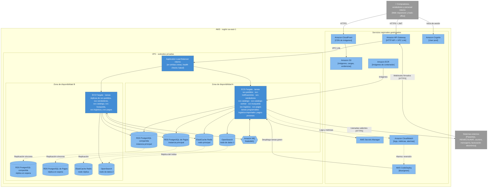
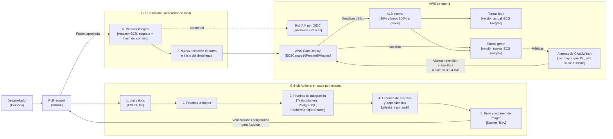
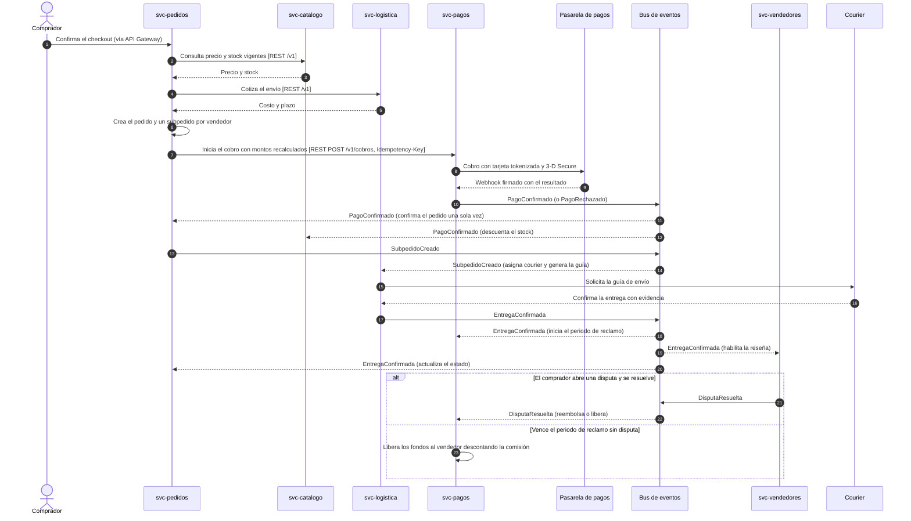

> [6. Documentación de Arquitectura (Bosquejo)](../6.md) › [6.4. Otras Vistas](6.4.md)

# 6.4. Otras Vistas

Tres vistas complementan los diagramas C4: dónde se despliega cada contenedor en la nube, cómo llega un cambio a producción y cómo colaboran los módulos en el flujo principal de compra.

## Vista de despliegue en AWS

Distribución de los contenedores de [6.2](../6.2/6.2.md) en la región sa-east-1 (São Paulo) con 2 zonas de disponibilidad ([ADR-GLO-05](../../4/4.6/4.6.5/4.6.5.md)). Los microservicios corren en Amazon ECS sobre Fargate detrás de un Application Load Balancer interno ([ADR-GLO-06](../../4/4.6/4.6.4/4.6.4.md)), con sus réplicas repartidas entre las dos zonas.

| Elemento de despliegue | Contenedores que aloja | Configuración | Decisión |
|---|---|---|---|
| Amazon CloudFront + Amazon S3 | Imágenes de producto; archivos de carga masiva, evidencias de disputas y archivos de couriers (en S3) | Bucket privado con Origin Access Control; CloudFront solo para imágenes | ADR-CAT-05, ADR-VEN-04, ADR-LOG-04 |
| Amazon API Gateway + Amazon Cognito | Punto de entrada e identidad | HTTP API con autorizador JWT de Cognito; VPC Link hacia el ALB interno; recibe también los webhooks externos | ADR-GLO-02 |
| Application Load Balancer interno | Balanceo hacia todos los microservicios | En las dos zonas; health check `GET /salud`; grupos de destino blue/green para el despliegue | ADR-GLO-06, ADR-CAT-09 |
| Amazon ECS sobre Fargate | Los servicios y tareas de 6.2 | `svc-pedidos` de 2 a 6 tareas y `svc-notificaciones` de 1 a 3; `svc-vendedores` con 2 instancias activas; `svc-catalogo` de 2 a 8 tareas, `svc-busqueda` de 2 a 12 y `svc-catalogo-worker` de 1 a 2; `svc-logistica` con 2 tareas; `svc-pagos` de 2 a 6 tareas; `logistica-importador` y `pagos-procesos` como tareas programadas con Amazon EventBridge Scheduler | ADR-GLO-06, ADR-PED-05, ADR-TAC-VEN-02, ADR-CAT-05, ADR-LOG-04, ADR-PAG-04 |
| Amazon RDS for PostgreSQL | Una base lógica por módulo | Instancia compartida (pedidos, vendedores, catalogo, logistica) e instancia propia de Pagos; ambas Multi-AZ, con principal en la zona A y réplica en espera en la zona B y conmutación automática | ADR-GLO-04, ADR-TAC-VEN-02, ADR-PAG-04, ADR-TAC-PAG-02 |
| Amazon ElastiCache for Redis | Carrito de Pedidos; caché de perfiles y reputación de Vendedores | Un clúster compartido con prefijo de claves por módulo; nodo principal y nodo réplica en otra zona, con persistencia AOF | ADR-PED-03, ADR-TAC-VEN-03 |
| Amazon OpenSearch Service | Índice `productos` | 2 nodos de datos `r6g.large.search` (uno por zona) y 3 nodos maestros dedicados; acceso solo desde las subredes de `svc-busqueda` | ADR-CAT-06 |
| Amazon MQ for RabbitMQ | Bus de eventos y cola de verificación | Exchange `qhatu.eventos`, colas durables por consumidor y colas de mensajes fallidos | ADR-GLO-03, ADR-TAC-VEN-01 |
| AWS Secrets Manager | Clave maestra del cifrado por campo y secretos de terceros | La leen `svc-vendedores`, `svc-logistica` y `svc-pagos` al iniciar | ADR-TAC-VEN-11, ADR-TAC-LOG-05, ADR-TAC-PAG-06 |
| Amazon ECR, AWS CodeDeploy y Amazon CloudWatch | Imágenes, despliegues y observabilidad | Ver la vista siguiente | ADR-CAT-07, ADR-CAT-09, ADR-TAC-CAT-02 |

## Vista de integración y despliegue continuo

Recorrido de un cambio desde el pull request hasta producción. El pipeline se definió para los servicios de Catálogo y Búsqueda ([ADR-CAT-07](../../4/4.3/4.3.md), [ADR-CAT-08](../../4/4.3/4.3.md) y [ADR-CAT-09](../../4/4.3/4.3.md)), como aplicación del tema individual DevOps ([0.2.3](../../0/0.2/0.2.3/0.2.3.md)), y está pensado para que los demás microservicios lo reutilicen, ya que comparten el mismo stack (ADR-GLO-07).

| Etapa | Qué hace | Cuándo corre | Escenarios / ADR |
|---|---|---|---|
| 1. Lint y tipos | Verifica estilo y tipos de TypeScript. | Cada pull request | ESC-CAT-12, ADR-CAT-07 |
| 2. Pruebas unitarias | Prueba la lógica de dominio con un umbral de cobertura de 80%. | Cada pull request | ESC-CAT-12, ADR-TAC-CAT-12 |
| 3. Pruebas de integración | Levanta PostgreSQL, RabbitMQ y OpenSearch efímeros y valida los contratos de `ProductoActualizado` y de la API de precio y stock; `oasdiff` bloquea cambios incompatibles y la suite de XSS valida la sanitización. | Cada pull request | ESC-CAT-06, ESC-CAT-10, ESC-CAT-12, ADR-TAC-CAT-12 |
| 4. Escaneo de secretos y dependencias | Detecta llaves o credenciales en el código y dependencias vulnerables. | Cada pull request | ESC-CAT-12, ADR-CAT-07 |
| 5. Build y escaneo de imagen | Construye la imagen de contenedor y busca vulnerabilidades. | Cada pull request | ESC-CAT-12, ADR-CAT-07 |
| 6. Publicar imagen | Sube la imagen a Amazon ECR, con acceso a AWS por un rol asumido por OIDC. | Al fusionar en `main` | ESC-CAT-12, ADR-CAT-07 |
| 7. Desplegar | Registra la definición de tarea e inicia el despliegue blue/green: 10% del tráfico a la versión nueva durante 5 min y luego 100%; las tareas anteriores siguen vivas 15 min. | Al fusionar en `main` | ESC-CAT-02, ESC-CAT-12, ADR-CAT-09 |
| Reversión automática | Si una alarma de errores o latencia salta durante el despliegue, CodeDeploy devuelve el tráfico a la versión anterior. | Durante el despliegue | ESC-CAT-02, ADR-TAC-CAT-02 |
| Infraestructura | Los cambios de Terraform siguen el mismo flujo: `fmt`, `validate`, `tflint` y `plan` en el pull request; `apply` al fusionar (automático en staging, con aprobación en producción). | Cada pull request y fusión | ESC-CAT-12, ADR-CAT-08 |

> Los workflows viven en el [repositorio de código](https://github.com/ulima-arqsoft/arqui262-grupo5-codigo/tree/main/.github/workflows), no en el de documentación, cuyo directorio `/.github/` está protegido por CODEOWNERS del docente (ADR-CAT-07).

## Vista de comportamiento: flujo principal de compra

Colaboración entre módulos desde el checkout hasta la liberación del pago, con los contratos de [2.1.6](../../2/2.1/2.1.6/2.1.6.md) y el modelo de coordinación de [ADR-GLO-03](../../4/4.6/4.6.2/4.6.2.md): REST solo para las consultas del checkout y eventos de dominio para todo lo demás.

| Paso | Contrato | Requisitos | Escenarios |
|---|---|---|---|
| 2–3 | API de precio y stock | RF-CAT-10, RF-PED-04 | ESC-CAT-07, ESC-PED-05 |
| 4–5 | API de cotización de envío | RF-LOG-01, RF-PED-03 | ESC-PED-01, ESC-LOG-03 |
| 7–9 | API de cobros y webhook de la pasarela | RF-PED-05, RF-PAG-01, RF-PAG-02 | ESC-PAG-01, ESC-PAG-06 |
| 10–12 | `PagoConfirmado` | RF-PAG-02, RF-PED-06, RF-CAT-11 | ESC-PED-07 |
| 13–14 | `SubpedidoCreado` | RF-PED-06, RF-LOG-03 | ESC-PED-08 |
| 17–20 | `EntregaConfirmada` | RF-LOG-09, RF-PAG-04, RF-VEN-05, RF-PED-07 | ESC-LOG-08, ESC-PAG-10, ESC-VEN-08 |
| 21–23 | `DisputaResuelta` o liberación | RF-VEN-09, RF-PAG-06, RF-PAG-04 | ESC-VEN-07 |

---

[⬅️ Anterior](../6.3/6.3.md) | [🏠 Home](../../README.md)